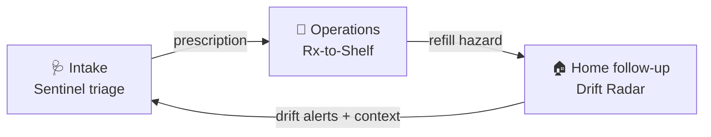
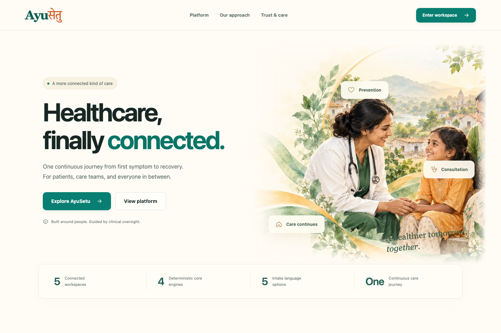
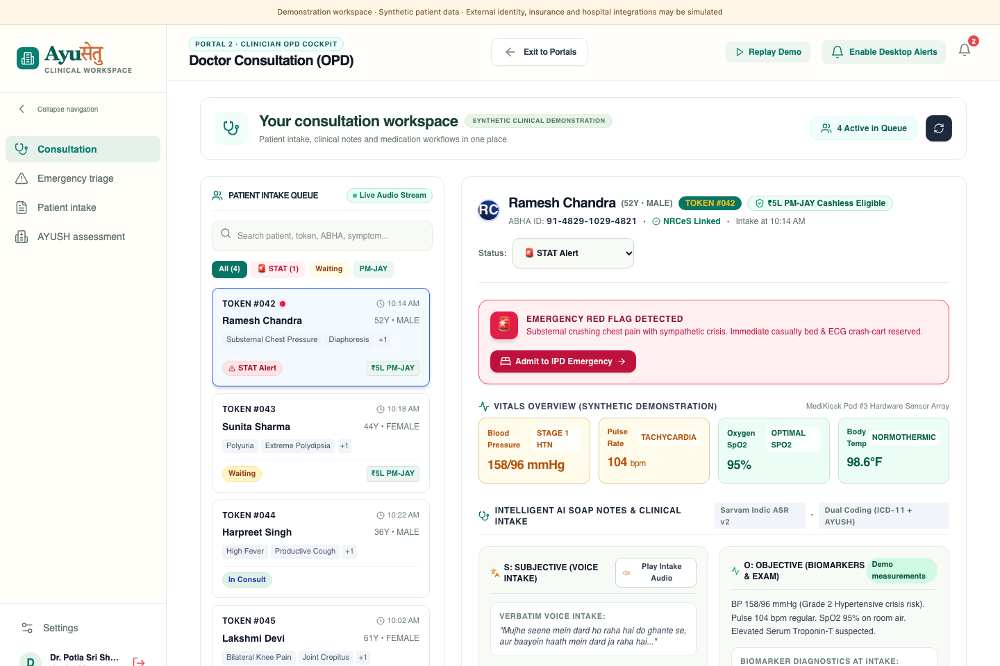
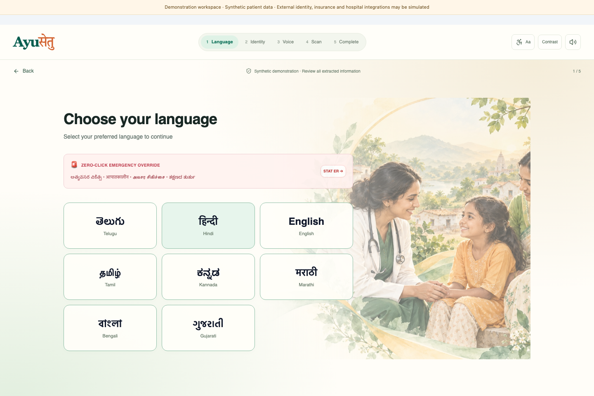
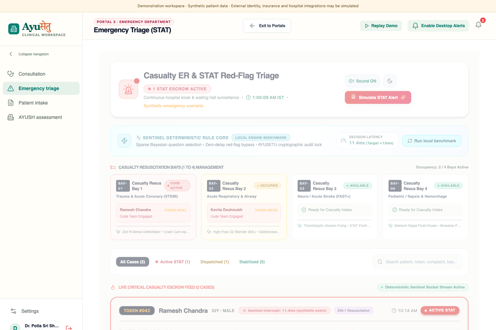
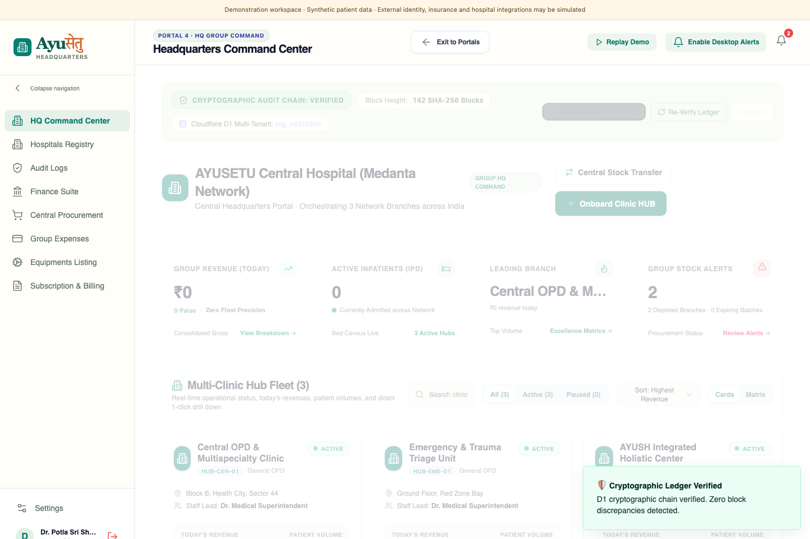
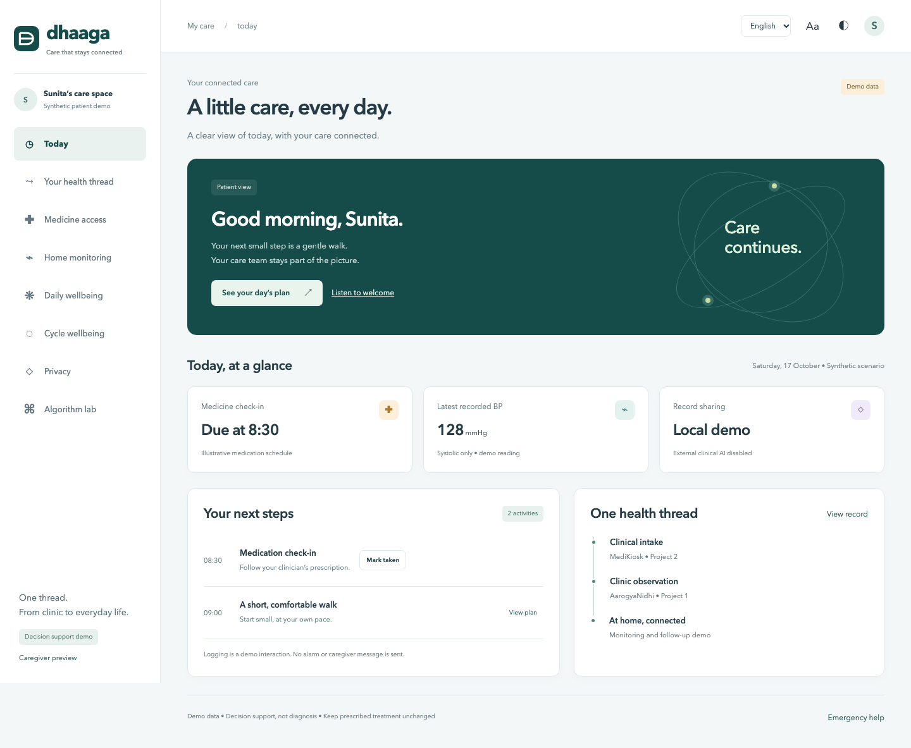
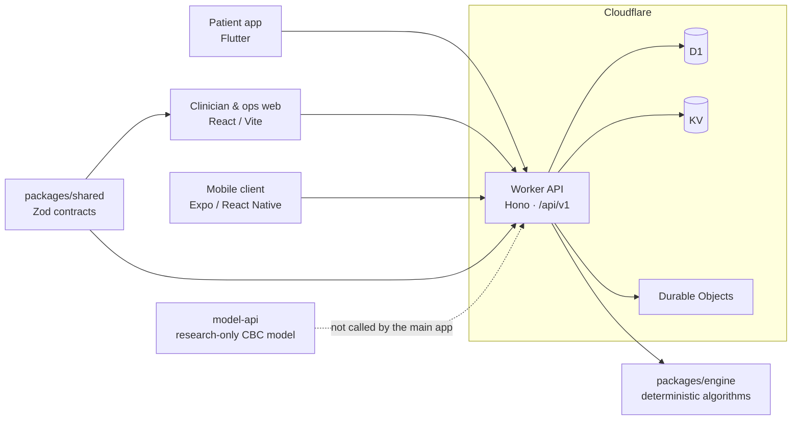

<div align="center">

# AYUSETU · आयुसेतु

### The Continuity-of-Care Operating System

**Intake → Clinic Operations → Home Follow-up → back to Intake.**
One connected loop for patients, clinicians, and pharmacies, driven by deterministic, reviewable algorithms.

<br/>

[](https://github.com/potlasrisharan/hackshift-sudarshan/actions/workflows/ci.yml)


**Built by Team Sudarshan for HackShift 2026 · IIIT Delhi · Theme: Healthcare & Well-being**

[Overview](#-overview) ·
[Architecture](#-architecture) ·
[Algorithms](#-deterministic-algorithms) ·
[CBC Research Model](#-cbc-research-model) ·
[Quick Start](#-quick-start) ·
[Deployment](#-cloudflare-deployment) ·
[Docs](#-project-documents)

</div>

---

> [!WARNING]
> **Prototype software, not a medical device.** Some API paths use in-memory stores or synthetic demonstration records. Do **not** use this application for real patient care, and do **not** send real patient information to demo or research services. Read [`docs/DEPLOYMENT.md`](docs/DEPLOYMENT.md) and [`docs/PRD.md`](docs/PRD.md) before making implementation or deployment decisions.

## ✨ Overview

AYUSETU unifies two earlier codebases into a single closed-loop ecosystem:

| Origin | Scope |
|---|---|
| **AarogyaNidhi (ClinicOS)** | Multi-clinic operations, role isolation, POS, batch/expiry inventory radar, double-entry ledger |
| **MediKiosk** | Multilingual voice intake, adaptive triage questioning, red-flag detection, prescription OCR, SOAP note generation |



- **Intake → Ops (Rx-to-Shelf):** prescriptions match in-stock, course-valid, lowest-cost batches.
- **Ops → Home (refill hazard):** inventory and prescription timelines drive proactive refill nudges.
- **Home → Intake (closed loop):** monitoring drift alerts feed nurse queues and pre-load context for the next visit.

> **Core product rule: _algorithms decide; AI may translate or format._**
> Safety gates and ranking rules stay deterministic and reviewable. Language services never diagnose and never override a safety decision.

### Hackathon requirement coverage

| ID | Area | How AYUSETU approaches it |
|---|---|---|
| PS-1 | Accessibility | Voice-first Indic UX, WhatsApp-native flows, offline-capable kiosk |
| PS-2 | Affordability | Generic-substitution savings, FEFO expiry-aware allocation |
| PS-3 | Quality of care | Hard-rule red-flag bypass, course-valid batch dispensing |
| PS-4 | AI-assisted guidance | Adaptive questioning, clinician SOAP note generation |
| PS-5 | Remote monitoring | Home check-ins and baseline-aware Drift Radar |
| PS-6 | Digital health management | Single Patient Thread, FHIR R4 mappers, multi-clinic inventory and ledger |
| PS-7 | Responsible AI & privacy | PHI redaction gate, consent receipts, hash-chained audit logs |

> [!NOTE]
> The table above describes design intent from the [hackathon brief](docs/HACKATHON_BRIEF.md). Feature coverage varies by client and module; see [`docs/REQUIREMENTS.md`](docs/REQUIREMENTS.md) for traceability and [`docs/PROGRESS.md`](docs/PROGRESS.md) for current status.

## 🖼️ Screenshots

<table>
  <tr>
    <td align="center"><br/><sub><b>Landing</b></sub></td>
    <td align="center"><br/><sub><b>Clinical workspace</b></sub></td>
    <td align="center"><br/><sub><b>Kiosk</b></sub></td>
  </tr>
  <tr>
    <td align="center"><br/><sub><b>Emergency</b></sub></td>
    <td align="center"><br/><sub><b>Headquarters</b></sub></td>
    <td align="center"><br/><sub><b>Dashboard</b></sub></td>
  </tr>
</table>

## 🏗️ Architecture



Cloudflare is the deployment target. The Worker entry point is `backend/src/index.ts`; the root `wrangler.jsonc` configures the Worker, D1, KV, and Durable Object bindings. GitHub Actions builds the web app, applies D1 migrations, publishes the Pages artifact, and deploys the Worker once verification jobs pass.

The repository has two web build paths and two mobile codebases:

- `apps/web` is the lightweight web build used by the root build and Cloudflare Pages workflow. It compiles source from `frontend/website/src`.
- `frontend/website` also has a standalone Vite project and lockfile.
- `frontend/app` is the Flutter patient and kiosk client; `apps/mobile` is the Expo / React Native client.

Check the workflow and app configuration before assuming the clients have identical feature coverage.

### Applications and services

| Path | Technology | Purpose |
|---|---|---|
| `backend/` | TypeScript, Hono, Cloudflare Workers | Shared `/api/v1` API, module routes, migrations, Durable Objects |
| `frontend/website/` | React, Vite, Tailwind CSS | Clinician and operations portal |
| `apps/web/` | Vite | Root build and Pages entry points |
| `frontend/app/` | Flutter, Dart, Riverpod, GoRouter | Patient and kiosk application |
| `apps/mobile/` | Expo, React Native, TypeScript | Native mobile app and Android build config |
| `packages/engine/` | TypeScript | Deterministic triage, pharmacy, follow-up, HER, and Vitalis algorithms |
| `packages/shared/` | TypeScript, Zod | Shared contracts, models, interoperability helpers |
| `services/` | TypeScript, Python | Language gateway and local privacy node |
| `model-api/` | Python, FastAPI, scikit-learn | Isolated, research-only CBC model API |

**API route prefixes:** `/api/v1/intake` · `/ops` · `/bridge` · `/home` · `/her` · `/vitalis`. Consult each module's route file for request schemas and current behavior.

## 🧠 Deterministic Algorithms

The core decision logic lives in [`packages/engine`](packages/engine). Specifications live in [`docs/PRD.md`](docs/PRD.md) and [`docs/algorithms/`](docs/algorithms/). Read them before changing any clinical or operational rule.

| Engine | What it does |
|---|---|
| 🚨 **Sentinel** | Selects intake questions and evaluates defined red-flag conditions |
| 💊 **Rx-to-Shelf** | Plans medicine allocation against stock, expiry, and prescription constraints |
| 📈 **Drift Radar** | Compares observations with a patient's baseline and flags defined changes |
| 🔁 **ThreadPulse** | Estimates demand from refill and cohort probabilities |
| 🌸 **HER A0–A4** | Women's health safety checks, cycle patterns, evidence-based screening, wellness ranking, trends |
| 🌿 **Vitalis V0–V14** | Safety checks, healthspan progress, preventive ranking, exercise progression, biomarker and behavior analysis |

### Measured mechanisms (synthetic benchmark)

Seed `26047` · 500 synthetic cases · reproduce with `make bench`. Raw output: [`docs/benchmarks/`](docs/benchmarks/).

| Measure | AYUSETU | Naive baseline |
|---|---:|---:|
| Unsafe stock selections | **0** | 276 |
| Injected BP ramps detected (of 250) | **250** | 0 |
| Unchanged streams falsely alerted (of 250) | 4 | 0 |

| Algorithm | Mean latency per call (1,000 iterations) |
|---|---:|
| Sentinel | 0.006 ms |
| Rx-to-Shelf | 0.013 ms |
| Drift Radar | 0.031 ms |
| ThreadPulse | 0.040 ms |

> [!IMPORTANT]
> These numbers demonstrate **mechanisms on hand-constructed synthetic cases**, not clinical performance. The baseline ignores clinical constraints, so its lower cost is not a valid saving, and no independent clinical dataset was used. See [`docs/benchmarks/RESULTS.md`](docs/benchmarks/RESULTS.md) for the full list of limitations.

## 🔬 CBC Research Model

📄 [`model-api/README.md`](model-api/README.md) · Based on a [published Indian CBC study](https://www.nature.com/articles/s41598-023-27548-w)

A frozen, India-only **logistic regression** pipeline that scores a complete blood count (CBC) result. Served by an isolated FastAPI service that the main app does **not** call.

| | |
|---|---|
| **Inputs** | WBC, RBC, neutrophil %, lymphocyte %, monocyte % (derived: NLR, LMR) |
| **Model** | `india-cbc-logistic-c87ec8485159` · 7 features · fixed cutoff `0.626816` |
| **Evaluation** | Internal nested cross-validation on 752 published records with reconstructed labels |
| **AUC** | 0.713 (95% CI 0.677–0.749) |
| **Accuracy / Sensitivity / Specificity** | 63.2% / 35.9% / 90.4% |
| **Output** | A research score and `above_cutoff` flag, always marked `research_only` |

```bash
curl -X POST http://127.0.0.1:8000/predict \
  -H "Content-Type: application/json" \
  -d '{"wbc":8.95,"rbc":4.41,"neutrophils":65,"lymphocytes":25,"monocytes":9}'
```

> [!CAUTION]
> The score is **not** a diagnosis and **not** a calibrated cancer probability. Sensitivity is low (35.9%), the metrics come from internal validation rather than independent validation, and labels, hospital-source confounding, and measurement precision all limit interpretation. Never use it to guide patient care, and never send identifiable patient data to it. The API has no authentication or application-level rate limiting.

## 🚀 Quick Start

### Requirements

- **Node.js** `>=22.13` and **npm** `>=10` (root TypeScript project and Cloudflare tooling)
- **Flutter / Dart** compatible with `frontend/app/pubspec.yaml` (patient app)
- **Android Studio / SDK** for Android builds; **Xcode** for iOS builds on macOS
- **Python 3.12** for the isolated `model-api` service
- A **Cloudflare account** and GitHub Actions secrets for deployment only; local development needs no Cloudflare credentials

### Clone and install

```bash
git clone https://github.com/potlasrisharan/hackshift-sudarshan.git
cd hackshift-sudarshan
npm ci
```

<details open>
<summary><b>🌐 Web and API integration demo</b></summary>

```bash
npm ci --prefix frontend/website --ignore-scripts
npm run integration:dev
```

The integration server starts at `http://127.0.0.1:8790` (exact ports are printed by the command). For the root Pages build and bundled API build:

```bash
npm run build
```

The root `build` installs the website package from its lockfile before compiling, so Cloudflare Pages can use a root `npm ci` followed by `npm run build` with no separate dashboard build command.

</details>

<details>
<summary><b>📱 Flutter patient app</b></summary>

```bash
cd frontend/app
flutter pub get
flutter run -d chrome
```

Use `flutter devices` to pick an Android or iOS device. Run tests with `flutter test`.

</details>

<details>
<summary><b>📲 Expo / React Native app</b></summary>

```bash
cd apps/mobile
npm ci
npm run start
```

For local Android native generation, run `npm run prebuild` and `npm run android` on a machine with the Android toolchain.

</details>

<details>
<summary><b>🧪 Research model API (Python)</b></summary>

```bash
cd model-api
python -m venv .venv
# activate the environment for your platform
python -m pip install -r requirements-dev.txt
python -m unittest discover -s tests -v
python -m uvicorn api.main:app --host 127.0.0.1 --port 8000 --workers 1 --no-access-log
```

Interactive schema at `http://127.0.0.1:8000/docs` · health at `GET /health`.

</details>

### Shortcuts

| Command | Does |
|---|---|
| `make setup` | `npm ci` |
| `make dev` | Build, then start the dev server |
| `make test` / `make e2e` | Vitest suite / Playwright browser suite |
| `make bench` | Reproduce the synthetic benchmark |
| `make eval` | Safety-focused evaluation tests |
| `make privacy` | Run the local privacy node |
| `make up` / `make down` | Docker Compose stack up / down |

## ✅ Build and Verification

| Command | Purpose |
|---|---|
| `npm run typecheck` | TypeScript checks for root and backend projects |
| `npm run check:frontend` | TypeScript check for the Pages frontend configuration |
| `npm run build` | Typecheck, build Pages web assets, bundle the Node API demo |
| `npm run build:worker` | Wrangler Worker dry-run build |
| `npm run integration:build` | Build the standalone website integration app |
| `npm run integration:worker:build` | Build the integration Worker with Wrangler |
| `npm test` | Root Vitest suite |
| `npm run eval` | Safety-focused evaluation tests |
| `npm run e2e` | Playwright browser suite |
| `npm run lint` | Biome checks on configured source paths |
| `cd apps/mobile && npm run typecheck` | Expo / React Native TypeScript check |
| `cd frontend/app && flutter analyze` | Analyze Flutter / Dart sources |
| `cd frontend/app && flutter test` | Flutter tests |

GitHub Actions runs the broader pipeline: builds, browser and integration checks, a secret scan, and a container smoke check. A green local build does **not** confirm a successful Cloudflare deployment. Inspect the Actions run and the deployed app separately.

## ☁️ Cloudflare Deployment

The workflow uses Wrangler to apply D1 migrations, publish `dist/web` to the Pages project `ayuseva`, and deploy the Worker described by `wrangler.jsonc`. It triggers on pushes to `main` (and the configured feature branch) after verification passes.

**Required GitHub Actions secrets**

| Secret | Purpose |
|---|---|
| `CLOUDFLARE_API_TOKEN` | Token with permissions for the configured Pages, Worker, and D1 deployment actions |
| `CLOUDFLARE_ACCOUNT_ID` | Cloudflare account identifier |

Never place these in source files, commit them, or expose them to frontend code. For local Worker development, use Wrangler's local bindings and git-ignored `.dev.vars` files ([Wrangler docs](https://developers.cloudflare.com/workers/wrangler/)).

```bash
npm run build:worker
npx wrangler d1 migrations apply dhaaga-db --local --config wrangler.jsonc
npx wrangler pages deploy dist/web --project-name=ayuseva --branch=main
npx wrangler deploy
```

> [!CAUTION]
> Production migrations and deployments are external side effects. Review the target account, project, branch, migration status, and CI results before running them manually. See [`docs/DEPLOYMENT.md`](docs/DEPLOYMENT.md) and [`docs/TROUBLESHOOTING.md`](docs/TROUBLESHOOTING.md).

## 🔐 Configuration and Secrets

- `wrangler.jsonc` holds non-secret Worker configuration and Cloudflare resource identifiers.
- `.dev.vars` and `.env*` are git-ignored. Keep local credentials there; use `.env.example` for variable names only.
- Optional AI or speech providers must be configured as **server-side Worker secrets**. Never embed provider keys in Flutter, React, or static web bundles.
- The build works from a clean root `npm ci`; Tailwind and Autoprefixer for the Pages Vite config are declared in the root package manifest for Cloudflare's root-only install.

## 🛡️ Data, Privacy, and Clinical Limitations

- Treat every current flow as development or demonstration software unless a specific feature has been reviewed and approved for clinical use.
- Do not enter real patient identifiers or records into synthetic demo flows, screenshots, issue reports, model requests, or third-party services.
- Persistence varies by route. Some HER, Vitalis, intake, and demo flows still use in-memory stores or seeded data, which is not durable or suitable for multi-instance production.
- The isolated CBC model is research-only. Its output is neither a diagnosis nor a calibrated disease probability.
- Before handling real health data, complete security, access-control, consent, retention, audit, privacy, clinical-safety, backup, and disaster-recovery reviews. Do not claim regulatory compliance based on this README or a technical design alone.
- Financial amounts use **integer paise**. Tenant-scoped data access and input validation follow the architecture rules in [`AGENTS.md`](AGENTS.md) and [`docs/PRD.md`](docs/PRD.md).

<details>
<summary><b>Known gaps (from module notes)</b></summary>

- **Privacy node:** end-to-end-encrypted sync, an encrypted durable health store, and UI connection are pending.
- **Language and voice:** a live provider key is required; speech-to-text, clinical translation, glossary review, and the full language set are pending.
- **Wearables:** only labelled simulated heart-rate ingestion is tested; real Health Connect / HealthKit / BLE integration is pending.

</details>

## 🤝 Contributing

1. Read [`AGENTS.md`](AGENTS.md), [`docs/PRD.md`](docs/PRD.md), and relevant architecture decisions first.
2. Keep each change focused and preserve unrelated working-tree changes.
3. Update schemas, migrations, docs, and clients together when a shared API contract changes.
4. Use deterministic rules for clinical or operational decisions; generated text must never override a safety rule.
5. Run the checks relevant to your change and report any that could not run.
6. Keep secrets, generated build outputs, release packages, and real patient data out of commits.
7. Write clear, scoped commit messages, for example `fix(web): resolve Pages Tailwind dependency` or `docs: refresh repository setup guide`.

## 📚 Project Documents

| Document | What it covers |
|---|---|
| [`docs/PRD.md`](docs/PRD.md) | Product requirements; primary source of truth |
| [`docs/HACKATHON_BRIEF.md`](docs/HACKATHON_BRIEF.md) | HackShift 2026 problem statement and requirement mapping |
| [`docs/DEPLOYMENT.md`](docs/DEPLOYMENT.md) | Deployment status and operational constraints |
| [`docs/DECISIONS.md`](docs/DECISIONS.md) | Architecture decisions |
| [`docs/algorithms/`](docs/algorithms/) | Algorithm specifications and notes |
| [`docs/REQUIREMENTS.md`](docs/REQUIREMENTS.md) | Requirement traceability |
| [`docs/COMPLIANCE.md`](docs/COMPLIANCE.md) | Controls and compliance notes |
| [`docs/DEMO_SCRIPT.md`](docs/DEMO_SCRIPT.md) | The tested demo journey |
| [`docs/TROUBLESHOOTING.md`](docs/TROUBLESHOOTING.md) | Known setup and deployment issues |
| [`docs/PROGRESS.md`](docs/PROGRESS.md) | Project progress notes |
| [`model-api/README.md`](model-api/README.md) | CBC research model API |

## 👥 Team Sudarshan

**Saksham Goswami** · **Paarth Goswami** · **Rohan Singh** · **Potla Sri Sharan**

---

<div align="center">

**Built for HackShift 2026.**
AYUSETU is a software prototype for improving continuity across healthcare workflows.
It is not a medical device and not a substitute for professional care.

</div>
