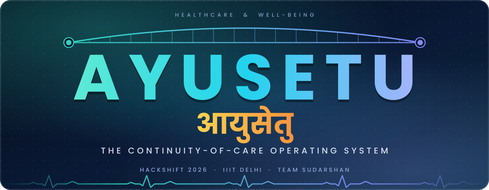
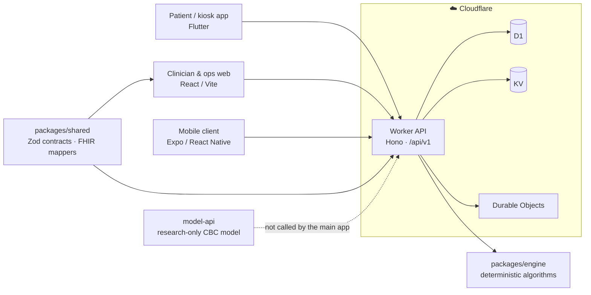
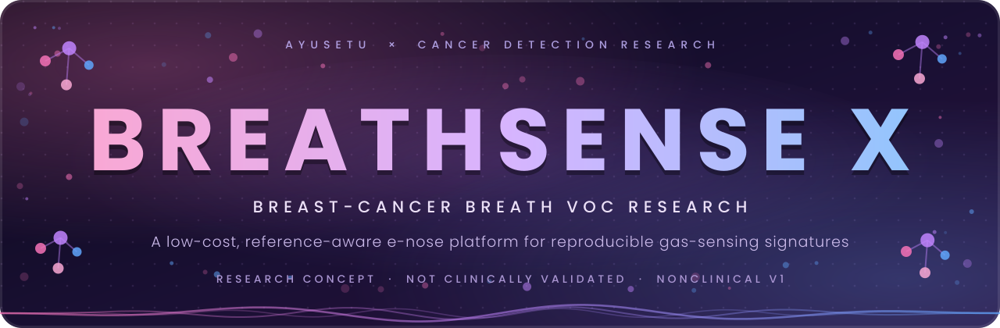
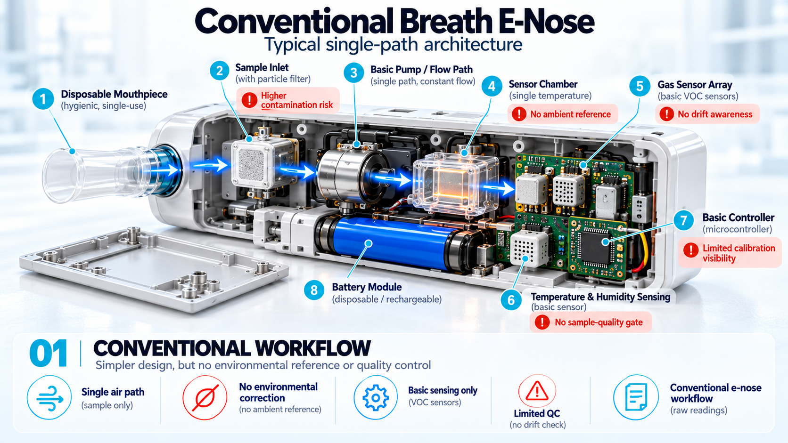
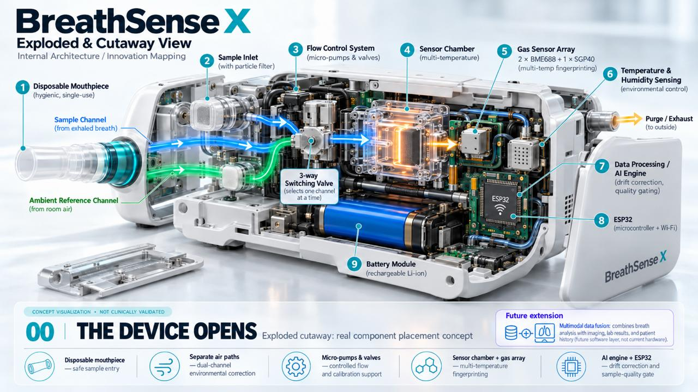
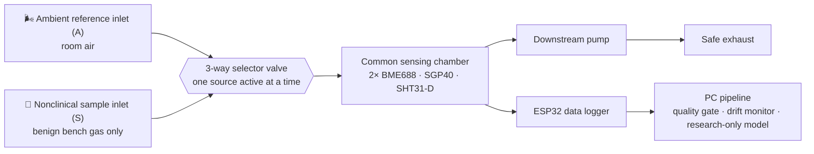
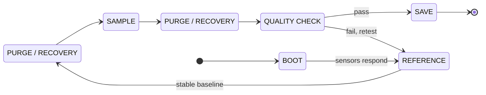

<div align="center">



<br/>

**One thread from first symptom to full recovery.**
Intake → Clinic Operations → Home Follow-up → back to Intake, joined by deterministic, reviewable algorithms,
plus an independent **cancer-detection research** programme.

<br/>

[](https://github.com/potlasrisharan/hackshift-sudarshan/actions/workflows/ci.yml)


[**Overview**](#-overview) &nbsp;·&nbsp;
[**Architecture**](#-architecture) &nbsp;·&nbsp;
[**Algorithms**](#-deterministic-algorithms) &nbsp;·&nbsp;
[**🔬 Research**](#-cancer-detection-research) &nbsp;·&nbsp;
[**Quick Start**](#-quick-start) &nbsp;·&nbsp;
[**Status**](#-project-status) &nbsp;·&nbsp;
[**Docs**](#-project-documents)

</div>

---

> [!WARNING]
> **Prototype software, not a medical device.** Some API paths use in-memory stores or synthetic demonstration records. Do **not** use this application for real patient care, and do **not** send real patient information to demo or research services. Read [`docs/DEPLOYMENT.md`](docs/DEPLOYMENT.md) and [`docs/PRD.md`](docs/PRD.md) before making implementation or deployment decisions.

<table align="center">
  <tr>
    <td align="center"><h2>24</h2><sub><b>deterministic engines</b><br/>4 core · 5 HER · 15 Vitalis</sub></td>
    <td align="center"><h2>4</h2><sub><b>interface languages</b><br/>English · हिन्दी · ਪੰਜਾਬੀ · தமிழ்</sub></td>
    <td align="center"><h2>0</h2><sub><b>unsafe stock picks</b><br/>500-case synthetic benchmark</sub></td>
    <td align="center"><h2>2</h2><sub><b>cancer-detection tracks</b><br/>BreathSense X · CBC model</sub></td>
  </tr>
</table>

## 🧭 What's Inside

| | **Pillar 1 · Care Platform** | **Pillar 2 · Cancer-Detection Research** |
|---|---|---|
| **What** | AYUSETU: patient intake, clinic operations, and home follow-up on one consented Patient Thread | **BreathSense X** (breast-cancer breath VOC e-nose) and a **CBC blood-count research model** |
| **Stack** | Cloudflare Workers · Hono · D1 · React · Flutter · Expo · TypeScript engines | ESP32 + BME688 / SGP40 sensing · Python · FastAPI · scikit-learn |
| **Principle** | *Algorithms decide; AI may translate or format.* | *Measure, don't assume.* Every claim is tagged and bounded |
| **Go to** | [Overview](#-overview) · [Architecture](#-architecture) · [Algorithms](#-deterministic-algorithms) | [Research programme](#-cancer-detection-research) · [BreathSense X](#1--breathsense-x--breast-cancer-breath-voc-research) · [CBC model](#2--cbc-research-model--blood-count-cancer-risk-score) |

<details>
<summary><b>🎯 HackShift 2026 requirement coverage (PS-1 to PS-7)</b></summary>

<br/>

**Event:** HackShift 2026 · IIIT Delhi · Theme *Healthcare & Well-being: Reimagining Healthcare Through Technology*

| ID | Area | How AYUSETU approaches it |
|---|---|---|
| PS-1 | Accessibility | Voice-first Indic UX, WhatsApp-native flows, offline-capable kiosk and algorithm lab |
| PS-2 | Affordability | Generic-substitution savings, FEFO expiry-aware allocation, integer-paise cost model |
| PS-3 | Quality of care | Hard-rule red-flag bypass, course-valid batch dispensing, tested safety gates |
| PS-4 | AI-assisted guidance | Adaptive questioning, source-cited clinician summaries |
| PS-5 | Remote monitoring | Home check-ins and baseline-aware Drift Radar |
| PS-6 | Digital health management | Single Patient Thread, FHIR R4 collection export, multi-clinic inventory and ledger |
| PS-7 | Responsible AI and privacy | PHI redaction gate, consent receipts with revoke/delete, tamper-evident audit chain |

Design intent comes from the [hackathon brief](docs/HACKATHON_BRIEF.md). Coverage varies by client and module: see [`docs/REQUIREMENTS.md`](docs/REQUIREMENTS.md) for traceability, [`docs/PILLARS.md`](docs/PILLARS.md) for shipped slices mapped to evidence, and [`docs/PROGRESS.md`](docs/PROGRESS.md) for current status.

</details>

<details>
<summary><b>👩 The demo story: Sunita, 52</b></summary>

<br/>

Sunita (diabetes and hypertension, Hindi speaker, low literacy) taps "हिंदी" at a clinic kiosk. **Sentinel** asks adaptive questions and screens for red flags. A source-cited clinician brief is ready for the doctor. The prescription flows to **Rx-to-Shelf**, which rejects the cheapest batch that would expire mid-course and the wrong-strength batch, then proposes the cheapest *feasible* plan across clinics for a pharmacist to confirm. At home, **Drift Radar** compares her blood-pressure readings against her *own* baseline and flags a sustained upward shift that a fixed population threshold would miss. Every step is consented, auditable, and revocable.

The scripted six-minute and two-minute journeys are in [`docs/DEMO_SCRIPT.md`](docs/DEMO_SCRIPT.md). All demo data is synthetic.

</details>

## 🖼️ Screenshots

<table>
  <tr>
    <td align="center"><br/><sub><b>Landing</b></sub></td>
    <td align="center"><br/><sub><b>Clinical workspace</b></sub></td>
    <td align="center"><br/><sub><b>Kiosk</b></sub></td>
  </tr>
  <tr>
    <td align="center"><br/><sub><b>Emergency</b></sub></td>
    <td align="center"><br/><sub><b>Headquarters</b></sub></td>
    <td align="center"><br/><sub><b>Dashboard</b></sub></td>
  </tr>
</table>

## 🏗️ Architecture



Cloudflare is the deployment target. The Worker entry point is `backend/src/index.ts`; the root `wrangler.jsonc` configures the Worker, D1, KV, and Durable Object bindings. GitHub Actions builds the web app, applies D1 migrations, publishes the Pages artifact, and deploys the Worker on the configured branches once verification passes.

The repository has **two web build paths** and **two mobile codebases**:

- `apps/web` is the lightweight web build used by the root build and Cloudflare Pages workflow. It compiles source from `frontend/website/src`.
- `frontend/website` also has a standalone Vite project and lockfile.
- `frontend/app` is the Flutter patient and kiosk client (Dhaaga); `apps/mobile` is the Expo / React Native client.

Check the workflow and app configuration before assuming the clients have identical feature coverage.

### Applications and services

| Path | Technology | Purpose |
|---|---|---|
| `backend/` | TypeScript, Hono, Cloudflare Workers | Shared `/api/v1` API, module routes, D1 migrations, Durable Objects |
| `frontend/website/` | React, Vite, Tailwind CSS | Clinician and operations portal |
| `apps/web/` | Vite | Root build and Pages entry points |
| `frontend/app/` | Flutter, Dart, Riverpod, GoRouter | Patient and kiosk application |
| `apps/mobile/` | Expo, React Native, TypeScript | Native mobile app and Android build configuration |
| `packages/engine/` | TypeScript | Deterministic triage, pharmacy, follow-up, HER, and Vitalis algorithms |
| `packages/shared/` | TypeScript, Zod | Shared contracts, models, interoperability helpers |
| `services/` | TypeScript, Python | Language gateway and local privacy node |
| `model-api/` | Python, FastAPI, scikit-learn | Isolated, research-only CBC model API |
| `Breath_Sense_Cancer_Detection_Research/` | PDF, figures | BreathSense X research and engineering report |

**API route prefixes:** `/api/v1/intake` · `/ops` · `/bridge` · `/home` · `/her` · `/vitalis`. Consult each module's route file for request schemas and current behavior.

The Doctor Consultation dashboard also includes a **CBC Reports** workflow: local PDF/image extraction, reviewed measurement revisions, and explicit frozen-model research analysis through `/api/v1/cbc`. It currently requires the authenticated synthetic clinical workspace; production patient-record access remains disabled. See [the CBC runbook](docs/CBC_RUNBOOK.md) for local setup, model parity evidence, and optional private source retention.

## 🧠 Deterministic Algorithms

The core decision logic lives in [`packages/engine`](packages/engine). Specifications are in [`docs/PRD.md`](docs/PRD.md) and [`docs/algorithms/`](docs/algorithms/). Read them before changing any clinical or operational rule.

| Engine | What it does | How |
|---|---|---|
| 🚨 **Sentinel** | Selects intake questions, evaluates red flags | Bayesian posterior over latent classes; next question maximizes expected entropy reduction *after* mandatory danger screens. An affirmative chest-pain, breathlessness, or fainting screen returns emergency |
| 💊 **Rx-to-Shelf** | Plans medicine allocation | Exact integer optimization of course cost plus transfer cost. Salt, strength, form, quantity, and expiry must hold (stock must outlive the course by 14 days). No fuzzy drug match is auto-accepted; every plan needs a pharmacist |
| 📈 **Drift Radar** | Flags sustained change from a patient's own baseline | Robust baseline (median and MAD of first 7 days) with one-sided CUSUM. An independent absolute-limit alert (systolic ≥ 180) always fires, even during cold start |
| 🔁 **ThreadPulse** | Estimates demand and stock-out risk | Exact demand distribution by convolving per-patient refill probabilities; reorder quantity from a service-level quantile |
| 🌸 **HER A0–A4** | Women's health | A0 safety gate · A1 cycle deviation detector · A2 screening evidence routing · A3 wellness ranker with contraindications · A4 longitudinal trend analyzer |
| 🌿 **Vitalis V0–V14** | Longevity and preventive health | Safety gate, healthspan index, preventive ranker, exercise progression, biomarker trends, lifestyle correlations, readiness, functional capacity, deduplication, eligibility, behavior simulator |

Each engine returns explanatory payloads (inputs, constraints, intermediate values, rejection reasons), so every decision can be inspected. The algorithms produce software outputs, **not** a medical diagnosis or a substitute for clinician judgment.

### Measured mechanisms (synthetic benchmark)

Seed `26047` · 500 synthetic cases · reproduce with `make bench` · raw output in [`docs/benchmarks/`](docs/benchmarks/).

| Measure | AYUSETU | Naive baseline |
|---|---:|---:|
| Unsafe stock selections | **0** | 276 |
| Injected BP ramps detected (of 250) | **250** | 0 |
| Unchanged streams falsely alerted (of 250) | 4 | 0 |

| Algorithm | Mean latency per call (1,000 iterations) |
|---|---:|
| Sentinel | 0.006 ms |
| Rx-to-Shelf | 0.013 ms |
| Drift Radar | 0.031 ms |
| ThreadPulse | 0.040 ms |

A real k6 transport test against the health route (5 virtual users, 15 s) completed 117,589 iterations; see [`docs/benchmarks/k6-health.txt`](docs/benchmarks/k6-health.txt).

> [!IMPORTANT]
> These numbers show **mechanisms on hand-constructed synthetic cases**, not clinical performance. The naive baseline ignores clinical constraints, so its lower cost is not a valid saving. The load test is not an authenticated or database workload. No independent clinical dataset was used. See [`docs/benchmarks/RESULTS.md`](docs/benchmarks/RESULTS.md).

---

## 🔬 Cancer-Detection Research

<div align="center">



</div>

<br/>

Alongside the care platform, Team Sudarshan runs a **cancer-detection research programme** with two independent tracks. Both are **research-only**, **not clinically validated**, and **never used by the main application to make care decisions**.

| | **BreathSense X** | **CBC research model** |
|---|---|---|
| **Cancer focus** | Breast cancer | Cancer-risk scoring from routine blood counts |
| **Signal** | Breath volatile organic compounds (VOCs) via a low-cost e-nose | Complete blood count (WBC, RBC, differentials, NLR, LMR) |
| **Stage** | Research concept, nonclinical V1 hardware plan (report v2.0) | Frozen exploratory model served by an isolated API |
| **Evidence** | Experiments E1–E7 planned; no patient data | Internal nested cross-validation, AUC 0.713 |
| **Read** | [Research report (PDF)](Breath_Sense_Cancer_Detection_Research/Breath-Sense-Cancer-Detection-Literature-Review.pdf) | [`model-api/README.md`](model-api/README.md) |

### 1 · BreathSense X: breast-cancer breath VOC research

📄 **[BreathSense X: Research and Engineering Report, v2.0](Breath_Sense_Cancer_Detection_Research/Breath-Sense-Cancer-Detection-Literature-Review.pdf)** · revised 18 October 2026

Exhaled air carries numerous VOCs shaped by metabolism, oxidative stress, diet, medication, smoking, and environment. There is **no accepted single breast-cancer-specific breath biomarker**, so BreathSense X asks a deliberately narrower, testable question first:

> *Can an affordable electronic nose obtain reproducible gas-response signatures, identify compromised measurements, and reduce environmental and day-to-day drift on held-out nonclinical sessions?*

Only after that instrument question is answered should biomedical and clinical partners assess whether breath profiles carry a robust breast-cancer-related signal. **V1 involves no patients and tests no disease hypothesis.**

<table>
  <tr>
    <td align="center"><br/><sub><b>Simplified conventional baseline</b><br/>single air path, no reference, no drift awareness</sub></td>
    <td align="center"><br/><sub><b>Proposed BreathSense X prototype</b><br/>concept visualization, not a built device</sub></td>
  </tr>
</table>

#### Five researched concepts, one assessable platform

| # | Concept | What must be demonstrated | Status |
|---|---|---|---|
| 1 | **Ambient-reference measurement** | Lower environmental sensitivity than a sample-only baseline on held-out days | Proposed |
| 2 | **Drift monitoring and recalibration flags** | Drift detected and stability improved on later unseen sessions, without hiding sensor failure | Proposed |
| 3 | **Sample-quality gate with abstain / retest** | Known poor runs rejected; false-reject rate and coverage reported | Proposed |
| 4 | **Multi-heater gas-sensing features** | Held-out gain over single-resistance features, weighed against power and time | Proposed |
| 5 | **Clinical multimodal fusion** | Added predictive value over a clinical-only baseline in ethics-approved cohorts | Future clinical phase |

The novelty claim is a **measurably improved low-cost integration**, not the invention of e-noses, and **not** diagnostic effectiveness. Ambient-air purge already exists in prior work, and the report says so explicitly.

#### Proposed instrument



A **single switched chamber** (rather than two parallel chambers) lets ambient and sample streams visit the *same* sensors at different times, avoiding sensor-to-sensor manufacturing variability. The trade-off is carryover and a longer cycle, which the experiments measure. Sources are **never mixed**.

<details>
<summary><b>⚙️ Control sequence (state machine)</b></summary>

<br/>



Any state can drop to **FAULT / FAILSAFE**: pump off, valve to its verified safe default, acquisition stopped, fault flag logged, manual reset required. This is proposed logic, not yet implemented.

</details>

<details>
<summary><b>🧰 Hardware envelope: ≈ INR 15,000 (nonclinical, USB-powered)</b></summary>

<br/>

| Phase | Contents | INR |
|---|---|---:|
| **Phase 1: sensor logger** (always deliverable) | 2× BME688, SGP40, ESP32, optional SHT31-D, wiring, status screen | 6,600 |
| **Phase 2: pneumatic platform** | Valve, pump, drivers and power, PTFE and fittings, chamber and enclosure, consumables | 5,900 |
| **Reserve** | Shipping, spares, price and GST uncertainty | 2,500 |
| **Total** | | **15,000** |

**Go / no-go rule:** if the exact valve and pump cannot be sourced and verified within budget, the deliverable becomes a reliable ESP32 + BME688 + SGP40 logger with raw-data integrity (Phase 1). Pump, valve, and flow sensor are marked *procurement not approved* until verified. A passive 3D render is never presented as a working fluidic subsystem. Prices are V1 planning allowances and were not re-verified; GC-MS, ethics approval, and regulatory validation are excluded.

</details>

<details>
<summary><b>🧪 Validation plan: phases A–E and experiments E1–E7</b></summary>

<br/>

| Phase | Purpose |
|---|---|
| **A** · Electrical and data integrity | Stable reads, traceable logs, versioned hardware config, raw-data hashes |
| **B** · Instrument repeatability | Within-session, between-session, and between-device (BME688 A vs B) variation |
| **C** · Environmental correction ablation | Raw → fused → + ambient reference → + drift correction → + quality rejection, on the same held-out sessions |
| **D** · Carryover assessment | Reference after a test condition vs a reference-only baseline; recovery time; never claim zero carryover without evidence |
| **E** · Future clinical validation | Ethics-approved recruitment, benign-disease controls, independent sites, GC-MS where feasible. *Separate future stage* |

| ID | Experiment |
|---|---|
| E1 | Warm-up and baseline stabilization |
| E2 | Valve isolation and leakage |
| E3 | Purge and carryover |
| E4 | Humidity robustness |
| E5 | Drift and sensor duplication |
| E6 | ML ablation (linear vs Random Forest vs SVM; no deep learning by default) |
| E7 | Reliability stress cases |

**Methodology guardrails:** split by independent session or held-out day (never randomly across correlated readings), include humidity-only controls to expose label leakage, fit pipelines on training folds only, pre-register thresholds before final testing, report paired differences with confidence intervals, and publish a model card with forbidden medical uses. Engineered ambient-air conditions are **never** labelled cancer-positive or cancer-negative.

</details>

<details>
<summary><b>📚 Evidence base and honesty tags</b></summary>

<br/>

The report keeps every claim visibly tagged so nothing is overstated:

| Tag | Meaning |
|---|---|
| `[SUPPORTED IN V1]` | Stated in the original report and its cited sources; full-text re-verification pending |
| `[PROPOSED]` | Design intent added in v2.0; not yet built or measured |
| `[EXPERIMENTALLY UNVERIFIED]` | A performance claim that only the planned bench experiments can confirm |
| `[OPEN ITEM]` | Could not be verified; left open instead of guessed |
| `[FUTURE CLINICAL PHASE]` | Belongs to a separate, ethics-approved clinical stage |

Core literature carried into the report (figures as quoted there; re-verification against full texts is a listed open task):

| Source | Design | Takeaway |
|---|---|---|
| Leemans et al., 2022 | Systematic review, 32 breast-cancer VOC studies | VOC candidates are inconsistent across specimens and methods; supports standardized collection |
| Chemical Nose study, 2025 | 267 women (131 breast cancer, 136 healthy); Cyranose 320 + SVM | 91% accuracy for *its* design; not transferable to a BME688 system |
| JAMA Oncology review, 2018 | 63 publications across cancers | Pooled sensitivity 79%, specificity 89%; methods and physiology affect estimates |
| Clinical Biochemistry meta-analysis, 2025 | 125 datasets, 8,768 cancer patients | Pooled sensitivity 87%, specificity 81%; cross-cancer, not breast-specific |

Key gaps the project targets: poor reproducibility of named VOC biomarkers, scarce comparable benign-disease controls, under-handled humidity and ambient effects, sensor drift and carryover, and limited external validation.

</details>

> [!NOTE]
> **Evidence boundary.** Breast-cancer breath studies report encouraging classifications, but small cohorts, varying collection practices, and weak external validation prevent transferring those accuracies to this design. BreathSense X claims no diagnostic performance. **V1 is an ambient-air / benign bench demonstrator and must not be used for patient sampling or clinical testing.**

### 2 · CBC research model: blood-count cancer-risk score

📄 [`model-api/README.md`](model-api/README.md) · Based on a [published Indian CBC study](https://www.nature.com/articles/s41598-023-27548-w)

A frozen, **India-only logistic regression** that scores a complete blood count. It is served by an isolated FastAPI service that the main Cloudflare application does **not** call.

| | |
|---|---|
| **Inputs** | WBC, RBC, neutrophil %, lymphocyte %, monocyte % (derived: NLR and LMR, 7 model features) |
| **Model** | `india-cbc-logistic-c87ec8485159` · fixed cutoff `0.6268` |
| **Evaluation** | Internal nested cross-validation on 752 published records with reconstructed labels |
| **AUC** | 0.713 (95% CI 0.677–0.749) |
| **Accuracy · Sensitivity · Specificity** | 63.2% · 35.9% · 90.4% |
| **Output** | `score`, `cutoff`, `above_cutoff`, always flagged `research_only` |

```bash
curl -X POST http://127.0.0.1:8000/predict \
  -H "Content-Type: application/json" \
  -d '{"wbc":8.95,"rbc":4.41,"neutrophils":65,"lymphocytes":25,"monocytes":9}'
```

Units: WBC in 10⁹/L, RBC in 10¹²/L, differentials in **percentages**. All five values are required and the three differentials must total at most 100.

> [!CAUTION]
> The score is **not** a diagnosis and **not** a calibrated cancer probability. Sensitivity is low (35.9%), the metrics come from internal validation rather than independent validation, and labels, hospital-source confounding, and measurement precision all limit interpretation. Haemoglobin is excluded because source units are uncertain. Never use this to guide patient care, and never send identifiable patient data to it. The API currently has no authentication or application-level rate limiting.

### Research integrity commitments

- **No claim without a measurement.** Unverified parts, prices, and literature are left tagged *open*, never guessed.
- **No patient data** in either track. Do not send identifiers to the model API or to the e-nose pipeline.
- **No integration into care decisions.** Any future link goes through the shared Cloudflare backend and must honour tenant and consent boundaries.
- **Clinical translation is a separate, ethics-approved stage** with independent-site validation, calibration, and benign-disease controls.

---

## 🚀 Quick Start

### Requirements

- **Node.js** `>=22.13` and **npm** `>=10` (root TypeScript project and Cloudflare tooling)
- **Flutter / Dart** compatible with `frontend/app/pubspec.yaml` (patient and kiosk app)
- **Android Studio / SDK** for Android builds; **Xcode** for iOS builds on macOS
- **Python 3.12** for the isolated `model-api` service
- A **Cloudflare account** and GitHub Actions secrets for deployment only. Local development needs no Cloudflare credentials

### Clone and install

```bash
git clone https://github.com/potlasrisharan/hackshift-sudarshan.git
cd hackshift-sudarshan
npm ci
```

<details open>
<summary><b>🌐 Web and API integration demo</b></summary>

```bash
npm ci --prefix frontend/website --ignore-scripts
npm run integration:dev
```

The integration server starts at `http://127.0.0.1:8790` (exact ports are printed by the command). For the root Pages build and bundled API build:

```bash
npm run build
```

The root `build` installs the website package from its lockfile before compiling, so Cloudflare Pages can use a root `npm ci` followed by `npm run build` with no separate dashboard build command.

</details>

<details>
<summary><b>📱 Flutter patient and kiosk app</b></summary>

```bash
cd frontend/app
flutter pub get
flutter run -d chrome
```

Use `flutter devices` to pick an Android or iOS device. Run tests with `flutter test`.

</details>

<details>
<summary><b>📲 Expo / React Native app</b></summary>

```bash
cd apps/mobile
npm ci
npm run start
```

For local Android native generation, run `npm run prebuild` and `npm run android` on a machine with the Android toolchain.

</details>

<details>
<summary><b>🧪 CBC research model API (Python)</b></summary>

```bash
cd model-api
python -m venv .venv
# activate the environment for your platform
python -m pip install -r requirements-dev.txt
python -m unittest discover -s tests -v
python -m uvicorn api.main:app --host 127.0.0.1 --port 8000 --workers 1 --no-access-log
```

Interactive schema at `http://127.0.0.1:8000/docs` · health at `GET /health`. Hosting notes and the Render migration steps are in [`model-api/README.md`](model-api/README.md).

</details>

### Shortcuts

| Command | Does |
|---|---|
| `make setup` | `npm ci` |
| `make dev` | Build, then start the dev server |
| `make test` · `make e2e` | Vitest suite · Playwright browser suite |
| `make bench` | Reproduce the synthetic benchmark |
| `make eval` | Safety-focused evaluation tests |
| `make privacy` | Run the local privacy node |
| `make up` · `make down` | Docker Compose stack up · down |

## ✅ Build and Verification

| Command | Purpose |
|---|---|
| `npm run typecheck` | TypeScript checks for root and backend projects |
| `npm run check:frontend` | TypeScript check for the Pages frontend configuration |
| `npm run build` | Typecheck, build Pages web assets, bundle the Node API demo |
| `npm run build:worker` | Wrangler Worker dry-run build |
| `npm run integration:build` | Build the standalone website integration app |
| `npm run integration:worker:build` | Build the integration Worker with Wrangler |
| `npm test` | Root Vitest suite |
| `npm run eval` | Safety-focused evaluation tests |
| `npm run e2e` | Playwright browser suite |
| `npm run lint` | Biome checks on configured source paths |
| `cd apps/mobile && npm run typecheck` | Expo / React Native TypeScript check |
| `cd frontend/app && flutter analyze` | Analyze Flutter / Dart sources |
| `cd frontend/app && flutter test` | Flutter tests |

GitHub Actions runs the broader pipeline: builds, browser and integration checks, a secret scan, a container smoke check, and a mobile typecheck. A green local build does **not** confirm a successful Cloudflare deployment. Inspect the Actions run and the deployed app separately.

## ☁️ Cloudflare Deployment

The workflow uses Wrangler to apply D1 migrations, publish `dist/web` to the Pages project `ayuseva`, and deploy the Worker described by `wrangler.jsonc`. It triggers on pushes to `main` (and the configured feature branch) after verification passes.

**Required GitHub Actions secrets**

| Secret | Purpose |
|---|---|
| `CLOUDFLARE_API_TOKEN` | Token with permissions for the configured Pages, Worker, and D1 deployment actions |
| `CLOUDFLARE_ACCOUNT_ID` | Cloudflare account identifier |

Never place these in source files, commit them, or expose them to frontend code. For local Worker development, use Wrangler's local bindings and git-ignored `.dev.vars` files ([Wrangler docs](https://developers.cloudflare.com/workers/wrangler/)).

```bash
npm run build:worker
npx wrangler d1 migrations apply dhaaga-db --local --config wrangler.jsonc
npx wrangler pages deploy dist/web --project-name=ayuseva --branch=main
npx wrangler deploy
```

> [!CAUTION]
> Production migrations and deployments are external side effects. Review the target account, project, branch, migration status, and CI results before running them manually. See [`docs/DEPLOYMENT.md`](docs/DEPLOYMENT.md) and [`docs/TROUBLESHOOTING.md`](docs/TROUBLESHOOTING.md). An AWS CloudFormation template exists in `infra/aws` but has only been statically validated, never applied.

## 🔐 Configuration and Secrets

- `wrangler.jsonc` holds non-secret Worker configuration and Cloudflare resource identifiers.
- `.dev.vars` and `.env*` are git-ignored. Keep local credentials there; use `.env.example` for variable names only.
- Optional AI or speech providers must be configured as **server-side Worker secrets**. Never embed provider keys in Flutter, React, or static web bundles.
- The build works from a clean root `npm ci`; Tailwind and Autoprefixer for the Pages Vite config are declared in the root package manifest for Cloudflare's root-only install.

## 🛡️ Data, Privacy, and Clinical Limitations

- Treat every current flow as development or demonstration software unless a specific feature has been reviewed and approved for clinical use.
- Do not enter real patient identifiers or records into synthetic demo flows, screenshots, issue reports, model requests, or third-party services.
- Persistence varies by route. Some HER, Vitalis, intake, and demo flows still use in-memory stores or seeded data, which is not durable or suitable for multi-instance production.
- Both cancer-detection research tracks are research-only. Their outputs are neither diagnoses nor calibrated disease probabilities.
- Before handling real health data, complete security, access-control, consent, retention, audit, privacy, clinical-safety, backup, and disaster-recovery reviews. Do not claim regulatory compliance (including ABDM or DPDP) based on this README or a technical design alone.
- A security-clean production release is **not** claimed: dependency audit findings remain in the Expo build-tool graph and in inherited upstream code.
- Financial amounts use **integer paise**. Tenant-scoped data access and input validation follow the architecture rules in [`AGENTS.md`](AGENTS.md) and [`docs/PRD.md`](docs/PRD.md).

## 📊 Project Status

A completed checkpoint, **not** a finished product. "Done" means only the verified slice described. Full detail in [`docs/PROGRESS.md`](docs/PROGRESS.md) and [`docs/FINAL_REPORT.md`](docs/FINAL_REPORT.md).

| Area | State | Notes |
|---|:---:|---|
| Hono + Zod API, tenant-scoped D1 slice, hashed expiring sessions, role checks | ✅ | Local synthetic slice; production login disabled |
| Intake → clinician flow with replay protection and consent revoke | ✅ | Verified API and browser flows |
| Consent, provenance, FHIR R4 collection export, hash-chained audit | ✅ | Demo boundary; not an ABDM Bundle |
| Four core engines + benchmarks | ✅ | Property and exhaustive tests; no clinical calibration |
| HER (A0–A4) and Vitalis (V0–V14) engines and routes | ✅ | Some flows use seeded or in-memory data |
| Responsive PWA: 4 languages, elder mode, dark mode, offline algorithm lab | ✅ | Clinical translations are draft |
| Flutter kiosk (synthetic encounter intake, speech input on Android) | ✅ | Staff-assisted; OPD token and QR unavailable |
| Cloudflare CI/CD (verify, mobile typecheck, deploy) | ✅ | Later commits need their own CI run |
| Local privacy node (offline recall proof) | ✅ | Standalone proof; not connected to app records |
| Expo native app | 🚧 | Typecheck and JS export pass; no APK or device verification yet |
| **BreathSense X** (report v2.0, figures, validation plan) | 🚧 | Research concept; Phase 1 logger first, then Phase 2 pneumatics |
| **CBC research model** API | 🚧 | Exploratory; independent validation pending |
| Production SSO / MPI / RBAC, durable events and outbox | ⏳ | Pending |
| End-to-end-encrypted sync, wearables (Health Connect / HealthKit / BLE) | ⏳ | Simulated source only today |
| Prescription OCR, full multilingual voice and clinical translation | ⏳ | Needs provider keys and clinical glossary review |
| Clinical validation, calibrated models, regulatory review | ⏳ | Required before any real use |

## 🗂️ Repository Layout

```text
.
├── apps/
│   ├── mobile/                  # Expo / React Native client
│   └── web/                     # Vite build entry points for Pages
├── backend/
│   ├── migrations/              # D1 SQL migrations
│   └── src/
│       ├── do/                  # Cloudflare Durable Objects
│       ├── db/                  # Tenant-aware database helpers
│       └── modules/             # intake · ops · bridge · home · platform · her · vitalis
├── Breath_Sense_Cancer_Detection_Research/   # 🔬 BreathSense X report + figures
├── docs/                        # PRD, design, algorithms, benchmarks, modules
├── frontend/
│   ├── app/                     # Flutter patient and kiosk app
│   └── website/                 # Clinician web portal source
├── infra/                       # Dockerfile, Compose, AWS template (validated only)
├── model-api/                   # 🔬 Research-only CBC model service
├── packages/
│   ├── engine/                  # Sentinel · Rx-to-Shelf · Drift Radar · ThreadPulse · HER · Vitalis
│   └── shared/                  # Zod contracts, models, FHIR mappers
├── scripts/                     # Benchmarks, load test, secret scan
├── services/                    # lang-gateway, privacy-node
├── tests/                       # Root Vitest and browser tests
├── .github/workflows/ci.yml     # Verification and Cloudflare deployment
├── Makefile                     # Developer shortcuts
├── package.json                 # Root build and developer commands
└── wrangler.jsonc               # Main Cloudflare Worker configuration
```

## 🤝 Contributing

1. Read [`AGENTS.md`](AGENTS.md), [`docs/PRD.md`](docs/PRD.md), and relevant architecture decisions first.
2. Keep each change focused and preserve unrelated working-tree changes.
3. Update schemas, migrations, docs, and clients together when a shared API contract changes.
4. Use deterministic rules for clinical or operational decisions; generated text must never override a safety rule.
5. Run the checks relevant to your change and report any that could not run.
6. Keep secrets, generated build outputs, release packages, and real patient data out of commits.
7. Write clear, scoped commit messages, for example `fix(web): resolve Pages Tailwind dependency` or `docs: refresh repository setup guide`.

## 📚 Project Documents

| Document | What it covers |
|---|---|
| [`docs/PRD.md`](docs/PRD.md) | Product requirements and blueprint; primary source of truth |
| [`docs/HACKATHON_BRIEF.md`](docs/HACKATHON_BRIEF.md) | HackShift 2026 problem statement and requirement mapping |
| [`docs/INTEGRATION_DESIGN.md`](docs/INTEGRATION_DESIGN.md) | Patient Thread design, contracts, and provenance |
| [`docs/DEPLOYMENT.md`](docs/DEPLOYMENT.md) | Deployment status and operational constraints |
| [`docs/DECISIONS.md`](docs/DECISIONS.md) | Architecture decisions |
| [`docs/algorithms/`](docs/algorithms/) | Algorithm specifications (Sentinel, Rx-to-Shelf, Drift Radar, ThreadPulse) |
| [`docs/REQUIREMENTS.md`](docs/REQUIREMENTS.md) · [`docs/PILLARS.md`](docs/PILLARS.md) | Requirement traceability and evidence mapping |
| [`docs/COMPLIANCE.md`](docs/COMPLIANCE.md) | Controls and compliance notes |
| [`docs/DEMO_SCRIPT.md`](docs/DEMO_SCRIPT.md) · [`docs/JUDGE_QA.md`](docs/JUDGE_QA.md) | Tested demo journeys and honest Q&A |
| [`docs/benchmarks/`](docs/benchmarks/) | Reproducible benchmark outputs and limitations |
| [`docs/TROUBLESHOOTING.md`](docs/TROUBLESHOOTING.md) | Known setup and deployment issues |
| [`docs/PROGRESS.md`](docs/PROGRESS.md) · [`docs/FINAL_REPORT.md`](docs/FINAL_REPORT.md) | Progress notes and checkpoint report |
| [`model-api/README.md`](model-api/README.md) | CBC research model API |
| [`Breath_Sense_Cancer_Detection_Research/`](Breath_Sense_Cancer_Detection_Research/) | BreathSense X research report and figures |

## 👥 Team Sudarshan

<div align="center">

**Saksham Goswami** &nbsp;·&nbsp; **Paarth Goswami** &nbsp;·&nbsp; **Rohan Singh** &nbsp;·&nbsp; **Potla Sri Sharan**

</div>

---

<div align="center">

**Built for HackShift 2026 · IIIT Delhi**

AYUSETU is a software prototype for improving continuity across healthcare workflows.
BreathSense X and the CBC model are research concepts, not clinically validated.
None of it is a medical device or a substitute for professional care.

</div>
