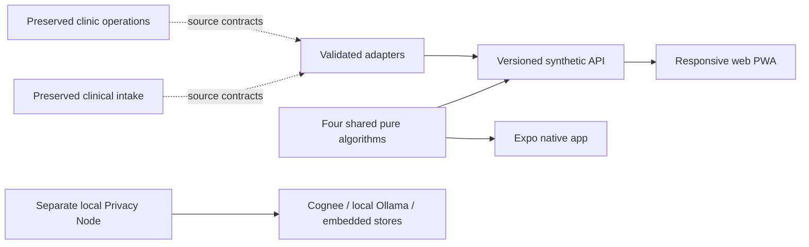

# Dhaaga

**Care that stays connected.** A synthetic continuity-of-care integration demo for
HackShift, preserving AarogyaNidhi/ClinicOS and MediKiosk as unmodified originals.

The user's complete implementation request is in [prompts.md](prompts.md), pushed
before implementation. **Its full Definition of Done is not yet satisfied.** This
repository distinguishes working mechanisms, simulated data, unverified code and
external blockers; it is not ready for real patient data or clinical deployment.

## New integrated clinic workspace

`npm ci && npm run integration:dev` starts the React intake/clinician milestone
at http://127.0.0.1:8790 with persistent synthetic records. See the
[runbook](docs/INTEGRATION_RUNBOOK.md) for local credentials, verification and remaining scope.
The earlier demo below remains separate until the integration cutover gates pass.

## Flutter patient intake kiosk

The active Android tablet/Web kiosk is in [frontend/app](frontend/app/README.md).
Its Phase 2 implementation includes Hindi, English, Punjabi and Tamil, dark/Elder
Mode, staff sign-in, entered synthetic demographics and symptoms, required care
consent, emergency guidance, a server-issued encounter receipt and a visible
60-second inactivity reset. Optional Android speech source is implemented; Web
uses typed input and Android microphone/device behavior remains unverified.

Use **Flutter 3.35.7 / Dart 3.9.2**, pinned in frontend/app/.fvmrc:

```sh
cd frontend/app
flutter pub get
dart run build_runner build --delete-conflicting-outputs
flutter analyze
flutter test --coverage
```

The kiosk follows packages/shared/integration.ts and backend/src/index.ts:
staff-authenticated POST /api/v1/encounters persists the intake. The response is
an encounter receipt; OPD tokens, wait estimates, QR and phone/ABHA lookup are
explicitly unavailable. No phone number or ABHA is collected. For functional Web
integration, serve the Flutter assets and persistent API behind the same HTTPS
origin; see the [kiosk setup guide](frontend/app/README.md#api-configuration-and-running)
and [backend runbook](docs/INTEGRATION_RUNBOOK.md).

The configured public Worker still served the legacy API at Phase 2 verification;
its successful health check does not establish live encounter/OCR support. No
backend deployment was performed. Use synthetic information only.

Phase 2 evidence: **49 Flutter tests**, **zero analyzer issues**, **91.1% domain/data
coverage**, release Web builds and real local-backend routine/emergency Chrome
walkthroughs. See [the phase report](docs/MOBILE_KIOSK_PHASE2.md) for measured scope.
OCR, encrypted offline replay, lockdown, debug APK and Android device verification
remain later gates. The separate Expo app below is the earlier mobile project.

## Earlier demo: run locally

Node >=22.13, npm and Git:

```bash
make demo
```

Open http://127.0.0.1:8787, grant local demo-processing consent, and explore Today,
Patient Thread, Medicine access, Monitoring, Wellbeing, Cycle, Privacy and the
Algorithm Lab. Optional speech is disabled by default. `make up` runs the Docker
container. `make mobile` starts the separate Expo development-client project.



## Verified scope

- Validated synthetic record adapters with provenance and FHIR R4 aligned export.
- Four deterministic mechanisms: Bayesian question selection, exact course-valid
  stock allocation, robust BP CUSUM and exact refill-demand convolution.
- Consent/revocation, isolated expiring sessions, source-cited local summaries,
  bounded ingestion, red-flag handling and tamper-evident session audit verification.
- Responsive web, four draft interface dictionaries, large text/dark mode,
  offline algorithm screen, explicit degraded/unavailable integration status.
- Native Expo screens sharing the engine, secure check-in, approximate reminder
  and biometric-lock source; see current build/device limitations.
- Standalone Cognee local remember/recall verified with local models and a Python
  egress guard. This is not yet connected to the website/mobile record.

## Commands and evidence

`make test`, `make lint`, `make build`, `make bench`, `make eval`,
`make verify-untouched`, `npm run e2e`. Benchmarks and limitations are in
[docs/benchmarks](docs/benchmarks/RESULTS.md). API specification: `/openapi.json`,
entry guidance: `/docs`. Existing originals are in `hackshift/projects/`;
`baseline-untouched` protects their publishable source.

[Progress](docs/PROGRESS.md) · [Discovery](docs/DISCOVERY.md) ·
[Design](docs/INTEGRATION_DESIGN.md) · [Traceability](docs/REQUIREMENTS.md) ·
[Pillars](docs/PILLARS.md) · [Deployment](docs/DEPLOYMENT.md) ·
[Safety/security](docs/COMPLIANCE.md) · [Demo](docs/DEMO_SCRIPT.md) ·
[Final checkpoint report](docs/FINAL_REPORT.md)

New work: [Project 1 + Project 2 integration implementation plan](docs/PROJECT_INTEGRATION_PLAN.md)
— frontend selection, shared backend/data design, migration sequence and acceptance gates.

Unknown-provenance local databases, historic authenticated-token test scripts,
secrets and duplicate import folders are excluded from publication. No live
upstream database is accessed by the synthetic demonstration.
