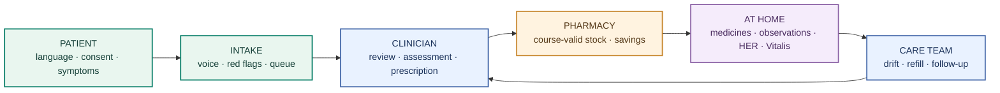
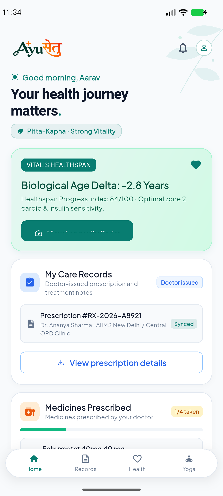
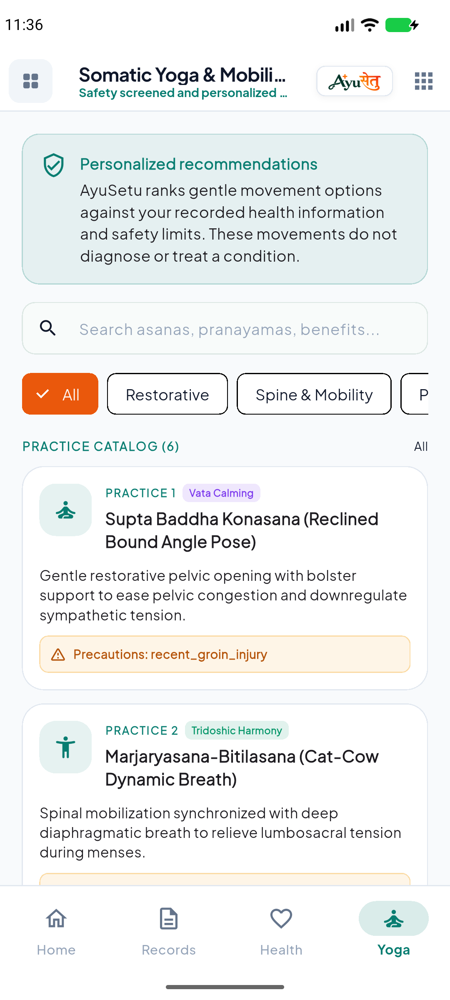
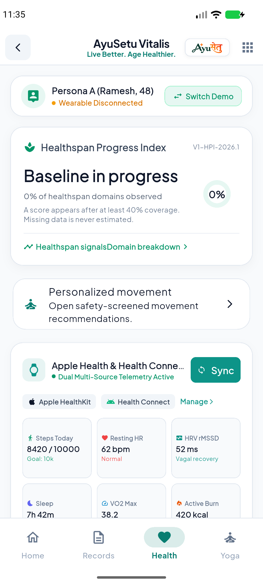
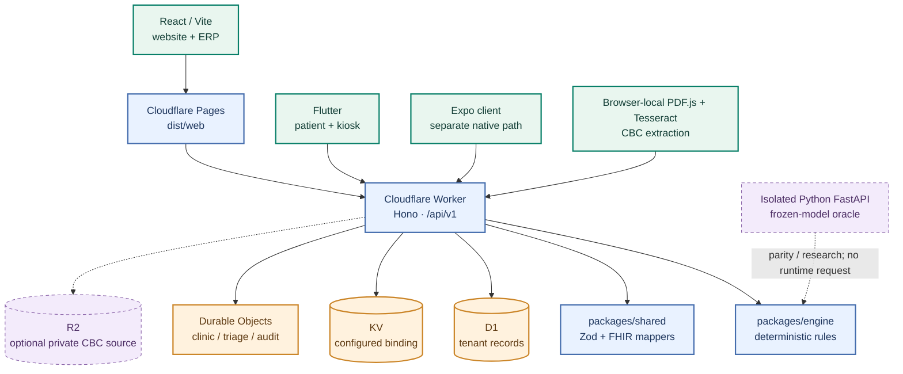
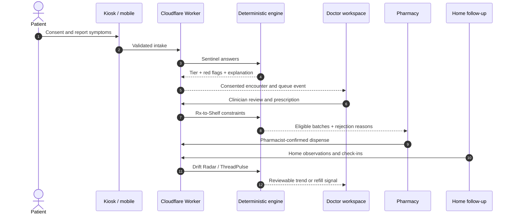
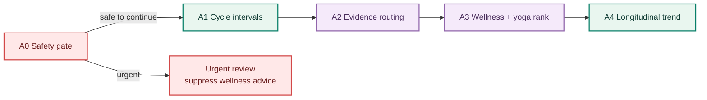
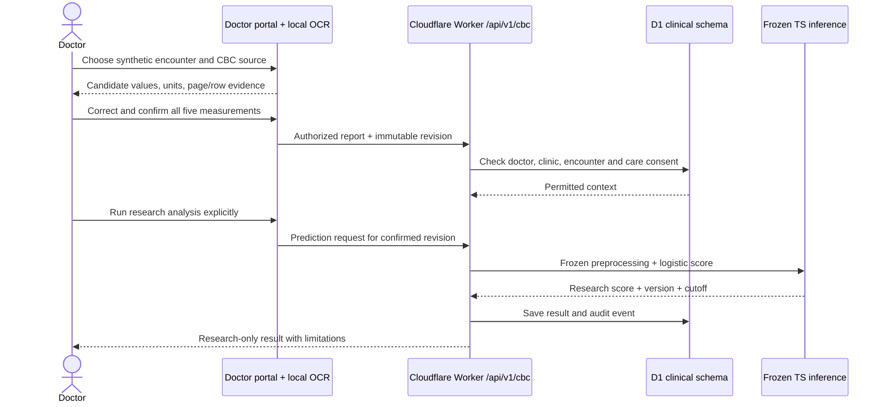
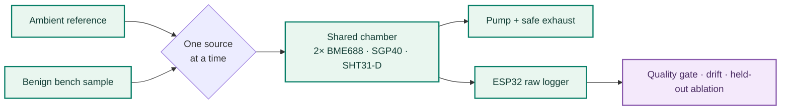

<div align="center">


<br />

### One thread from first symptom to better days at home.

**A connected care prototype for patient intake, clinical review, pharmacy, follow-up, women's health and healthspan.**<br />
Rule engines produce inspectable decisions. Clinicians retain control. Language tools help people communicate.

<br />

[](https://github.com/potlasrisharan/hackshift-sudarshan/actions/workflows/ci.yml)
[](wrangler.jsonc)
[](package.json)
[](frontend/website)
[](frontend/app)
[](backend)
[](#research)

[Explore the product](#product) · [Screenshots](#screenshots) · [Features](#features) · [Architecture](#architecture) · [Algorithms](#algorithms) · [Research](#research) · [Run locally](#run-locally) · [Evidence](#evidence)

<br />


</div>

> [!IMPORTANT]
> **Project status: engineering and hackathon prototype.** Screens and benchmark fixtures use synthetic people and measurements. Several modules use local or in-memory stores. The research model has no independent clinical validation. Do not use the system for patient care or upload real patient records. [Current progress](docs/PROGRESS.md) · [Product requirements](docs/PRD.md) · [Deployment boundaries](docs/DEPLOYMENT.md)

The vector care strip includes subtle motion where supported; GitHub may display its static frame. GitHub README pages do not support custom page fonts or transitions, so the layout uses portable SVG artwork, diagrams and Markdown.

<a id="product"></a>
## The idea

A person's story usually breaks at every handoff: the intake form does not reach the doctor, the prescription does not know which stock is usable, and the home reading loses its clinical context. **AYUSETU keeps those handoffs visible as one consented Patient Thread.** It brings together the kiosk, doctor, pharmacy, clinic operations and patient follow-up while keeping deterministic safety rules ahead of language generation.

| The thread | What the prototype demonstrates | Distinctive mechanism |
|---|---|---|
| **Listen and triage** | Indic language intake, transcription/translation review, adaptive questions and emergency flags | Mandatory red-flag screen before information-gain question selection |
| **Review and prescribe** | Consultation queue, source-linked notes, vitals and research-only CBC report review | Clinician sign-off; CBC result is isolated from diagnosis and prescriptions |
| **Fulfil safely** | Inventory, batch eligibility, generic savings, FEFO dispensing and POS | Exact salt/strength/form, full-course stock and expiry constraints before cost |
| **Stay connected** | Medicine plan, home observations, nurse queue and refill risk | Personal baseline change detection alongside an independent absolute alert |
| **Support daily health** | HER cycle and symptom tracking; Vitalis healthspan; personalized gentle yoga | Contraindication gates, data coverage and provenance before ranking advice |

### Why this is different

1. **One journey across roles.** Patient, clinician, pharmacist, nurse and operations views share contracts instead of telling unrelated stories.
2. **Algorithms decide; AI translates.** Urgency, stock feasibility and safety gates come from versioned rules. Speech and language services assist communication and require review.
3. **A visible reason for every result.** Rejected batches, red-flag rule IDs, model limitations, data coverage and source evidence are exposed to the user or clinician.
4. **Economics without unsafe shortcuts.** All money is integer paise; a cheaper batch is never selected when composition, quantity, allergy or expiry fails.
5. **Healthspan, not lifespan prediction.** The Vitalis V1 engine tracks modifiable behaviors and preventive-care coverage; it does not calculate biological age or years of life gained.
6. **Research stays research.** CBC scoring and BreathSense X are labelled with their evidence limits and are not fed into care decisions.



<a id="screenshots"></a>
## Product gallery

The images below are captures/previews of **synthetic demo screens** in this repository. They show the interface, not evidence of a production clinical deployment. The Android images were captured from the Flutter app on a Pixel 8a emulator.

The home screen's age-delta card and the Vitalis wearable values are illustrative demo content. The V1 healthspan engine does not produce a biological-age estimate, and the pictured values do not prove a device connection.

<table>
  <tr>
    <td width="50%" align="center"><br /><sub><b>01 / Website landing</b> · React</sub></td>
    <td width="50%" align="center"><br /><sub><b>02 / Doctor consultation</b> · synthetic queue</sub></td>
  </tr>
  <tr>
    <td align="center"><br /><sub><b>03 / Patient kiosk</b> · language-first intake</sub></td>
    <td align="center"><br /><sub><b>04 / Headquarters</b> · operations overview</sub></td>
  </tr>
</table>

<table>
  <tr>
    <td width="33%" align="center"><br /><sub><b>Android / Home</b></sub></td>
    <td width="33%" align="center"><br /><sub><b>Android / Yoga</b></sub></td>
    <td width="33%" align="center"><br /><sub><b>Android / Vitalis</b></sub></td>
  </tr>
</table>

<details>
<summary><b>More interface previews</b></summary>

<br />

[Emergency triage](docs/design/previews/emergency-desktop.png) · [Responsive patient web](docs/design/previews/patient-390.png) · [Wide patient web](docs/design/previews/patient-1440.png) · [Measured benchmark chart](docs/benchmarks/measured-results.png). The earlier responsive patient web preview is a web capture, not an Android screenshot.

</details>

<a id="features"></a>
## Complete feature map

The repository has multiple clients and deployment paths. A checked-in screen is not automatically a live Cloudflare feature. The matrix points to the implementation and names the current boundary.

### Web: patient, clinical and operations

| Area | Included capabilities | Implementation / boundary |
|---|---|---|
| **Public site and patient web** | Landing, solutions, about, news, support, contact, privacy, patient thread, medicine access, home monitoring, accessibility controls | [`frontend/website/src/pages`](frontend/website/src/pages), [`frontend/website/src/main.tsx`](frontend/website/src/main.tsx); responsive synthetic demo |
| **Kiosk and intake** | Language choice, QR/mobile/ABHA/Aadhaar or new-patient entry in demo, reviewed voice transcript, translation, symptom capture, red-flag escalation, serial OPD flow | [`PatientKiosk`](frontend/website/src/components/PatientKiosk.tsx), [`intake routes`](backend/src/modules/intake/routes.ts); external identity is not verified by the demo |
| **Doctor workspace** | Live intake queue, encounter selection, vitals, source citations, SOAP review, dual coding, prescription and emergency escalation | [`DoctorConsultation`](frontend/website/src/components/DoctorConsultation.tsx), [`EmergencyTriage`](frontend/website/src/components/EmergencyTriage.tsx); synthetic consultation records |
| **CBC reports** | Local PDF/image OCR, units and evidence review, explicit confirmation, revision history, frozen research inference and deletion | [`CBC feature`](frontend/website/src/features/cbc), [`Worker routes`](backend/src/modules/cbc/routes.ts); authenticated **synthetic** encounters in development/test only |
| **CBC Research Explorer** | Editable synthetic inputs and two demo presets showing above/below-cutoff research signals | [`Browser demo`](frontend/website/src/features/cbc/CbcResearchDemo.tsx); runs locally in-browser without clinical login, Render calls or patient-record writes |
| **Clinical and administrative portals** | AYUSH, staff, attendance, shift management, IPD, clinic administration, hospital registry, equipment and audit views | [`App view map`](frontend/website/src/App.tsx), [`components`](frontend/website/src/components); coverage differs by view |
| **Clinic commerce** | Stock radar, procurement, prescription-to-shelf planning, POS, generic savings, billing, expenses, earnings, ledger and financial views | [`ops routes`](backend/src/modules/ops/routes.ts), [`bridge routes`](backend/src/modules/bridge/routes.ts); some operational flows use seeded data |
| **Localization** | English, Hindi, Punjabi and Tamil interface dictionaries; translated intake review | [`packages/i18n`](packages/i18n), [`website language control`](frontend/website/src/components/WebsiteLanguageSelect.tsx); clinical translations need human review |

### Flutter patient and kiosk application

| Journey | Screens and behavior | Source |
|---|---|---|
| **Entry** | Portal selection, patient sign-up/login, once-only onboarding and profile preferences | [`router`](frontend/app/lib/core/router/app_router.dart), [`onboarding`](frontend/app/lib/features/onboarding), [`auth`](frontend/app/lib/features/auth) |
| **Care** | Prescribed medicine list and reminders, clinical management, nurse triage and legacy consultation views | [`prescription`](frontend/app/lib/features/prescription), [`clinical management`](frontend/app/lib/features/clinical_mgmt), [`nurse`](frontend/app/lib/features/nurse) |
| **HER** | Cycle calendar, symptom journal, questionnaires, wellness studio, doctor summary and wearable view | [`HER screens`](frontend/app/lib/features/her); backed by A0–A4 rules where connected |
| **Vitalis** | Healthspan dashboard, questionnaire, activity, nutrition, sleep, cardio, biomarkers, functional tests, preventive care, simulator, trajectory and summary | [`Vitalis screens`](frontend/app/lib/features/vitalis); V0–V14 engine and `/api/v1/vitalis` routes |
| **Personalized yoga** | Gentle movement catalog, category/search, safety precautions and ranked suggestions from recorded context | [`Yoga screen`](frontend/app/lib/features/yoga/presentation/screens/yoga_prescription_screen.dart), [`HER ranker`](packages/engine/her/wellness_ranker.ts) |
| **In-app notices** | Medication timing and care reminders shown inside the app | [`Reminder service`](frontend/app/lib/core/services/medicine_reminder_service.dart); no push-notification delivery is claimed |

[`apps/mobile`](apps/mobile) is a separate Expo / React Native client and Android build path. It is not feature-parity with Flutter. The currently verified mobile coverage is in [PROGRESS.md](docs/PROGRESS.md); an APK or store release is not implied by the source tree.

<a id="architecture"></a>
## System architecture

### Runtime topology



**Cloudflare configuration is explicit.** The root [`wrangler.jsonc`](wrangler.jsonc) declares the production Worker, D1, KV and Durable Object bindings. [`backend/wrangler.jsonc`](backend/wrangler.jsonc) is a separate integration Worker configuration for the persisted clinical slice. [`backend/src/index.ts`](backend/src/index.ts) mounts module routes and the clinical integration app. R2 storage for original CBC source files is optional; it is not present in the root Wrangler binding by default. Cloudflare Queues and a fully durable event outbox are roadmap items, not deployed bindings.

**Two web builds:** [`apps/web`](apps/web) is the root Pages build and compiles website source into `dist/web`. [`frontend/website`](frontend/website) also has its own Vite build for the clinical integration environment. The two mobile trees likewise have different scopes. Do not infer parity from a shared brand.

### API route map

| `/api/v1` prefix | Responsibility | Implementation |
|---|---|---|
| `/intake` | Registration, symptom intake, translation and encounter/token flow | [Intake](backend/src/modules/intake/routes.ts) |
| `/auth/patient`, `/patient`, `/patients` | Patient login, profile/preferences and patient records | [Patient auth](backend/src/modules/patient_auth/routes.ts), [patient route](backend/src/index.ts) |
| `/prescriptions`, `/documents` | Prescribed care and document endpoints | [Prescriptions](backend/src/index.ts#L989), [documents](backend/src/index.ts#L781) |
| `/ops`, `/bridge` | Stock, POS, ledger, procurement and prescription-to-shelf/refill bridges | [Operations](backend/src/modules/ops/routes.ts), [bridge](backend/src/modules/bridge/routes.ts) |
| `/home` | Home vitals, drift and nurse follow-up queue | [Home](backend/src/modules/home/routes.ts) |
| `/her`, `/vitalis` | Women's health and healthspan workflows | [HER](backend/src/modules/her/routes.ts), [Vitalis](backend/src/modules/vitalis/routes.ts) |
| `/abdm`, `/insurance`, `/platform` | Interoperability, insurance and administrative demo surfaces | [ABDM](backend/src/index.ts#L703), [insurance](backend/src/index.ts#L756), [platform](backend/src/modules/platform/routes.ts) |
| `/cbc` | Doctor-only synthetic CBC report and frozen-model research workflow | [CBC](backend/src/modules/cbc/routes.ts); disabled in production |

Some routes have seeded or in-memory behavior. An endpoint name does not establish a live external integration or regulatory certification.

### One intake, many guarded handoffs



Some screen paths still use synthetic or in-memory state; the diagram describes the intended connected workflow and the implemented algorithm boundaries. See [integration design](docs/INTEGRATION_DESIGN.md) and [progress](docs/PROGRESS.md) for persistence by slice.

### Trust and data rules

- **Validation:** Zod checks shared TS API boundaries; the Flutter client has its own typed models. Patient and tenant identifiers come from server sessions for protected clinical routes.
- **Tenant isolation:** D1 access uses [`tenantDb`](backend/src/db/tenant.ts) and an `org_id` scope. The CBC route additionally checks doctor role, same-clinic encounter and active care consent.
- **Consent and provenance:** The clinical slice records consent receipts, revisions and audit events. Revocation removes access to protected reports. CBC source retention uses private R2 only when bound.
- **Privacy at language boundaries:** Identifiers should be redacted before external AI requests; browser CBC OCR stays local and sends only clinician-confirmed measurements to the Worker.
- **Finance:** Prices, costs and ledger totals are integer paise, avoiding floating-point currency errors.
- **Safety:** A red flag overrides wellness ranking. A score never writes a diagnosis, prescription, queue priority or emergency decision without a separate rule and clinician action.

<a id="algorithms"></a>
## The algorithm handbook

The [PRD](docs/PRD.md) is the product specification; **checked-in engine code and algorithm notes describe the implemented slice**. The equations below reflect that code. None is clinically calibrated. All four core algorithms have direct [technical notes](docs/algorithms), and source lives in [`packages/engine`](packages/engine).

### 01 · Sentinel: ask useful questions, keep danger first

For latent review class `c` and answered symptoms `E`, the engine computes stable log weights and normalizes them:

```text
log w(c) = log prior(c) + Σ answered i log P(answer_i | c)
P(c | E) = exp(log w(c) − max log w) / Σ_j exp(log w(j) − max log w)
H(C) = −Σ_c P(c) log₂ P(c)
IG(q) = H(C) − P(yes)H(C | yes) − P(no)H(C | no)
```

An unanswered **chest pain, breathlessness or fainting** question is asked before other high-information questions. Any affirmative one returns `emergency`; otherwise the output remains `clinician-review`. `unsure` does not alter likelihoods. The current closed ontology has **four illustrative classes and seven symptoms**, not the larger target model in the PRD. [Source](packages/engine/index.ts) · [Design note](docs/algorithms/sentinel.md)

### 02 · Rx-to-Shelf: cheapest *feasible* full course

```text
minimize  Σ_b (pricePaise_b × units_b) + transferPaise × numberOfUsedRemoteClinics
subject to Σ_b units_b = requiredUnits;  0 ≤ units_b ≤ stock_b; units_b integer
           same salt + strength + form;  expiry_b ≥ courseEnd + 14 days
           at most two source clinics; recorded exact-salt allergy blocks planning
```

The planner filters unsafe batches, enumerates all one- or two-clinic subsets and fills eligible stock by unit price. Under its declared single-composition, linear-cost constraints this is exact; it is not a general mixed-drug optimizer. The dispensing layer adds FEFO within an approved brand and still requires pharmacist confirmation. [Planner](packages/engine/index.ts) · [Dispensing](packages/engine/dispensing.ts) · [Proof and limits](docs/algorithms/rx-to-shelf.md)

### 03 · Drift Radar: change from *your* starting pattern

For systolic readings, same-day samples are averaged and sorted. The first seven observed days define `m = median(x)` and `s = max(3, 1.4826 × MAD(x))`. Later readings update a one-sided CUSUM:

```text
Cₜ = max(0, Cₜ₋₁ + (xₜ − m)/s − 0.5)
trend flag ⇔ Cₜ ≥ 5; absolute flag ⇔ xₜ ≥ 180 mmHg
```

A gap over three days resets CUSUM, missing days are not imputed, and the absolute flag works during cold start. This is an **illustrative single-channel BP mechanism**, not the BOCPD/multisensor target described in the PRD. [Source](packages/engine/index.ts) · [Limits](docs/algorithms/drift-radar.md)

### 04 · ThreadPulse: a distribution, not a single forecast

Each synthetic patient contributes one independent Bernoulli refill event `Xᵢ ~ Bernoulli(pᵢ)`. The exact Poisson-binomial distribution is built by convolution:

```text
f₀(0) = 1
fᵢ(k) = (1 − pᵢ)fᵢ₋₁(k) + pᵢ fᵢ₋₁(k−1)
q = smallest k with P(N ≤ k) ≥ serviceLevel
suggestedOrder = max(0, q − stock); stockoutRisk = P(N > stock)
```

The method runs in `O(n²)` time and `O(n)` space for `n ≤ 500`. Refill probabilities are supplied by a synthetic scenario; this slice does not learn them from real patient histories or place a purchase order. [Source](packages/engine/index.ts) · [Design note](docs/algorithms/threadpulse.md)

### 05 · HER: A0–A4 women's health rules



| Engine | Implemented method | Guardrail |
|---|---|---|
| **A0 safety gate** | Ordered rules for possible pregnancy with pain/bleeding, sudden severe pelvic pain, bleeding with fainting, severe breathlessness and crisis signals | Urgent result suppresses wellness advice; [source](packages/engine/her/safety_gate.ts) |
| **A1 cycle detector** | `Lᵢ = startᵢ₊₁ − startᵢ`; mean `μ = ΣLᵢ/n`, population `σ = √[Σ(Lᵢ−μ)²/n]`, variability `CV = 100σ/μ`; date sorting, deduplication, phase windows and age-aware flags | Pregnancy/lactation returns context-limited output; low history returns insufficient data; [source](packages/engine/her/cycle_detector.ts) |
| **A2 screening** | Maps cycle, questionnaire and verified lab evidence to review categories for PCOS features, pelvic pain/endometriosis features and heavy-bleeding/anemia features | No diagnostic probability; adolescent rules differ; [source](packages/engine/her/screening_engine.ts) |
| **A3 wellness ranker** | Excludes contraindications, pregnancy/lactation movement variants and incompatible diets, then scores `base utility + evidence/relevance/context boosts` | Urgent flags yield no recommendations; up to 25 yoga items in the movement category; [source](packages/engine/her/wellness_ranker.ts) |
| **A4 trends** | Deduplicated 7/14/30-day window; `coverage = daysLogged/windowDays`; rolling mean only when coverage meets the configured minimum | Descriptive association, never causation; [source](packages/engine/her/trend_analyzer.ts) |

The yoga screen requests the ranked `yoga_movement` catalog and shows precautions and rationale. Exercises are selected against recorded conditions, fatigue, pain, mobility restrictions and safety rules; it is not a prescription for treating an illness. [Mobile UI](frontend/app/lib/features/yoga/presentation/screens/yoga_prescription_screen.dart)

### 06 · Vitalis: V0–V14 healthspan toolkit

**V1 healthspan progress index** is a coverage-aware weighted average over eight modifiable domains: activity `1.5`, strength/mobility `1.2`, sleep/recovery `1.4`, nutrition `1.3`, cardio `1.2`, metabolic `1.4`, preventive care `1.0`, psychosocial wellbeing `1.0`.

```text
coverage = Σ weight(observed domains) / Σ weight(all eight domains)
HPI = round[Σ weightᵢ × observedScoreᵢ / Σ weight(observed domains)]
HPI = unavailable when coverage < 0.40; missing domains are never silently scored zero
```

| Engine | Rule or calculation | Source |
|---|---|---|
| **V0** safety | Chest pain/syncope → urgent; clinician exertion restriction or cardiovascular history blocks/reviews vigorous activity; CKD blocks unsupervised protein loading | [Safety gate](packages/engine/vitalis/v0_safety_gate.ts) |
| **V1** healthspan index | Eight-domain weighted mean with observed-weight coverage threshold | [HPI](packages/engine/vitalis/v1_healthspan_index.ts) |
| **V2** preventive ranker | `clamp(0.35 evidence + 0.35 relevance + 0.20 feasibility − 0.10 burden, 0, 1)` | [Ranker](packages/engine/vitalis/v2_preventive_ranker.ts) |
| **V3** exercise progression | Adjusts weekly target using current minutes, tolerance and recovery; safety/clinical holds outrank progression | [Progression](packages/engine/vitalis/v3_exercise_progression.ts) |
| **V4** biomarker trends | Quarantines implausible points; `Δ = latest − previous`, `slope/day = Δ / elapsedDays`, monthly slope uses `30.4375` days | [Trends](packages/engine/vitalis/v4_biomarker_trends.ts) |
| **V5** lifestyle correlations | Pearson `r = [nΣxy − ΣxΣy] / √[(nΣx²−(Σx)²)(nΣy²−(Σy)²)]`; explicitly non-causal | [Correlations](packages/engine/vitalis/v5_lifestyle_correlations.ts) |
| **V6** recommendation selector | Evidence library → V0 contraindication filter → context relevance → V2 ranking | [Selector](packages/engine/vitalis/v6_recommendation_selector.ts) |
| **V7** VO₂ provenance | Labels measured vs wearable-estimated values; a separate non-exercise estimate is marked research-only | [VO₂](packages/engine/vitalis/v7_vo2_provenance.ts) |
| **V8** rolling baseline | 21-day source-aware window, minimum seven samples; `z = (today − mean)/max(0.5, σ)` | [Baseline](packages/engine/vitalis/v8_rolling_baseline.ts) |
| **V9** sleep regularity | Circular bedtime mean across midnight; dispersion `√(−2 ln R) × 1440/(2π)` and bounded consistency score | [Sleep](packages/engine/vitalis/v9_sleep_regularity.ts) |
| **V10** daily readiness | Available streams reweighted from HRV `.35`, resting HR `.25`, efficiency `.20`, regularity `.20`; symptoms/high fatigue override | [Readiness](packages/engine/vitalis/v10_daily_readiness.ts) |
| **V11** functional capacity | Grip, five chair rises, falls and mobility history route to functional review suggestions | [Function](packages/engine/vitalis/v11_functional_capacity.ts) |
| **V12** telemetry ingest | Source-record deduplication, UTC-to-local-day buckets, metric harmonization and daily aggregation | [Ingest](packages/engine/vitalis/v12_time_series_dedup.ts) |
| **V13** preventive eligibility | Age, risk, last-completed date and interval rules create due/overdue items | [Eligibility](packages/engine/vitalis/v13_preventive_eligibility.ts) |
| **V14** behavior simulator | Illustrative walking `≈100 steps/min`; projects schedule volume and percentage of the 150-min/week activity reference | [Simulator](packages/engine/vitalis/v14_behavior_simulator.ts) |

The readiness score and simulator are **wellness indicators**, not exercise clearance, mortality predictions or lifespan estimates. Backend route coverage and demo values vary by endpoint; inspect [`/api/v1/vitalis`](backend/src/modules/vitalis/routes.ts) before using a screen as proof of a persistent record.

### 07 · Other operational mathematics

| Utility | Calculation / constraint | Source |
|---|---|---|
| **Savings meter** | `brandTotal = units × brandPricePaise`; `genericTotal = units × eligibleUnitPricePaise`; `savings = max(0, brandTotal − genericTotal)`. Exact composition, stock, course expiry, allergies and NTI block substitution | [Engine](packages/engine/index.ts) |
| **FEFO dispensing** | Among clinician-allowed complete courses, select total cost; within the selected brand consume earliest-expiring valid batches first | [Dispensing](packages/engine/dispensing.ts) |
| **Double-entry ledger** | Every journal line is nonnegative integer paise; balance requires `Σdebits = Σcredits`; `profit = revenue − COGS − operating expenses` | [Engine](packages/engine/index.ts) |
| **Refill warning** | `daysToExhaustion = floor(remainingUnits / max(1, dailyDoseUnits))`; warn when within configured lead time | [Engine](packages/engine/index.ts) |

<a id="research"></a>
## Research programme

Research work is deliberately separated from clinical decisions. It comprises a **CBC blood-count model** and the **BreathSense X** e-nose concept. Neither is validated for patient diagnosis.

### CBC: from source document to a versioned research score

**Quick pitch demo — CBC Research Explorer.** In **Doctor Consultation**, select **Try demo**, choose a **Demo values** preset, then select **Run research model**. All five measurements remain editable, with units and numeric validation. Changing inputs or presets clears the previous result.

| Synthetic preset | WBC (×10⁹/L) | RBC (×10¹²/L) | Neutrophils | Lymphocytes | Monocytes | Model output |
|---|---:|---:|---:|---:|---:|---|
| Risk signal · experimental | 8.95 | 4.41 | 65% | 25% | 9% | `0.653` — Potential risk signal detected |
| No risk signal · experimental | 7 | 4.8 | 60% | 32% | 5% | `0.286` — No risk signal detected by this model |

Both presets run the existing frozen model with the unchanged cutoff `0.626816175626443`. The browser computes the score on-device; this explorer needs no clinical login, makes no Render inference call and saves nothing to patient records. It remains separate from the authenticated report workflow below. **These are experimental model flags, not established clinical risk categories, cancer probabilities or diagnoses. A result below the cutoff does not rule out cancer.** The expandable **Why experimental?** panel explains development metrics, data limitations and the need for representative data and independent validation.

The Doctor Consultation dashboard now embeds a **CBC Reports** workflow for authenticated synthetic encounters in development/test. The clinician can select a PDF, PNG or JPEG; same-origin PDF.js/Tesseract extracts candidate rows in the browser; the clinician reviews units and source evidence, corrects all five fields, confirms a revision, then explicitly runs the frozen model in the Cloudflare Worker. The isolated Python [`model-api`](model-api) remains the original model oracle and optional standalone research service; the web app does **not** call Render at runtime. [Detailed runbook](docs/CBC_RUNBOOK.md)



**Inputs and units:** WBC/TLC `10⁹/L`; RBC `10¹²/L`; neutrophils, lymphocytes and monocytes `%`. Differential percentages are rounded to whole percentages inside the frozen preprocessing. The seven model features are `[WBC, lymphocytes, neutrophils, monocytes, RBC, NLR, LMR]`, with `NLR = N/L` and `LMR = L/M`. Undefined ratios use the frozen training imputation statistics and indicators. Each standardized feature contributes to `z = intercept + Σ coefficientᵢ × (xᵢ − meanᵢ)/scaleᵢ`; `score = 1/(1+e⁻ᶻ)` and the frozen cutoff is `0.626816175626443`. [Frozen TS representation](packages/engine/cbc/frozen-model.json) · [Inference](packages/engine/cbc/inference.ts)

The saved model is `india-cbc-logistic-c87ec8485159`. Internal nested cross-validation on 752 published, reconstructed records reported AUC `0.713`, accuracy `63.2%`, sensitivity `35.9%`, specificity `90.4%`. These are **internal study metrics, not independent validation of this deployed workflow**. A score is neither a calibrated cancer probability nor a diagnosis. Source document retention in R2 is optional. CBC does not change SOAP, codes, prescription, queue priority or emergency routing. [Model details](model-api/README.md) · [Clinical boundary](docs/CBC_RUNBOOK.md)

### BreathSense X: an assessable instrument concept

<div align="center"></div>

BreathSense X explores low-cost, **nonclinical** volatile-organic-compound sensing. Version 1 is a proposed benign bench/ambient-air instrument, with no patient sampling. The central question is whether a shared sensor chamber, an ambient reference, quality rejection and drift monitoring improve repeatability on held-out sessions. It makes **no breast-cancer diagnostic-performance claim**. [Research and engineering report](Breath_Sense_Cancer_Detection_Research/Breath-Sense-Cancer-Detection-Literature-Review.pdf)

<div align="center">
  
  <br />
  <sub><b>Proposed design / invention map.</b> Concept visualization from the research report; not an assembled device, validated mechanical drawing, approved bill of materials or evidence of cancer detection.</sub>
</div>

**What the numbered cutaway proposes**

| Label | Design element | Role and current boundary |
|---|---|---|
| **1** | Disposable mouthpiece | Hygienic, single-use breath entry in a **future human-sampling phase**; excluded from the nonclinical V1 bench plan. |
| **2** | Filtered sample inlet | Proposed particle-filtered sample path. The blue breath channel is illustrative; V1 accepts only benign test gas or ambient-air comparisons. |
| **3** | Flow control | Micro-pump and selector valve switch **one source at a time** between the sample and the separate green ambient-reference path, then purge through an isolated exhaust. Valve port layout, leaks and pump suitability still need verification. |
| **4** | Shared sensor chamber | Both streams visit the same chamber sequentially for a reference-relative comparison; BME688 heater profiles are internal to the sensors, **not** chamber heating. |
| **5** | Gas sensor array | Proposed **2 × BME688 + 1 × SGP40** broad-response sensors for multi-profile fingerprints; they do not identify a cancer-specific compound. |
| **6** | Temperature and humidity | Environmental measurements, with an optional independent **SHT31-D**, to log conditions and test correction rather than assume it helps. |
| **7** | Data processing / “AI engine” | Proposed drift analysis and sample-quality rejection. In V1, analysis runs on a **PC**, not as a proven onboard diagnostic model. |
| **8** | ESP32 | Proposed Wi-Fi microcontroller for timestamped raw sensor, source, valve and quality logs. |
| **9** | Rechargeable battery | Future portable-power concept; the V1 bench plan uses **USB power**. |

The report's **five proposed, experimentally unverified innovations** are (1) switched ambient referencing, (2) repeated-reference drift awareness, (3) a baseline/noise/recovery quality gate, (4) supported BME688 multi-temperature heater-profile features and (5) **future** fusion with imaging, lab results and patient history. The fifth is a software research direction for a separate ethics-approved clinical phase, not a V1 hardware module or a patient-facing result. [Innovation evidence plan](Breath_Sense_Cancer_Detection_Research/Breath-Sense-Cancer-Detection-Literature-Review.pdf)



| Study phase | Evidence required before advancing |
|---|---|
| **A / B** | Electrical integrity and within/between-session repeatability |
| **C / D** | Ambient correction, drift ablation, carryover and recovery on unseen days |
| **E** | Separate ethics-approved clinical collaboration with appropriate controls and independent sites |

The full report specifies experiments E1–E7, an approximately ₹15,000 nonclinical hardware envelope, component contingencies and claim tags. A rendered concept image is **not** evidence that the pneumatic system has been built. [Conventional concept](Breath_Sense_Cancer_Detection_Research/Conventional_model.png) · [Full-size proposed cutaway](Breath_Sense_Cancer_Detection_Research/Proposed_Model_Prototype.jpeg)

<a id="stack"></a>
## Technology stack

| Layer | Technologies | Why they are here |
|---|---|---|
| **Web UX** | React 18, TypeScript, Vite 5/8, Tailwind CSS 3, GSAP | Responsive public, patient, kiosk and ERP surfaces across two web builds |
| **Patient / kiosk app** | Flutter, Dart, Riverpod, GoRouter | Android, iOS and web app routes with typed state |
| **Second native path** | Expo, React Native, TypeScript | Separate mobile prototype/build path |
| **API** | Cloudflare Workers, Hono, Zod | Shared `/api/v1` contracts and edge request handling |
| **Storage / coordination** | D1, Durable Objects, KV; optional private R2 for CBC sources | Tenant records, coordination and opt-in original-document retention |
| **Decision engines** | Pure TypeScript in `packages/engine` | Reviewable algorithms reusable across API and demos |
| **Documents and language** | PDF.js, Tesseract.js, browser Speech APIs, optional server-side language providers | Local CBC extraction and multilingual intake assistance |
| **Research model** | Python 3.12, FastAPI, scikit-learn; frozen TS Worker representation | Reproducibility/oracle and optional isolated research endpoint |
| **Quality / delivery** | Vitest, Playwright, Biome, Wrangler, GitHub Actions, Docker smoke build | Verification, Pages publish, D1 migration and Worker deployment |

<div align="center">

         

</div>

<a id="run-locally"></a>
## Run locally

**Prerequisites:** Node.js `≥22.13`, npm `≥10`; Flutter and Android SDK for the Flutter app; Python 3.12 only for the isolated model oracle. A Cloudflare account is needed for deployment, not for the local synthetic demo.

```bash
git clone https://github.com/potlasrisharan/hackshift-sudarshan.git
cd hackshift-sudarshan
npm ci
npm ci --prefix frontend/website --ignore-scripts
npm run integration:dev
```

The persisted clinical integration server prints its local address (normally `http://127.0.0.1:8790`). Open `/erp.html#/app?view=doctor-consultation` for the doctor dashboard. Follow the [CBC local workflow](docs/CBC_RUNBOOK.md) for the separately seeded synthetic doctor account. The root `npm run dev` starts a different legacy API demo.

For the live development preview, after installing dependencies, run these in two terminals from the repository root:

```bash
# Terminal 1: synthetic clinical demo backend
node --import tsx backend/local/server.ts

# Terminal 2: website with hot reload
node node_modules/vite/bin/vite.js --config frontend/website/vite.config.ts --host 127.0.0.1 --port 5173
```

Open `http://127.0.0.1:5173/erp.html#/app?view=doctor-consultation`. The **CBC Research Explorer** is above clinical session access and can be demonstrated without connecting a clinical account. GitHub source updates do not themselves publish the website or enable production CBC report access.

<details>
<summary><b>Flutter Android / iOS / web</b></summary>

```bash
cd frontend/app
flutter pub get
flutter devices
flutter run -d <device-id>
```

The Flutter patient experience uses the configured API base URL. Emulator, browser and physical device networking have different host addresses; see [`api_config.dart`](frontend/app/lib/core/network/api_config.dart).

</details>

<details>
<summary><b>Expo native prototype</b></summary>

```bash
cd apps/mobile
npm ci
npm run start
```

Android native generation needs the Android toolchain and the separate `npm run prebuild` / `npm run android` path.

</details>

<details>
<summary><b>Frozen CBC Python oracle</b></summary>

```bash
cd model-api
python -m venv .venv
# Activate .venv using your platform's command.
python -m pip install -r requirements-dev.txt
python -m uvicorn api.main:app --host 127.0.0.1 --port 8000 --workers 1 --no-access-log
```

The sample request and exact expected response are in [`model-api/README.md`](model-api/README.md). The main portal computes its frozen result in the Worker and makes no runtime request to this service.

</details>

### Verification commands

```bash
npm run lint
npm run typecheck
npm run check:frontend
npm test
npm run eval
npm run e2e
npm run cbc:worker:smoke
npm run cbc:e2e
npm run build
npm run build:worker
```

These are available repository commands, not a claim that every command passed for this README edit. The [CI workflow](.github/workflows/ci.yml) runs verification before deploy; CBC has additional focused smoke/browser commands. Build outcomes and deployed behavior should be checked per revision.

### Cloudflare delivery

The CI deployment job runs on configured push branches after verification, applies remote D1 migrations, publishes `dist/web` to the `ayuseva` Pages project, and deploys the root Worker. Deployment requires the GitHub Actions secrets `CLOUDFLARE_API_TOKEN` and `CLOUDFLARE_ACCOUNT_ID`; local development uses Wrangler local bindings and git-ignored environment variables. No key belongs in client code or this README. [Workflow](.github/workflows/ci.yml) · [Runbook](docs/DEPLOYMENT.md) · [Wrangler config](wrangler.jsonc)

<a id="evidence"></a>
## Evidence, status and limitations

The numbers below are **synthetic mechanism checks**, not clinical sensitivity, safety or operational savings claims. Seed `26047`, 500 constructed cases; reproduce with `npm run bench`. [Full results and methodology](docs/benchmarks/RESULTS.md)

| Synthetic benchmark | AYUSETU mechanism | Naive comparator |
|---|---:|---:|
| Unsafe stock selections | **0** | 276 |
| Injected BP ramps flagged, out of 250 | **250** | 0 |
| Unchanged BP streams flagged, out of 250 | 4 | 0 |

The comparator deliberately lacks the safety constraints, and the BP scenarios favor the injected change pattern. These values do not establish clinical performance. The [raw benchmark artifacts](docs/benchmarks) and [current progress](docs/PROGRESS.md) describe what has actually been measured.

| Scope | Present state | Next evidence needed |
|---|---|---|
| Core Sentinel / Rx / Drift / ThreadPulse | Deterministic TypeScript demos, tests and synthetic benchmarks | Clinician-reviewed ontology, independent datasets, prospective utility |
| Web clinical integration and CBC | Authenticated synthetic local/Worker workflow; research score isolated from care | Production identity, real-record authorization, clinical validation and security review |
| HER, Vitalis and yoga | Implemented rules, routes and mobile screens; some seeded/in-memory state | Durable longitudinal data, reviewed content and device verification |
| Flutter app | Android/iOS/web source and emulator demo | Device coverage, store packaging and release verification |
| Expo app | Separate prototype and typecheck path | Native device build and feature-parity decisions |
| BreathSense X | v2.0 report and instrument validation plan | Bench hardware, held-out repeatability, then separate ethics-approved study |
| Cloudflare deployment | Workflow for Pages, D1 and Worker | Check the latest workflow run and deployed revision before claiming live status |

> [!CAUTION]
> Do not put real patient data into demo screens, screenshots, public issues, the research API or synthetic clinical accounts. The README describes software mechanisms and design intent; it is not evidence of medical-device approval, ABDM integration, DPDP compliance or clinical accuracy.

<a id="repository"></a>
## Repository map

```text
backend/              Cloudflare Worker, Hono modules, D1 migrations, Durable Objects
frontend/website/      React public site, patient web, ERP and clinician workspace
frontend/app/          Flutter patient and kiosk application
apps/web/              Root Pages build and static assets
apps/mobile/           Separate Expo / React Native client
packages/engine/       Sentinel, Rx, Drift, ThreadPulse, HER, Vitalis, CBC utilities
packages/shared/       Zod contracts, models and interoperability helpers
packages/i18n/         Web interface dictionaries
model-api/             Isolated frozen Python CBC service and tests
services/              Supporting language/privacy service prototypes
docs/                  PRD, architecture, algorithms, runbooks, benchmarks, design
Breath_Sense_Cancer_Detection_Research/  Nonclinical research report and figures
.github/workflows/     Verification and Cloudflare deployment
```

### Read further

| Document | Best for |
|---|---|
| [PRD](docs/PRD.md) | Vision, acceptance boundaries, planned algorithms and schemas |
| [Progress](docs/PROGRESS.md) · [Final report](docs/FINAL_REPORT.md) | What shipped and what remains |
| [Requirements](docs/REQUIREMENTS.md) · [Pillars](docs/PILLARS.md) | HackShift traceability |
| [Integration design](docs/INTEGRATION_DESIGN.md) · [Runbook](docs/INTEGRATION_RUNBOOK.md) | Clinical integration and seeded local workflow |
| [CBC runbook](docs/CBC_RUNBOOK.md) · [Model card](model-api/README.md) | Report workflow, frozen model and research limits |
| [Algorithm notes](docs/algorithms) · [Benchmarks](docs/benchmarks/RESULTS.md) | Equations, complexity, test conditions and raw evidence |
| [Deployment](docs/DEPLOYMENT.md) · [Troubleshooting](docs/TROUBLESHOOTING.md) | Cloudflare and CI operations |
| [BreathSense report](Breath_Sense_Cancer_Detection_Research/Breath-Sense-Cancer-Detection-Literature-Review.pdf) | Instrument design, experiments and evidence tags |

<div align="center">

---

**AYUSETU · आयुसेतु**<br />
*Care stays connected. Decisions stay accountable.*


</div>
