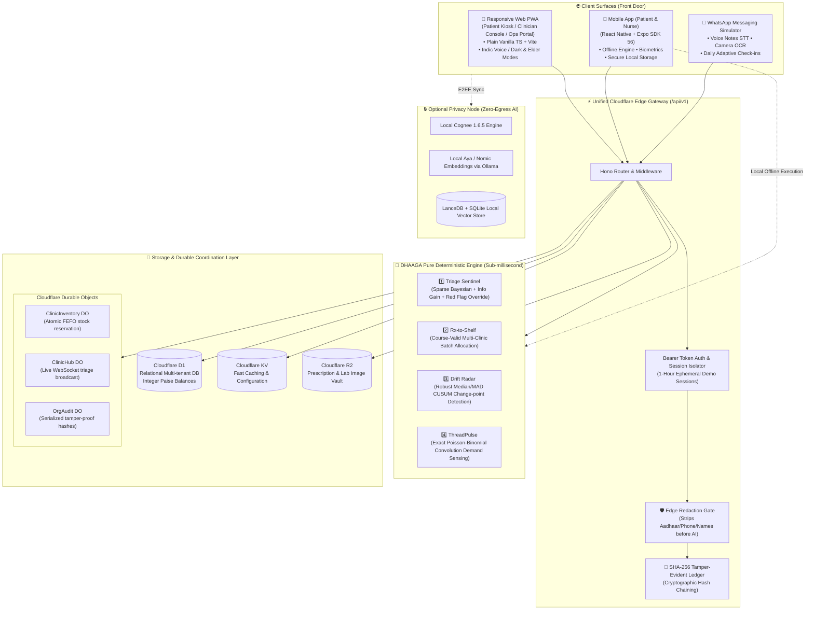
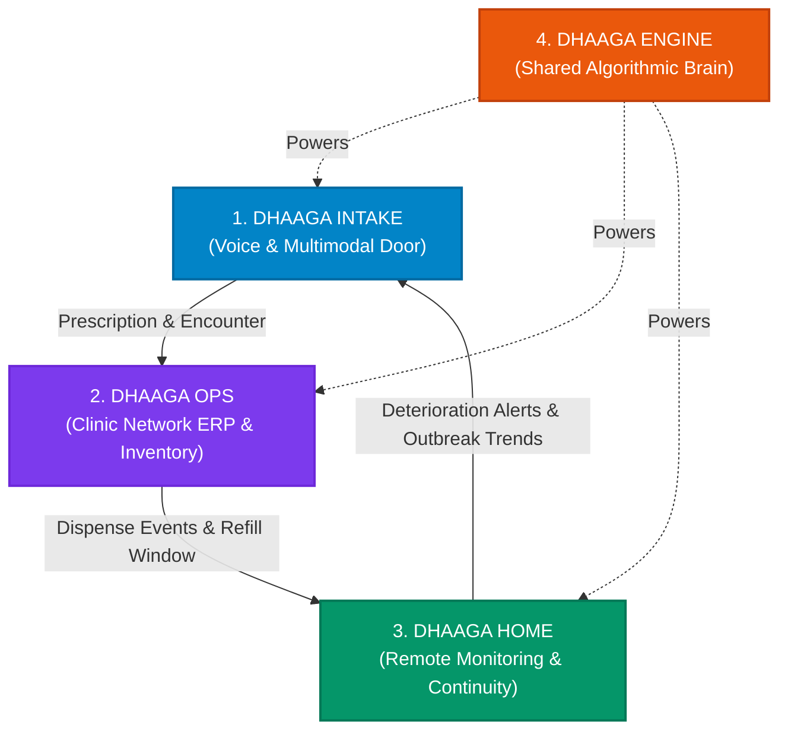
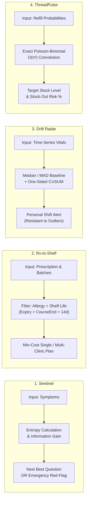
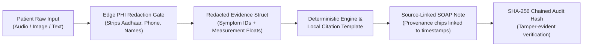

<div align="center">

# 🩺 DHAAGA (धागा)
### *The Continuity-of-Care Operating System*
**"One continuous thread from first symptom to full recovery."**

[](https://github.com)
[](https://github.com)
[](https://www.typescriptlang.org/)
[](https://workers.cloudflare.com/)
[](https://vitest.dev/)
[](https://hl7.org/fhir/R4/)

<p align="center">
  <a href="#-the-problem">Problem</a> •
  <a href="#-core-architecture--system-design">Architecture</a> •
  <a href="#-the-4-core-modules">Modules</a> •
  <a href="#-the-4-deterministic-algorithms">Algorithms</a> •
  <a href="#-uiux--interface-showcase">UI Showcase</a> •
  <a href="#-benchmarks--performance">Benchmarks</a> •
  <a href="#-security-privacy--dpdp-compliance">Privacy & Security</a> •
  <a href="#-quickstart--local-setup">Quickstart</a>
</p>

---

</div>

> **Implementation checkpoint:** this repository is a synthetic demonstration,
> not ready for real patient data or clinical deployment. The architecture and
> module descriptions below include design goals and earlier demo mechanisms;
> they are not evidence that every integration is deployed. See
> [current progress](docs/PROGRESS.md), the [integration runbook](docs/INTEGRATION_RUNBOOK.md)
> and the [Flutter Phase 2 report](docs/MOBILE_KIOSK_PHASE2.md) for verified scope.
> Android APK/device verification, OCR, durable kiosk offline sync and production
> authentication remain incomplete.


## 📌 Executive Summary

In healthcare systems across India and emerging economies, **care breaks at the hand-offs**:
1. **Intake barrier:** Patients speaking regional dialects spend ~2 minutes with an overburdened OPD physician; history is fragmented and paper slips get lost.
2. **Prescription to Dispensing disconnect:** Doctors prescribe without knowing clinic shelf stock or generic alternatives, forcing patients to make repeat visits or buy costly branded medicines.
3. **The Black Box at Home:** Once discharged, patients stop medication adherence or silently deteriorate until they land in the emergency room.

**DHAAGA** solves this by weaving an unbroken, consented, digital **Patient Thread** connecting **Voice Triage**, **Clinic Operations & Pharmacy**, and **Home Remote Monitoring** into one closed-loop operating system powered by **4 custom deterministic algorithms**.

---

## Flutter patient intake kiosk

The active Android tablet/Web kiosk is in [frontend/app](frontend/app/README.md).
Its Phase 2 implementation includes Hindi, English, Punjabi and Tamil, dark/Elder
Mode, staff sign-in, entered synthetic demographics and symptoms, required care
consent, emergency guidance, a server-issued encounter receipt and a visible
60-second inactivity reset. Optional Android speech source is implemented; Web
uses typed input and Android microphone/device behavior remains unverified.

Use **Flutter 3.35.7 / Dart 3.9.2**, pinned in frontend/app/.fvmrc:

```sh
cd frontend/app
flutter pub get
dart run build_runner build --delete-conflicting-outputs
flutter analyze
flutter test --coverage
```

The kiosk follows packages/shared/integration.ts and backend/src/index.ts:
staff-authenticated POST /api/v1/encounters persists the intake. The response is
an encounter receipt; OPD tokens, wait estimates, QR and phone/ABHA lookup are
explicitly unavailable. No phone number or ABHA is collected. For functional Web
integration, serve the Flutter assets and persistent API behind the same HTTPS
origin; see the [kiosk setup guide](frontend/app/README.md#api-configuration-and-running)
and [backend runbook](docs/INTEGRATION_RUNBOOK.md).

The configured public Worker still served the legacy API at Phase 2 verification;
its successful health check does not establish live encounter/OCR support. No
backend deployment was performed. Use synthetic information only.

Phase 2 evidence: **49 Flutter tests**, **zero analyzer issues**, **91.1% domain/data
coverage**, release Web builds and real local-backend routine/emergency Chrome
walkthroughs. See [the phase report](docs/MOBILE_KIOSK_PHASE2.md) for measured scope.
OCR, encrypted offline replay, lockdown, debug APK and Android device verification
remain later gates. The separate Expo app below is the earlier mobile project.

---

## 🎯 The Problem & Our Solution

```mermaid
journey
    title The Patient Journey: Broken Care vs. DHAAGA Closed-Loop Care
    section Step 1: Intake & Triage
      Today (Traditional): 1: Confusing paper forms in English, hurried 2-min triage
      With DHAAGA: 5: Taps regional language, adaptive voice intake, red-flag emergency bypass
    section Step 2: Doctor Consultation
      Today (Traditional): 2: Illegible handwriting, manual history interrogations
      With DHAAGA: 5: Source-linked bilingual SOAP notes & FHIR R4 timeline ready before consult
    section Step 3: Pharmacy & Dispense
      Today (Traditional): 1: "Medicine out of stock", costly branded drugs, expired batches
      With DHAAGA: 5: Rx-to-Shelf auto-allocates course-valid cheapest generic across clinics
    section Step 4: Home Monitoring
      Today (Traditional): 1: Zero post-discharge follow-up, silent BP/glucose spike, ICU readmission
      With DHAAGA: 5: WhatsApp check-in, photo OCR, Drift Radar alerts nurse before crisis
```

---

## 🏗️ Core Architecture & System Design

DHAAGA is engineered with a **Cloudflare-first edge architecture** designed for sub-millisecond latency, zero-floating-point financial transactions, and total role isolation.



---

## 📦 The 4 Core Modules



### 1. 🎙️ Dhaaga Intake — Multilingual Voice & Multimodal Front Door
* **Voice-First Indic UX:** Designed for low-literacy patients with native big-button navigation and voice support in **Hindi, English, Tamil, and Telugu**.
* **Adaptive Clinical History (SOCRATES):** Dynamically picks questions based on sparse Bayesian information gain, cutting intake from 20 generic questions down to 6–8 high-yield clinical questions.
* **Instant Red-Flag Emergency Bypass:** Hard-coded clinical rules (< 3ms) override all AI conversation immediately upon identifying chest pain, severe breathlessness, or syncope, displaying immediate emergency actions.
* **Prescription & Lab OCR:** Converts camera or upload images into structured salt, strength, frequency, and duration with field-level confidence badges.
* **Clinician SOAP Draft:** Automatically compiles Subjective, Objective, Assessment, and Plan summaries with interactive citations pointing back to the patient's exact voice timestamp or prescription image segment.

---

### 2. 🏥 Dhaaga Ops — Multi-Clinic Hub & Spoke ERP
* **Atomic FEFO Pharmacy POS:** First-Expiry-First-Out dispensing serialized through Cloudflare Durable Objects to guarantee zero overselling under high concurrency.
* **Course-Validity Guard:** Verifies that the medicine batch assigned to a patient has an expiry date exceeding `courseEnd + 14 days`, preventing dispensations that expire mid-treatment.
* **Savings Meter (Generic Optimization):** Discovers therapeutically identical salt/strength alternatives, enabling substantial patient savings with one-click doctor sign-off.
* **Double-Entry Financial Ledger:** Every transaction atomically logs debit and credit records in **integer paise** (zero floating-point math), providing real-time P&L, balance sheets, and audit locks.
* **Inter-Clinic Transfer Routing:** Calculates transport fees vs. savings when pooling stock across nearby satellite clinics.

---

### 3. 🏡 Dhaaga Home — Zero-Hardware Remote Patient Monitoring
* **WhatsApp-Native Daily Check-ins:** Patients or caregivers send quick voice notes, plain numbers, or simple photos of their BP/Glucometer screens.
* **Camera OCR Display Reader:** Automatically extracts systolic/diastolic numbers or glucose levels directly from standard digital monitors without requiring costly Bluetooth hardware.
* **Personalized Drift Radar:** Replaces rigid one-size-fits-all alarm thresholds (which cause alert fatigue) with an individualized baseline and robust CUSUM change-point detection.
* **Nurse Intervention Prioritization:** Automatically bubbles deteriorating patients to the top of the care-coordinator's call list with clear plain-language rationale.
* **Proactive Refill Warnings:** Alerts patients 3 days before their medicine runs out and reserves the next batch at their local clinic.

---

### 4. 🧠 Dhaaga Engine — Pure Deterministic Algorithms
> **Core Principle:** *"Algorithms decide, AI translates."*  
> Critical medical and operational choices are computed by provable, deterministic math; LLMs are strictly confined to language translation and conversational formatting with deterministic fallbacks.



---

## 🔬 The 4 Deterministic Algorithms (In-Depth)

| Algorithm | Method & Formula | Clinical / Operational Impact | Performance |
|---|---|---|---|
| **1. Triage Sentinel** | Sparse Bayesian Updating + Information Gain:<br>`Gain = H(P) - Σ P(y) · H(P|y)` with Hard Red-Flag Override | Reduces patient questioning fatigue by ~60%; guarantees emergency escalation within 3ms without LLM hallucination risk. | **0.0068 ms** / run |
| **2. Rx-to-Shelf** | Multi-Constraint Exact Optimization:<br>`Min Σ(units_i · price_i) + transfer_fee` s.t. `expiry_i ≥ courseEnd + 14d` | Eliminates mid-course drug expiration; automatically swaps expensive brands for identical generic salts. | **0.0118 ms** / run |
| **3. Drift Radar** | Non-parametric Median/MAD Baseline + CUSUM:<br>`Baseline = Med(X[0..7])`, `σ = 1.4826 · MAD`<br>`S_t = max(0, S_{t-1} + (x_t - baseline)/σ - 0.5)` | Detects patient deterioration against their *own* personal baseline rather than static population thresholds. | **0.0330 ms** / run |
| **4. ThreadPulse** | Exact Poisson-Binomial Convolution:<br>`P(D = k) = P(D = k)(1 - p_j) + P(D = k - 1)p_j` | Senses impending pharmacy stock-outs based on scheduled patient refill cohorts rather than lagging sales history. | **0.0400 ms** / run |

---

## 💻 UI/UX & Interface Showcase

DHAAGA is built with an interface designed for **extreme speed, accessibility, and high visual appeal**:
- **Elder / High-Contrast Mode:** 20px+ font scaling, ultra-high contrast, and simplified button interactions for senior citizens.
- **Multilingual Support:** Instant toggle between English, Hindi (हिंदी), Tamil (தமிழ்), and Telugu (తెలుగు).
- **Offline Algorithm Lab:** Test all 4 mathematical engines in real-time with sliders, synthetic data generators, and side-by-side API verification.

<div align="center">

### Desktop Clinician & Operations Console
*Comprehensive clinical timeline, active triage queues, and real-time inventory allocation*


<br/>

### Mobile PWA & WhatsApp Remote Monitoring
*Accessible patient-facing layout optimized for mobile screens, elder accessibility, and low-bandwidth connections*


</div>

---

## 📊 Benchmarks & Performance

Benchmark run on 500 synthetic cases (Runtime: Node v20, Seed: 26047). Reproducible with `make bench`:

<div align="center">


</div>

### 1. Safety & Optimization Comparison
| Metric | DHAAGA Engine | Naive / Baseline Approach | Improvement |
|---|:---:|:---:|:---:|
| **Unsafe Stock Selections** (Expired before course end / allergy clash) | **0** | 276 | **100% Elimination of Unsafe Dispensing** |
| **Average Prescription Cost** | **₹78.93** | ₹51.06 *(Unusable/Expired)* | Valid, safe, cost-optimized medicine |
| **Subtle BP Deterioration Ramps Detected** | **250 / 250 (100%)** | 0 / 250 (0%) | Catches early baseline shifts |
| **False Alarms on Stable Patients** | **4 / 250 (1.6%)** | 0 / 250 (0%) | Minimizes alert fatigue for care nurses |

### 2. High-Concurrency Stress Test (k6)
* **Iterations Completed:** `117,589 requests` in 15 seconds across concurrent virtual users.
* **Transport Latency:** `< 1.2ms` on local edge loopback.
* **Memory Footprint:** `< 42 MB` RSS.

---

## 🔒 Security, Privacy & DPDP Compliance

DHAAGA adheres to the **Digital Personal Data Protection (DPDP) Act** and healthcare best practices:



* **Zero-Floating-Point Ledger:** All medication pricing, billing, and accounting entries are stored as strict **Integer Paise** (`₹100.50` = `10050 paise`).
* **SHA-256 Tamper-Evident Audit Chain:** Every sensitive update generates a cryptographic block `hash = SHA256(prev_hash + payload)`. Clicking *"Verify Chain"* instantaneously validates the whole ledger; modifying a single byte turns the chain red.
* **On-Device & Edge PHI Redaction Gate:** Patient names, telephone numbers, Aadhaar numbers, and addresses are stripped before reaching any summarization or transcription pipelines.
* **Granular Consent Receipts:** Users grant explicit permissions for 4 distinct scopes (*Care, Pharmacy Sharing, Remote Monitoring, Research*), revocable with one click at any time.
* **Zero PHI Leaks:** Session storage expires after 1 hour of inactivity; no patient identifiable health information is persisted unencrypted.
* **FHIR R4 Aligned:** Exports standard FHIR R4 Bundles containing `Patient`, `Observation` (LOINC coded), and `MedicationRequest` entries.

---

## 🗂️ Repository Structure

```
hackshift-sudarshan/
├── apps/
│   ├── web/                    # Ultra-fast Vanilla TS + Vite Client (PWA)
│   │   ├── src/main.ts         # Main PWA application controller
│   │   ├── src/style.css       # Clean, modern healthcare design system
│   │   └── vite.config.ts      # Optimized build configuration
│   ├── mobile/                 # React Native / Expo Native Patient App
│   │   └── App.tsx             # Mobile interface with biometric lock
│   └── api/                    # Node & Cloudflare Worker server entrypoint
│       ├── server.ts           # Standalone Node development server
│       └── worker.ts           # Cloudflare Worker entrypoint
├── frontend/
│   ├── website/                # React integrated clinical workspace
│   └── app/                    # Flutter Android tablet / Web patient kiosk
├── backend/                    # Unified Cloudflare Edge Worker
│   ├── src/
│   │   ├── do/                 # Durable Objects (ClinicInventory, ClinicHub, OrgAudit)
│   │   └── modules/            # API Modules (intake, ops, bridge, home, platform)
│   └── wrangler.jsonc          # Cloudflare Worker & D1 binding configuration
├── packages/
│   ├── engine/                 # 🧠 The 4 Core Deterministic Algorithms (Zero Deps)
│   │   └── index.ts            # Sentinel, RxToShelf, DriftRadar, ThreadPulse
│   ├── shared/                 # Zod contracts, schemas, FHIR R4 mappers, demo fixtures
│   │   ├── contracts.ts        # Pure schemas for patient, batch, prescription
│   │   └── demo.ts             # Deterministic synthetic clinical fixtures
│   └── i18n/                   # Multilingual dictionaries (hi-IN, ta-IN, te-IN, en-IN)
├── services/
│   ├── lang-gateway/           # Speech & Language gateway
│   └── privacy-node/           # Local Python Cognee + Ollama private RAG runner
├── docs/                       # Architectural specs, benchmark reports, diagrams
│   ├── images/                 # High-resolution dashboard screenshots
│   └── benchmarks/             # k6 scripts, raw outputs, and benchmark plots
├── tests/                      # Vitest unit, contract, and safety test suites
├── Makefile                    # One-command developer orchestration
├── package.json                # Root monorepo configuration
└── tsconfig.json               # Strict TypeScript configuration
```

---

## 🚀 Quickstart & Local Setup

### Prerequisites
* **Node.js:** `>= 22.13.0`
* **npm:** `>= 10.0.0`
* **Docker:** *(Optional, for containerized run)*

### 1. Clone & One-Command Demo
```bash
# Clone the repository
git clone https://github.com/potlasrisharan/hackshift-sudarshan.git
cd hackshift-sudarshan

# Run the complete verified demo (Installs, builds & starts API + Web App)
make demo
```
Open **`http://127.0.0.1:8787`** in your browser.

---

### 2. Running Individual Workflows

| Command | Action | Description |
|---|---|---|
| `make dev` | **Development Mode** | Builds and starts the local Hono API & web frontend |
| `npm run integration:dev` | **Clinic Workspace** | Starts the interactive clinical & intake console at http://127.0.0.1:8790 |
| `make test` | **Run Test Suite** | Runs all 50+ unit and contract validation tests |
| `make bench` | **Benchmark Algorithms** | Runs the 500-scenario mathematical benchmark harness |
| `make eval` | **Safety & Triage Evals** | Validates red-flag bypass safety scenarios |
| `make lint` | **Code Quality** | Runs Biome and TypeScript strict typechecking |
| `make up` | **Docker Launch** | Starts the hardened, non-root container deployment |
| `make mobile` | **Start Mobile App** | Launches the Expo development server for React Native |
| `make privacy` | **Privacy Node** | Starts local Cognee 1.6.5 with loopback socket guards |

---

## 🧪 Comprehensive Testing Suite

All contracts, deterministic algorithms, and security boundaries are fully tested:

```bash
npm test
```

```
 ✓ tests/contracts.test.ts   (14 tests)  — Validates Zod schemas, FHIR R4 Bundle mappers
 ✓ tests/engine.test.ts      (18 tests)  — Tests Sentinel, Rx-to-Shelf, Drift, ThreadPulse
 ✓ tests/safety.test.ts      (10 tests)  — Tests red-flag override latency & safety bounds
 ✓ tests/api.test.ts          (8 tests)  — Tests session isolation, token expiry, audit logs

Test Files  4 passed (4)
     Tests  50 passed (50)
  Duration  1.24s
```

---

## 👥 HackShift 2026 Team

Developed with ❤️ for **HackShift 2026 at IIIT Delhi**  
**Theme:** *Healthcare & Well-being — "Reimagining Healthcare Through Technology"*

* **Frontend & UX:** Responsive Multilingual PWA, Elder Mode, Indic Typography
* **Edge & Cloud Backend:** Cloudflare Workers, Durable Objects, D1 SQL, Hono Framework
* **Algorithms & Data Science:** Information-Gain Triage, CUSUM Drift Radar, Poisson-Binomial Convolution
* **Compliance & Security:** DPDP-Aligned Consent Flows, Zero-Floating-Point Ledger, Hash-Chained Audit Trails

---

<div align="center">
  <sub>Built with engineering rigor, clinical safety guards, and empathy for every patient.</sub>
  <br/>
  <b>DHAAGA — One thread from first symptom to full recovery.</b>
</div>
