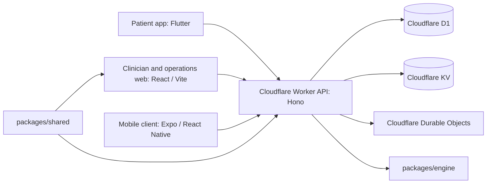

# AYUSETU

AYUSETU is a healthcare workflow project that connects patient intake, clinic operations, follow-up, and preventive health features. Its repository contains a Cloudflare Worker API, a clinician web portal, patient-facing mobile clients, and deterministic TypeScript health and operations algorithms.

> **Project status:** This repository is under active development. Some API paths use in-memory stores or synthetic demonstration records. Do not use the current application for real patient care or send real patient information to demo or research services. See [deployment notes](docs/DEPLOYMENT.md) and [the product requirements](docs/PRD.md) before making implementation or deployment decisions.

## Contents

- [Architecture](#architecture)
- [Applications and services](#applications-and-services)
- [Deterministic algorithms](#deterministic-algorithms)
- [Repository layout](#repository-layout)
- [Requirements](#requirements)
- [Run locally](#run-locally)
- [Build and verification commands](#build-and-verification-commands)
- [Cloudflare deployment](#cloudflare-deployment)
- [Configuration and secrets](#configuration-and-secrets)
- [Data, privacy, and clinical limitations](#data-privacy-and-clinical-limitations)
- [Model API](#model-api)
- [Contributing](#contributing)
- [Project documents](#project-documents)

## Architecture



Cloudflare is the deployment target for the main application. The Worker entry point is `backend/src/index.ts`; the root `wrangler.jsonc` configures the Worker, D1, KV, and Durable Object bindings. GitHub Actions builds the web app, applies D1 migrations, publishes the Pages artifact, and deploys the Worker on the configured branches when its verification jobs pass.

The repository includes two web build paths and two mobile codebases. `apps/web` is the lightweight web build used by the root build and Cloudflare Pages workflow; it uses source code from `frontend/website/src`. `frontend/website` also has a standalone Vite project and lockfile. `frontend/app` is the Flutter patient/kiosk client; `apps/mobile` is an Expo/React Native client. Check the corresponding workflow and app configuration before assuming the clients have identical feature coverage.

## Applications and services

| Path | Technology | Purpose |
|---|---|---|
| `backend/` | TypeScript, Hono, Cloudflare Workers | Shared `/api/v1` API, module routes, migrations, and Durable Objects |
| `frontend/website/` | React, Vite, Tailwind CSS | Clinician and operations portal source and standalone web project |
| `apps/web/` | Vite | Root build and Pages entry points, backed by `frontend/website/src` |
| `frontend/app/` | Flutter, Dart, Riverpod, GoRouter | Patient and kiosk application |
| `apps/mobile/` | Expo, React Native, TypeScript | Native mobile application and Android build configuration |
| `packages/engine/` | TypeScript | Deterministic triage, pharmacy, follow-up, HER, and Vitalis algorithms |
| `packages/shared/` | TypeScript, Zod | Shared contracts, models, and interoperability helpers |
| `model-api/` | Python, FastAPI, scikit-learn | Isolated research-only CBC model API; not called by the main app |

The Worker modules currently include intake, operations, bridge, home follow-up, platform, HER, and Vitalis routes. Common route prefixes include `/api/v1/intake`, `/api/v1/ops`, `/api/v1/bridge`, `/api/v1/home`, `/api/v1/her`, and `/api/v1/vitalis`. Consult each module's route file for request schemas and current behavior.

The Doctor Consultation dashboard also includes a **CBC Reports** workflow: local PDF/image extraction, reviewed measurement revisions, and explicit frozen-model research analysis through `/api/v1/cbc`. It currently requires the authenticated synthetic clinical workspace; production patient-record access remains disabled. See [the CBC runbook](docs/CBC_RUNBOOK.md) for local setup, model parity evidence, and optional private source retention.

## Deterministic algorithms

The core decision logic lives in `packages/engine`. The product rule is **algorithms decide; AI may translate or format**. Safety gates and ranking rules should remain deterministic and reviewable; language services must not make diagnoses or override safety decisions.

| Engine | Purpose |
|---|---|
| Sentinel | Selects intake questions and evaluates defined red-flag conditions |
| Rx-to-Shelf | Plans medicine allocation against stock, expiry, and prescription constraints |
| Drift Radar | Compares observations with a patient's baseline and flags defined changes |
| ThreadPulse | Estimates demand from refill and cohort probabilities |
| HER A0–A4 | Women's health safety checks, cycle patterns, evidence-based screening, wellness ranking, and trends |
| Vitalis V0–V14 | Safety checks, healthspan progress, preventive ranking, exercise progression, biomarker and behavior analysis |

Algorithm specifications and product requirements are maintained in [`docs/PRD.md`](docs/PRD.md) and supporting files in `docs/algorithms/`. Read those specifications before changing a clinical or operational rule. The algorithms provide software outputs, not a medical diagnosis or substitute for clinician judgment.

## Repository layout

```text
.
├── apps/
│   ├── mobile/                 # Expo / React Native patient application
│   └── web/                    # Vite build entry points for Pages
├── backend/
│   ├── migrations/             # D1 SQL migrations
│   └── src/
│       ├── do/                  # Cloudflare Durable Objects
│       ├── db/                  # Tenant-aware database helpers
│       └── modules/             # Intake, ops, home, HER, Vitalis, and API routes
├── docs/                       # PRD, deployment, algorithms, and project notes
├── frontend/
│   ├── app/                     # Flutter patient and kiosk app
│   └── website/                 # Clinician web portal source
├── model-api/                  # Separate research CBC model service
├── packages/
│   ├── engine/                  # Deterministic algorithms
│   └── shared/                  # Shared types and schemas
├── tests/                       # Root Vitest and browser tests
├── .github/workflows/ci.yml    # Verification and Cloudflare deployment
├── package.json                # Root build and developer commands
└── wrangler.jsonc              # Main Cloudflare Worker configuration
```

## Requirements

- Node.js `>=22.13` and npm `>=10` for the root TypeScript project and Cloudflare tooling.
- Flutter and Dart versions compatible with `frontend/app/pubspec.yaml` to work on the Flutter client.
- Android Studio/Android SDK for Android builds; Xcode is required for iOS builds on macOS.
- Python 3.12 for the isolated `model-api` service.
- Cloudflare account and GitHub Actions secrets for deployment. Local development does not require Cloudflare credentials.

## Run locally

Clone the project and install the root dependencies:

```bash
git clone https://github.com/potlasrisharan/hackshift-sudarshan.git
cd hackshift-sudarshan
npm ci
```

### Web and API integration demo

Install the standalone website dependencies before building the integration Vite project:

```bash
npm ci --prefix frontend/website --ignore-scripts
npm run integration:dev
```

The integration server starts at `http://127.0.0.1:8790` (the exact local ports are printed by the command). The root `build` command installs the website package from its lockfile before compiling. This lets Cloudflare Pages use a root `npm ci` followed by `npm run build` without requiring a separate dashboard build command. For the root Pages build and bundled API build, run:

```bash
npm run build
```

### Flutter patient app

```bash
cd frontend/app
flutter pub get
flutter run -d chrome
```

Use `flutter devices` to select a connected Android or iOS device. Flutter tests can be run from this directory with `flutter test`.

### Expo / React Native app

```bash
cd apps/mobile
npm ci
npm run start
```

For local Android native generation, use `npm run prebuild` and `npm run android` on a machine with the Android toolchain installed.

## Build and verification commands

| Command | Purpose |
|---|---|
| `npm run typecheck` | TypeScript checks for root and backend projects |
| `npm run check:frontend` | TypeScript check for the Pages frontend configuration |
| `npm run build` | Typecheck, build the Pages web assets, and bundle the Node API demo |
| `npm run build:worker` | Wrangler Worker dry-run build |
| `npm run integration:build` | Build the standalone website integration app |
| `npm run integration:worker:build` | Build the integration Worker with Wrangler |
| `npm test` | Run the root Vitest suite |
| `npm run eval` | Run the safety-focused evaluation tests |
| `npm run e2e` | Run the Playwright browser suite |
| `npm run lint` | Run Biome checks on configured source paths |
| `cd apps/mobile && npm run typecheck` | Check Expo / React Native TypeScript |
| `cd frontend/app && flutter analyze` | Analyze Flutter/Dart sources |
| `cd frontend/app && flutter test` | Run Flutter tests |

GitHub Actions runs the broader verification pipeline, including builds, browser/integration checks, a secret scan, and a container smoke check. A green local build alone does not confirm successful Cloudflare deployment; inspect the Actions run and deployed application separately.

## Cloudflare deployment

The repository workflow uses Wrangler to apply D1 migrations, publish `dist/web` to the Pages project `ayuseva`, and deploy the Worker described by `wrangler.jsonc`. It is triggered by pushes to `main` (and the configured feature branch) after verification jobs pass.

Required GitHub Actions secrets:

- `CLOUDFLARE_API_TOKEN` — token with the permissions needed for the configured Pages, Worker, and D1 deployment actions.
- `CLOUDFLARE_ACCOUNT_ID` — Cloudflare account identifier.

Do not place these values in source files, commit them, or expose them to frontend code. Configure them in the repository's Actions secrets. For local Worker development, use Wrangler's local bindings and ignored `.dev.vars` files; see [Cloudflare's Wrangler documentation](https://developers.cloudflare.com/workers/wrangler/).

Useful deployment commands:

```bash
npm run build:worker
npx wrangler d1 migrations apply dhaaga-db --local --config wrangler.jsonc
npx wrangler pages deploy dist/web --project-name=ayuseva --branch=main
npx wrangler deploy
```

Production migrations and deployment are external side effects. Review the target account, project, branch, migration status, and CI results before running commands manually. See [`docs/DEPLOYMENT.md`](docs/DEPLOYMENT.md) and [`docs/TROUBLESHOOTING.md`](docs/TROUBLESHOOTING.md) for current operational guidance; update those documents if deployment behavior changes.

## Configuration and secrets

- `wrangler.jsonc` contains non-secret Worker configuration and Cloudflare resource identifiers.
- `.dev.vars` and `.env*` are ignored by Git. Keep local credentials there and use `.env.example` for variable names only.
- Optional AI or speech providers must be configured as server-side Worker secrets. Never embed provider keys in Flutter, React, or static web bundles.
- The build should work from a clean root `npm ci`; Tailwind and Autoprefixer used by the Pages Vite config are declared in the root package manifest for Cloudflare's root-only install.

## Data, privacy, and clinical limitations

- Treat all current flows as development or demonstration software unless a specific feature has been reviewed and approved for clinical use.
- Do not enter real patient identifiers or clinical records into synthetic demo flows, screenshots, issue reports, model requests, or third-party services.
- The main Worker is configured for Cloudflare D1, KV, and Durable Objects, but route-level persistence varies. Some HER, Vitalis, intake, and demo flows still include in-memory stores or seeded data; process memory is not durable or suitable for multi-instance production storage.
- The isolated CBC model is research-only. Its output is neither a diagnosis nor a calibrated disease probability and must not guide patient care.
- Before handling real health data, complete security, access-control, consent, retention, audit, privacy, clinical-safety, backup, and disaster-recovery reviews. Do not claim regulatory compliance based only on this README or a technical design.
- Financial amounts should use integer paise. Tenant-scoped data access and input validation should follow the repository's architecture rules in `AGENTS.md` and `docs/PRD.md`.

## Model API

`model-api/` is an optional, separate Python service containing a frozen CBC research model. The primary application does not call it. It has its own dependencies, API docs, limitations, and deployment notes in [`model-api/README.md`](model-api/README.md). Do not send personally identifiable or patient-level information to this prototype.

## Contributing

1. Read [`AGENTS.md`](AGENTS.md), [`docs/PRD.md`](docs/PRD.md), and relevant architecture decisions before making changes.
2. Keep a change focused and preserve unrelated working-tree changes.
3. Update schemas, migrations, docs, and clients together when a shared API contract changes.
4. Use deterministic rules for clinical or operational decisions; do not let generated text override a safety rule.
5. Run the checks relevant to your change and report any checks that could not run.
6. Keep secrets, generated build outputs, release packages, and real patient data out of commits.
7. Use clear, scoped commit messages that describe the effect, for example `fix(web): resolve Pages Tailwind dependency` or `docs: refresh repository setup guide`.

## Project documents

- [`docs/PRD.md`](docs/PRD.md) — product requirements and specifications; primary product source of truth.
- [`docs/DEPLOYMENT.md`](docs/DEPLOYMENT.md) — deployment status and operational constraints.
- [`docs/DECISIONS.md`](docs/DECISIONS.md) — architecture decisions.
- [`docs/algorithms/`](docs/algorithms/) — algorithm specifications and supporting notes.
- [`docs/TROUBLESHOOTING.md`](docs/TROUBLESHOOTING.md) — known setup and deployment troubleshooting.
- [`docs/PROGRESS.md`](docs/PROGRESS.md) — project progress notes.

---

Built for HackShift 2026. AYUSETU is a software prototype for improving continuity across healthcare workflows; it is not a medical device or a substitute for professional care.
