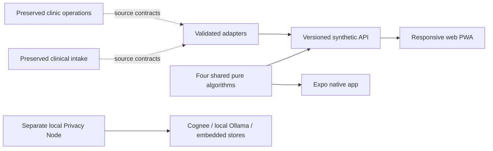

# Dhaaga

**Care that stays connected.** A synthetic continuity-of-care integration demo for
HackShift, preserving AarogyaNidhi/ClinicOS and MediKiosk as unmodified originals.

The user's complete implementation request is in [prompts.md](prompts.md), pushed
before implementation. **Its full Definition of Done is not yet satisfied.** This
repository distinguishes working mechanisms, simulated data, unverified code and
external blockers; it is not ready for real patient data or clinical deployment.

## Run locally

Node >=20.19, npm and Git:

```bash
make demo
```

Open http://127.0.0.1:8787, grant local demo-processing consent, and explore Today,
Patient Thread, Medicine access, Monitoring, Wellbeing, Cycle, Privacy and the
Algorithm Lab. Optional speech is disabled by default. `make up` runs the Docker
container. `make mobile` starts the separate Expo development-client project.



## Verified scope

- Validated synthetic record adapters with provenance and FHIR R4 aligned export.
- Four deterministic mechanisms: Bayesian question selection, exact course-valid
  stock allocation, robust BP CUSUM and exact refill-demand convolution.
- Consent/revocation, isolated expiring sessions, source-cited local summaries,
  bounded ingestion, red-flag handling and tamper-evident session audit verification.
- Responsive web, four draft interface dictionaries, large text/dark mode,
  offline algorithm screen, explicit degraded/unavailable integration status.
- Native Expo screens sharing the engine, secure check-in, approximate reminder
  and biometric-lock source; see current build/device limitations.
- Standalone Cognee local remember/recall verified with local models and a Python
  egress guard. This is not yet connected to the website/mobile record.

## Commands and evidence

`make test`, `make lint`, `make build`, `make bench`, `make eval`,
`make verify-untouched`, `npm run e2e`. Benchmarks and limitations are in
[docs/benchmarks](docs/benchmarks/RESULTS.md). API specification: `/openapi.json`,
entry guidance: `/docs`. Existing originals are in `hackshift/projects/`;
`baseline-untouched` protects their publishable source.

[Progress](docs/PROGRESS.md) · [Discovery](docs/DISCOVERY.md) ·
[Design](docs/INTEGRATION_DESIGN.md) · [Traceability](docs/REQUIREMENTS.md) ·
[Pillars](docs/PILLARS.md) · [Deployment](docs/DEPLOYMENT.md) ·
[Safety/security](docs/COMPLIANCE.md) · [Demo](docs/DEMO_SCRIPT.md) ·
[Final checkpoint report](docs/FINAL_REPORT.md)

Unknown-provenance local databases, historic authenticated-token test scripts,
secrets and duplicate import folders are excluded from publication. No live
upstream database is accessed by the synthetic demonstration.
