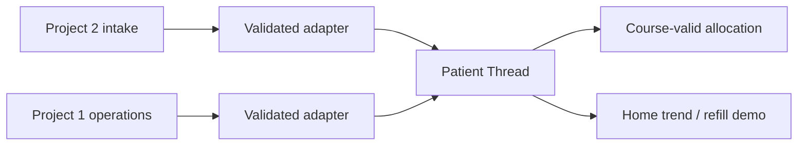

# Discovery — 17 October 2026

The Git root initially held only README.md. Two duplicated imports were present;
canonical originals are `hackshift/projects/project-1/` and `project-2/`.
`prompts.md` was pushed first in e302141. Original publishable sources were then
committed and tagged `baseline-untouched`. No source modifications are allowed.
See [SOURCE_INVENTORY.md](SOURCE_INVENTORY.md) for extracted routes, tables,
functions, triggers, UI entrypoints and a source manifest.

## Project 1: AarogyaNidhi / ClinicOS

Purpose: hub-and-spoke hospital and clinic operations. Users include super-admin,
hospital and clinic administrators, clinic staff, doctors and pharmacy/cashier
roles. Its business workflows cover inventory, POS, procurement, accounts, wards,
attendance, equipment, subscriptions and notifications.

| Area | Source evidence |
|---|---|
| Stack | React 18.3, TypeScript 5.5 range, Vite 5.4 range; installed lock resolves Vite 5.4.21 |
| Entry | src/main.tsx → App.tsx → HashRouter; HospitalContext owns session/profile |
| Auth | src/lib/authService.ts calls Supabase password sign-in/sign-up/reset/session APIs |
| Data | src/lib/dataService.ts: generic CRUD, RPC, function invocation, realtime subscriptions |
| Storage | Supabase Postgres migrations, policies, accounting triggers and RPCs |
| External | Supabase, Razorpay checkout/webhook functions; WhatsApp gateway; email; analytics |
| Env | VITE_SUPABASE_URL, VITE_SUPABASE_ANON_KEY; other function secrets require separate setup |
| Run | npm ci; npm run dev (default Vite 5173); npm run build; npm test |
| UI | Role-selected views in App.tsx rather than a URL for every feature; landing/about/contact/privacy/careers/support routes |
| Models | hospitals, clinics, profiles, inventory, sales, purchase orders/items, suppliers/prices, financial ledger, receipts, wards/admissions; full inventory extracted separately |
| Events/jobs | Supabase realtime subscriptions; SQL triggers for ledger/notifications; WhatsApp scripts |

Verified in `/tmp/dhaaga-upstream-1` so originals remain untouched: locked install,
TypeScript/Vite build, and 12 Jest tests with synthetic test environment. Initial
tests fail without SUPABASE_URL/ANON_KEY and webhook secret. Correct wrapper env:
`SUPABASE_URL=https://mock.supabase.co SUPABASE_ANON_KEY=synthetic-anon RAZORPAY_WEBHOOK_SECRET=synthetic-test-secret npm test -- --runInBand`.
These tests largely assert mocked HTTP replies; they do not validate live RLS,
concurrent database transactions or webhook implementation. npm reported 66
vulnerabilities: 1 low, 14 moderate, 49 high, 2 critical. Original dependencies
were not changed. Main JS output is about 2.62 MB before compression.

## Project 2: MediKiosk

Purpose: multilingual case-taking, triage, document extraction and clinician
handoff, with patient, doctor, AYUSH, emergency and admin portals. A Flutter kiosk
and HTML/JS portal suite share FastAPI and Vercel API entrypoints.

| Area | Source evidence |
|---|---|
| Stack | FastAPI, Pydantic v2, httpx, Supabase Python; Flutter/Dart kiosk; vanilla HTML/JS; Vercel JS functions |
| Entry | backend/app/main.py imports routers for intake, ABDM, insurance, documents, doctor, AI and patient |
| Run | python -m uvicorn backend.app.main:app --port 8000; python -m pytest backend/tests/test_clinical_gateway.py; Vercel dev for JS functions |
| Ports | Backend 8000; portal 3000; static server does not execute Vercel API functions |
| Env | SUPABASE_URL, SUPABASE_KEY, SARVAM_API_KEY; config resolves backend/.env |
| Models | Gender, SystemType, TriagePriority, patient/ABHA profile, chat messages and red-flag response, OCR medication/lab extraction, queue items, SOAP |
| Tables used in backend | patients, encounters, soap_notes, abdm_transactions |
| Auth | Several backend endpoints have no route-level auth dependency; browser creates a Supabase client with public anon config |
| Clinical engine | Regex red flags and a fixed question list, not the adaptive system claimed in README |
| Risk | Emergency response offers “Continue Routine Intake”; fallback inference returns osteoarthritis/AYUSH formulations regardless of arbitrary complaint |
| Other risks | Broad CORS with credentials; queue reads unscoped encounters; SOAP lookup can fall back to a different demo encounter |

Isolated Python dependencies installed. Test collection reaches app import but
fails with `SupabaseException: supabase_key is required`. We did not use public
client configuration to access the pre-existing hosted database. A populated
local SQLite file contains eight patients; provenance is unknown, so it is not
published or used. Live backend tests and Flutter device tests remain unverified.
The root npm build script merely prints “Build OK”; that is not a real portal test.

## Connection map

| Entity/workflow | Project 2 output | Project 1 input | New boundary |
|---|---|---|---|
| Patient | full_name/gender/age/ID | operational patient ID/context | Validated Patient adapter; birth date must be confirmed, never inferred from age |
| Prescription | extracted medication/approved prescription | medicine SKU/stock/POS | Exact composition and course-valid stock planner |
| Observation | intake/lab measurements | clinic records | FHIR-aligned, source-labelled chronological read model |
| Encounter | intake and SOAP | consult/billing | Planned explicit identity mapping; no automatic fuzzy merge |
| Home follow-up | absent | limited operational follow-up | Local trend engine and refill-demand engine |

The shipped adapters use synthetic contracts, not live connectors. Duplicate
identities are not automatically merged. Source conflicts are retained for review.
SSO, token exchange, event/outbox persistence and live cross-project dispensing
are pending and are not hidden behind green status indicators.

## Feasibility verification

Official documentation was checked on 17 October 2026; account quotas and model
availability still require credentials and runtime tests.

- **Sarvam:** official pricing lists ₹100 initial credits, STT ₹30/hour,
  translation ₹20/10K characters and Bulbul v3 ₹30/10K characters. Its current
  TTS REST contract uses `text`, `language_code`, model and speaker, returning
  base64 `audios`. Supported languages differ by API: do not equate all STT,
  translation and TTS languages. Live performance, commercial audio rights and
  account-specific quotas are unverified. [Pricing](https://docs.sarvam.ai/api/getting-started/pricing),
  [rate limits](https://docs.sarvam.ai/api/getting-started/ratelimits),
  [TTS](https://docs.sarvam.ai/api-reference/text-to-speech/convert).
- **Cognee:** installed 1.6.5 in isolated Python 3.11. Its local guide requires
  both generation and embedding providers to be local, and telemetry disabled.
  Current local stores include SQLite metadata, LanceDB vectors and Ladybug
  graphs; older references use Kuzu. Never assume Python runs inside Expo.
  The optional runner uses the installed local Aya model and Ollama nomic
  embeddings. Working-set memory and actual extraction/recall evidence are
  recorded separately; no universal minimum-RAM claim is made.
  [Local setup](https://docs.cognee.ai/guides/local-setup),
  [official example](https://github.com/topoteretes/cognee/blob/dev/examples/guides/local_ollama_example.py).
- **Expo:** SDK 56 supports Node 20.19+; newer SDKs require Node 22.13+.
  Native health/BLE modules require prebuild/custom native builds; Expo Go is
  insufficient. [SDK matrix](https://docs.expo.dev/versions/latest/),
  [development builds](https://docs.expo.dev/develop/development-builds/introduction/).
- **Health Connect:** granular record permissions and availability checks are
  needed; revoke must stop access. Android 14 integrates it as a framework
  component; older compatible devices use the separate app. Read-history and
  background features need separate approval. Google Fit support ends in 2026;
  new mobile integrations should target Health Connect.
  [Get started](https://developer.android.com/health-and-fitness/health-connect/get-started),
  [migration](https://developer.android.com/health-and-fitness/health-connect/migration/fit).
- **HealthKit:** iOS native entitlements, purpose strings and explicit type-level
  permission are required. Store release/signing cannot be established by a
  TypeScript mock. [HealthKit](https://developer.apple.com/documentation/healthkit).
- **BLE:** standard GATT devices can expose measurements, but vendor watches
  generally sync through vendor apps/aggregators. Android scan/connect
  permission and background lifecycle must be handled. Browser Bluetooth is
  limited to supported browsers, secure origins and user gestures.
  [BLE library](https://dotintent.github.io/react-native-ble-plx/),
  [Web Bluetooth](https://developer.chrome.com/docs/capabilities/bluetooth).
- **Alarms:** Android exact-alarm access is not granted by default for many new
  installs. The current mobile notification is deliberately approximate. iOS
  Critical Alerts require a special Apple entitlement; time-sensitive/local
  notifications cannot promise bypass of mute/Focus or exact delivery.
  [Android](https://developer.android.com/about/versions/14/changes/schedule-exact-alarms),
  [Apple entitlement](https://developer.apple.com/documentation/bundleresources/entitlements/com.apple.developer.usernotifications.critical-alerts).

## External blockers

AWS CLI exists but `aws sts get-caller-identity` reports no credentials. Sarvam
has no configured key. Live Supabase instances and ABDM credentials have not
been authorized/configured for this integration. No public URL, certified FHIR
profile, app-store entitlement or real wearable test is claimed.

### Later verification results

With SUPABASE_URL pointing to a local dummy endpoint and a synthetic nonempty key,
MediKiosk's root and red-flag tests both pass (two selected, five deselected).
No hosted patient data was accessed. Cognee's local remember/recall proof also
completed; see benchmarks/privacy-node.json. cfn-lint validates the AWS template.
