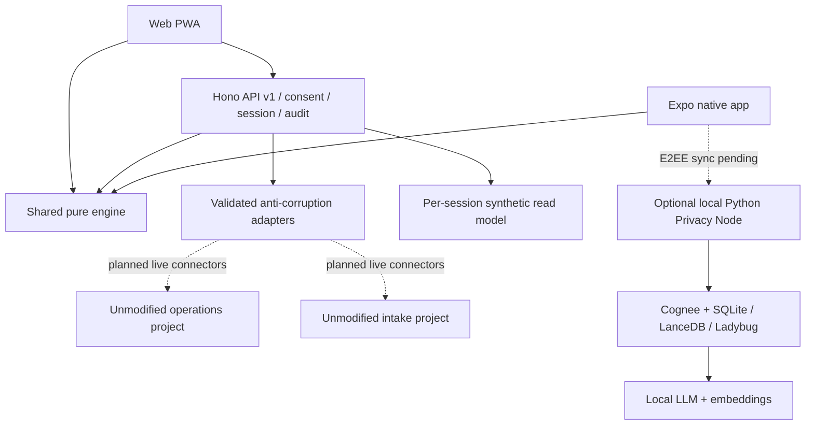
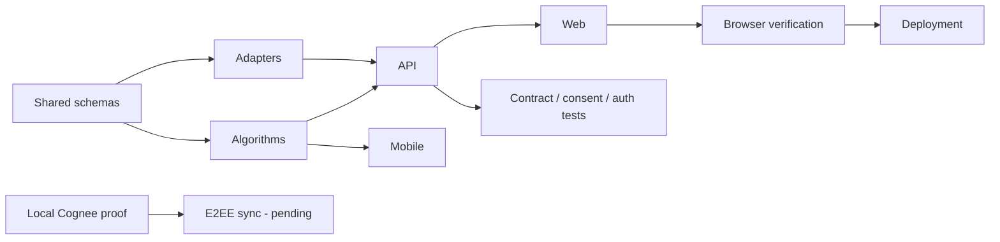

# Dhaaga — Care that stays connected

## Concepts considered (1 low, 5 high)

| Concept | Innovation | 24h feasibility | Judge impact | Story | Elegance | Risk to originals |
|---|---:|---:|---:|---:|---:|---|
| One menu linking two apps | 1 | 5 | 2 | 2 | 2 | Low |
| Patient Thread + prescription-to-stock + home loop | 5 | 3 | 5 | 5 | 4 | Low through adapters |
| Headless intelligence API only | 3 | 4 | 3 | 2 | 4 | Low |

Choose the Patient Thread. A shared record, course-valid stock plan and home trend
have a coherent care journey. Side-by-side links alone do not create continuity;
a headless API hides the patient experience. Live integrations remain a distinct
milestone: the current slice proves this journey on explicit synthetic contracts.



## Contracts and provenance

`packages/shared/contracts.ts` defines patient, observations, prescriptions and
inventory batches. Patient birth date must be confirmed rather than inferred from
age. Observation codes use LOINC and units use UCUM; source and measurement time
are required. The adapter retains distinct sources; it does not collapse conflicting
measurements. FHIR export is a collection, not an ABDM document Bundle. Consent,
MedicationRequest, Encounter and profile validation are still pending extensions.

Every protected API route requires an opaque expiring demo token. Record read,
export, ingestion and algorithm execution additionally require current local
processing consent. There are no staff, doctor or admin production credentials.
The session's patient is bound by the server; clients cannot submit arbitrary
patient IDs or assign upstream provenance. This is demo isolation, not upstream SSO.

```mermaid
sequenceDiagram
  participant U as Patient (demo)
  participant W as Web shell
  participant A as API
  participant E as Engine
  U->>W: Begin synthetic session and consent
  W->>A: Create token; grant local purpose
  A-->>W: Merged Project 1 + Project 2 observation fixtures
  U->>W: Open medicine access
  W->>E: Project 2 prescription + Project 1 stock fixture
  E-->>W: Course-valid cheapest feasible plan + rejection reasons
  U->>W: View home monitoring
  W->>E: Synthetic BP time series
  E-->>W: Baseline, CUSUM trace and uncertainty
  U->>W: Export / inspect / revoke
  W->>A: FHIR collection; audit verification; revoke consent
  A-->>W: Further record operations denied
```

## Planned live integration boundary

Live identity mapping must use explicit `(tenant,source,source_id)` mappings and
human-reviewed candidate matching. A name match never authorizes record access.
Token exchange must preserve each upstream's roles without impersonation or
accepting user-editable metadata. Introduce a durable outbox with versioned
`intake.completed`, `prescription.signed`, `dispense.completed`, `observation.recorded`
and `consent.revoked` events. Each event needs tenant, patient mapping, source ID,
event ID, schema version, occurredAt and purpose. Consumers dedupe event IDs,
retry bounded failures and move rejected events to a PHI-minimised dead-letter
queue. These services are not implemented in the in-memory demo.

Graceful degradation: local engine and cached shell remain available on synthetic
fixtures; failed server actions show errors rather than silently using a different
patient's data. A missing provider is shown as unavailable, never “connected”.

## Dependency plan and four-person boundaries



| Owner | Boundary | Integration gate |
|---|---|---|
| A | packages/engine + algorithm tests | Validated pure inputs; seeded benchmarks |
| B | apps/web + tokens/i18n | Same API contract; visible offline/degraded states |
| C | apps/mobile + privacy node + language gateway | No raw PHI egress; native permission tests |
| D | infra + docs + identity/event services | Untouched check; credentials; deploy/rollback |

Risks: upstream safety defects, absent live credentials, unknown data provenance,
clinical calibration, native entitlement restrictions, local-model RAM and
outdated mobile transitive packages. Mitigations: no real patient data; disabled
connectors; explicit capability status; isolated fixtures; tests and audited
versions; retain a one-command local synthetic demo.
