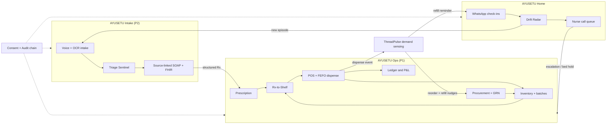
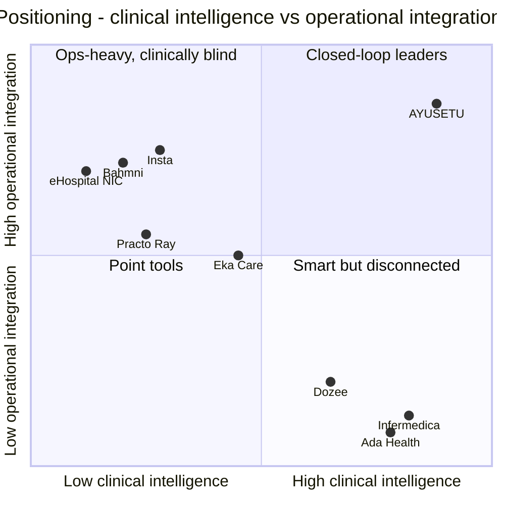

# AYUSETU (आयुसेतु) — The Continuity-of-Care Operating System
### *One thread from first symptom to full recovery.*

**HackShift 2026 · IIIT Delhi · Theme: Healthcare & Well-being — "Reimagining Healthcare Through Technology"**
**Document type:** Agent-ready PRD + technical blueprint · **Version:** 1.0 · **Date written:** 17 Oct 2026

> **How to use this file.** Paste it whole (or Part-by-Part) into your coding agent. Section **F5** contains the master rules file and per-task prompts. Everything marked **(E)** is an estimate; everything marked **(verify)** must be re-checked before you quote it to judges. Sources are in **I3**.

---

## 0. READ THIS FIRST — three flags that can change your plan

1. **Originality / "fresh code" rule.** Both READMEs describe *already-built* repositories (AarogyaNidhi — MIT licensed per its badge; MediKiosk — an SIH 2026 repo). Most 24-hour hackathons require that code be written during the event. **Ask the organisers today** whether pre-existing code is allowed. This PRD assumes the safe path: we use both READMEs as *requirement specs and inspiration* and write **all code fresh** in the 24 hours. If the rules allow reuse, you may lift UI/SQL ideas — but cite them openly.
2. **README claims we do not inherit.** Both READMEs contain marketing claims ("Security audit PASSED 100% RLS", "TLS 1.3 + AES-256 encrypted PHI", "Sarvam-105B / Saaras v3 / Vision 3B", "ABDM M1–M3 integration"). We do **not** repeat any of these as facts about *our* product. Our claims are limited to what we build and test in 24 hours.
3. **Free-tier and privacy reality (verify before deployment):** use Cloudflare as the primary platform for frontend, API/backend, data services, and static assets. Third-party AI, speech, OCR, and messaging services may have separate quotas, retention terms, or charges; use synthetic data only in the hackathon demo, never real patient-identifiable health information. Verify current Cloudflare limits and all provider pricing before making cost claims. WhatsApp delivery may incur charges and must remain optional behind a provider/configuration flag.

---

## Final implementation decision — Cloudflare-first deployment

**Deployment preference:** Cloudflare for the web frontend, API/backend, static assets, and edge orchestration wherever technically appropriate. Use Cloudflare Pages or Workers for delivery and API routes; choose D1 for relational demo data where its constraints fit, R2 for uploaded documents, Queues for asynchronous jobs, KV for non-sensitive cache/configuration, and Durable Objects only where serialized coordination is required. Keep secrets in environment bindings, enforce tenant authorization in every server-side handler, and never expose privileged credentials to clients. If a feature requires a service not available on Cloudflare, document it as an optional external adapter rather than silently introducing another mandatory host. Confirm current free-tier limits before the event; do not promise that every workload is permanently free. For the 24-hour demo, use synthetic patient data and clearly label mocked integrations (ABHA/ABDM, OTP, payment, and WhatsApp) as simulated unless live credentials and end-to-end tests are available.

## PART 0 — DUAL-PROJECT ANALYSIS & INTEGRATION

### 0.0 Top-3 concept directions considered → chosen

| # | Concept | One-liner | Verdict |
|---|---|---|---|
| **A** | "Two modules, one login" | Voice intake app + hospital ERP side by side | ❌ Rejected — stapled together; judges see two apps |
| **B** | **Closed-loop Continuity-of-Care OS** | Intake → clinic operations → home monitoring → back to intake, joined by one *Patient Thread* and 4 custom algorithms | ✅ **CHOSEN** |
| **C** | "Intelligence API only" | Rx-to-Shelf + demand forecasting as a headless service | ❌ Strong tech, weak human story, ignores the remote-monitoring theme |
| D | Syndromic surveillance | Kiosk intake → outbreak detection → stock pre-positioning | ⚠️ Folded into B as a *feature* (Outbreak Radar inside ThreadPulse) |

### 0.1 Umbrella problem statement (the hackathon's own)

> *"Healthcare & Well-being — develop technology-driven solutions to improve healthcare **accessibility, affordability and quality of care**, such as **AI-assisted guidance, remote monitoring and digital health management**."*

**Hard requirements derived (PS-1…PS-7):**

| ID | Requirement | How judged (predicted) |
|---|---|---|
| PS-1 | Improves **accessibility** (language, distance, literacy, bandwidth) | Voice-first Indic UX, WhatsApp-native, offline kiosk |
| PS-2 | Improves **affordability** | Generic-substitution Savings Meter, stock-out/waste reduction, no-hardware RPM |
| PS-3 | Improves **quality of care** | Red-flag triage, expiry-safe dispensing, deterioration detection |
| PS-4 | **AI-assisted guidance** | Adaptive voice triage + patient guidance + clinician SOAP |
| PS-5 | **Remote monitoring** | Home module (Drift Radar) — *this is the gap neither README covers* |
| PS-6 | **Digital health management** | Patient Thread, ABHA-aligned FHIR records, ops ERP |
| PS-7 | Responsible AI + privacy | Consent receipts, PHI redaction gate, human-in-the-loop |

### 0.2 Project 1 — AarogyaNidhi (ClinicOS) analysis

* **Goal:** hub-and-spoke hospital business ERP: one HQ + unlimited satellite clinics, with transactional integrity enforced in Postgres (RLS, triggers, RPCs).
* **Users:** super-admin, hospital admin, clinic admin, doctor, cashier/pharmacist.
* **Core problem:** fragmentation and revenue leakage in multi-clinic operations — silo software, oversold stock, expiry waste, manual accounting.
* **Hard requirements (P1-HR) — stated in its README:**

| ID | Requirement (from README) | Our 24-h scope |
|---|---|---|
| P1-HR1 | Multi-tenant hub-and-spoke (hospital → clinics) with role isolation (RLS) | **Full** (RLS + 5 roles) |
| P1-HR2 | POS: pharmacy / OPD fee billing, FEFO batch deduction, loose units, split payments, GST invoice | **Full** pharmacy POS + FEFO + loose units; OPD fee; PDF invoice |
| P1-HR3 | Inventory: batch/expiry radar, inter-clinic transfer, bulk import | **Full** radar + transfer; CSV import |
| P1-HR4 | IPD ward & bed matrix, admission → discharge billing | **Lite** (bed grid, admit/discharge, room-charge sum) |
| P1-HR5 | Procurement: PO → GRN → stock sync, GST split | **Lite** (PO, GRN, auto stock-in) |
| P1-HR6 | Financial suite: double-entry ledger auto-posted by DB triggers, P&L, balance sheet, audit lock | **Lite-Plus** (triggers → ledger → live P&L + balance sheet; audit-lock flag) |
| P1-HR7 | Staff roster/attendance; equipment registry | **Roadmap** (stub screens only) |
| P1-HR8 | WhatsApp receipts, audit logs | **Full** (WhatsApp + hash-chained audit log) |

* **Implicit judging expectations:** data integrity under concurrency; role isolation demo; real accounting outputs; polish.
* **Interpretation note:** README is vague on "biometric clock-in" and "CA PDF export" — we mark them roadmap and say so openly.

### 0.3 Project 2 — MediKiosk (AI patient case-taking) analysis

* **Goal:** autonomous multimodal clinical intake: natural voice conversation in Indic languages, paper-document digitisation, red-flag detection, physician-ready SOAP + FHIR before the consult. SIH 2026 PS #26047, Ministry of Ayush / AIIA.
* **Users:** patients/attendants, OPD physicians, triage nurses, AYUSH vaidyas, hospital admins.
* **Core problem:** ~2-minute consultations (README cites a BMJ Open 2017 67-country study — **verify** before quoting), illegible paper records, multilingual history-taking.
* **Hard requirements (P2-HR):**

| ID | Requirement (from README) | Our 24-h scope |
|---|---|---|
| P2-HR1 | Multilingual voice intake (Indic STT/TTS) | **Full:** Hindi, English, Punjabi, Tamil (+Hinglish code-mix) |
| P2-HR2 | Adaptive clinical questioning (SOCRATES-style) | **Full** via Triage Sentinel (our algorithm #1) |
| P2-HR3 | Red-flag detection → emergency bypass | **Full** (hard-rule override layer) |
| P2-HR4 | Vision OCR of prescriptions/lab reports | **Full** (prescription), lab report **Lite** |
| P2-HR5 | Physician SOAP note, source-linked | **Full** |
| P2-HR6 | ABHA login/consent (DPDP-style), FHIR R4 bundle export | **Lite:** ABHA *format-validated* mock + FHIR R4 bundle + consent receipt. **No live ABDM claim.** |
| P2-HR7 | Doctor / triage / patient / admin portals | **Full** doctor + patient; triage inside doctor console; admin = Ops |
| P2-HR8 | AYUSH Dashavidha Pariksha, NAMASTE/TM-2 coding | **Optional P2 "Ayush lens"** (radar chart only) |
| P2-HR9 | NHCX / PM-JAY pre-check | **Roadmap** |

### 0.4 Connections and integration concepts

**Shared users:** the same doctor sees the kiosk's SOAP and dispenses from the POS; the same pharmacist; the same patient across both.
**Shared data:** *patient identity, prescriptions, medicines, visits.* P2 **produces** structured prescriptions and symptom data; P1 **consumes** them as dispensing, stock, billing and ledger events.
**Complementary blind spots:** P2 ends when the patient walks into the consult room (nothing happens operationally); P1 starts at the billing counter (blind to clinical need, urgency, or what happens after discharge). **Neither watches the patient at home** — which is exactly the theme's "remote monitoring".
**Common underlying problem:** *continuity of care breaks at every hand-off* — language → clinician → pharmacy → home → next visit.

| Criterion (1–5) | A: Side-by-side | **B: Closed-loop OS** | C: Intelligence API | D: Surveillance |
|---|---|---|---|---|
| Innovation | 1 | **5** | 3 | 4 |
| Feasibility in 24 h | 5 | **4** | 4 | 3 |
| Judge impact | 2 | **5** | 3 | 4 |
| Story strength | 2 | **5** | 2 | 4 |
| Technical elegance | 2 | **5** | 4 | 3 |
| Covers PS "remote monitoring" | ✗ | **✓** | ✗ | ✗ |
| **Total** | 12 | **29** | 16 | 18 |

### 0.5 Unified product vision — "1 + 1 = 3"

**AYUSETU** (आयुसेतु) is a continuity-of-care OS. Every patient gets a **Patient Thread** — a single, consented, FHIR-aligned timeline — that three modules weave:

| Module | Name | Origin | Role |
|---|---|---|---|
| Front door | **AYUSETU Intake** | Project 2 | Voice triage + document OCR + SOAP |
| Engine room | **AYUSETU Ops** | Project 1 | Multi-clinic POS, inventory, wards, procurement, ledger |
| Back door (**new**) | **AYUSETU Home** | Theme gap | Remote monitoring + refill/continuity via WhatsApp |
| Brain | **AYUSETU Engine** | Bridge | 4 custom algorithms + AI gateway + consent/audit |

**Why 1+1=3** — capabilities that exist *only* because both are connected:

1. **Prescription becomes stock plan** (Rx-to-Shelf): intake OCR/SOAP → exact-salt match → expiry-safe, cheapest, in-stock plan across clinics.
2. **Intake feeds procurement** (ThreadPulse): patient-level refill hazards, not last year's sales, decide what each clinic orders.
3. **Stock feeds clinical safety:** triage and doctor see "drug unavailable here → equivalent at Clinic-East, 6 km".
4. **Home signals feed operations:** a deteriorating patient triggers a bed hold or a nurse call-slot.
5. **Syndromic Outbreak Radar:** symptom clusters at kiosks pre-position ORS/antipyretics before stock-outs.
6. **Financial truth:** every dispensed strip → COGS → ledger → live P&L, so "affordability" is measured, not claimed.

### 0.6 Requirement traceability

| Requirement | Satisfied by | Module | Demo proof |
|---|---|---|---|
| PS-1 Accessibility | Voice-first, 4 languages, WhatsApp voice-notes, offline kiosk | Intake/Home | Hindi voice intake in airplane mode |
| PS-2 Affordability | Savings Meter, ThreadPulse, expiry-aware FEFO | Ops/Bridge | ₹ saved panel; stock-out sim |
| PS-3 Quality | Sentinel red-flags, safe-dispense checks | Intake/Bridge | Chest-pain bypass < 3 s |
| PS-4 AI guidance | Adaptive triage, plain-language guidance | Intake/Home | Live conversation |
| PS-5 Remote monitoring | Drift Radar + WhatsApp BP-photo OCR | Home | Live chart with change-point |
| PS-6 Digital health mgmt | Patient Thread, FHIR bundle, ledger | All | FHIR download validates |
| PS-7 Responsible AI | Consent receipts, redaction gate, HITL, audit chain | Platform | Redaction diff view |
| P1-HR1…8 | Ops module (see 0.2 table) | Ops | Role-switch RLS demo |
| P2-HR1…9 | Intake module (see 0.3 table) | Intake | Kiosk demo |

### 0.7 Integration story (the narrative to pitch)

> **Sunita, 52, Bhiwani** (diabetes + hypertension) speaks Hindi to a kiosk at *AYUSETU Clinic North*. Sentinel asks 9 adaptive questions, spots no red flags, and photographs her old prescription. Dr. Arjun gets a source-linked SOAP in 10 seconds. His prescription flows to **Rx-to-Shelf**, which finds metformin 500 in stock at North with a batch that outlives her 30-day course, suggests a ₹-cheaper generic *with her doctor's consent*, and reserves it. The POS dispenses via FEFO; the ledger posts revenue and COGS. At home, **AYUSETU Home** WhatsApps her daily: she sends a voice note and a photo of her BP monitor. **Drift Radar** notices her baseline shifting *for her*, and puts her at the top of nurse Farzana's call list. Day 26, **ThreadPulse** predicts her refill and warns procurement that North will run short for 14 similar patients. The loop closes — and her next intake already knows her history.

### 0.8 Independent-demo plan (dual-submission safety)

| Entry point | Feature flag / URL | What judges of that project see | Minutes |
|---|---|---|---|
| **P2 standalone** | `/kiosk` + `/clinician` with `MODE=INTAKE_ONLY` | Voice intake, Sentinel, OCR, SOAP, FHIR, consent, offline mode | 4 |
| **P1 standalone** | `/ops` with `MODE=OPS_ONLY` | Role-switch RLS, POS+FEFO, concurrency test, transfer, PO→GRN, live P&L | 4 |
| **Theme standalone** | `/home` + `/nurse` with `MODE=HOME_ONLY` | WhatsApp sim, Drift Radar vs fixed thresholds | 3 |
| **Combined** | default | The Sunita story with the three "bridge" moments | 6 |

Implementation: one env var `AYUSETU_MODE` hides nav items; all three modes ship from one build. Seed script supports `--profile intake|ops|home|all`.

---

## PART A — PRODUCT & MARKET

### A1. Executive summary

* **Name:** **AYUSETU (आयुसेतु)** *(alternates: "Setu-Care", "Sutra Health")*
* **Tagline:** *One thread from first symptom to full recovery.*
* **Pitch (paragraph):** In India, care breaks at every hand-off: a patient who speaks Bhojpuri gets two minutes with a doctor; the prescription is illegible; the pharmacy is out of stock; the patient stops taking the drug on day 12 and returns sicker. AYUSETU stitches those hand-offs into one consented Patient Thread: voice-first AI intake in the patient's language, an operations OS that turns prescriptions into expiry-safe, cost-optimised dispensing across a clinic network, and a WhatsApp-native home module that watches each patient against *their own* baseline and tells nurses whom to call first. Four original algorithms — not a chatbot wrapper — make the loop auditable and safe.
* **30-second elevator:** *"Health systems fail at hand-offs, not at hospitals. AYUSETU is the thread: Hindi voice intake that triages safely, a clinic OS that turns the prescription into the right medicine at the lowest safe cost, and WhatsApp monitoring that spots a patient getting worse before they know it — all on one consented record. We built four custom algorithms so every AI decision is explainable, and we run on ₹-level cost per patient."*

### A2. Problem deep-dive

**Surface problems:** long queues, short consults, paper records, stock-outs.
**Root causes:**

1. **Information is lost at each hand-off** (patient→doctor→pharmacy→home); no system owns the *thread*.
2. **Operations are blind to clinical demand** (stock is bought from sales history, not from who is about to need what).
3. **Monitoring generates noise, not decisions** — alert fatigue; a population threshold treats a COPD patient with baseline SpO₂ 93 like a healthy adult.
4. **Language and literacy barriers** exclude exactly the high-burden population.

**Evidence (cited; verify before quoting):**

| Fact | Source |
|---|---|
| ABDM: **95.99 crore** ABHA IDs created (31 Jul 2026); **>105 crore** health records linked; **5.33 lakh** facilities and **9.85 lakh** professionals registered; **~2.72 lakh** facilities on ABDM-enabled software (10 Jul 2026) | [Kashmir Life/Lok Sabha reply](https://kashmirlife.net/over-1-12-crore-abha-accounts-created-in-jammu-kashmir-parliament-told-446964/) · [GKToday](https://www.gktoday.in/ayushman-bharat-digital-mission-crosses-93-95-crore-health-accounts/) · [PIB Jul 2026](https://static.pib.gov.in/WriteReadData/specificdocs/documents/2026/jul/doc202676912801.pdf) |
| Official doctor-population ratio **1:811** — but it counts AYUSH doctors and applies an 80% availability factor to both; the "WHO 1:1000 norm" is **not** an official WHO standard | [ETV Bharat/Lok Sabha](https://www.etvbharat.com/en/!health/doctor-population-ratio-in-india-is-estimated-to-be-1-811-centre-enn25080105862) · [Superkalam summary of WHO clarification](https://superkalam.com/current-affairs/25-11-2025/widely-quoted-who-norm-of-1-doctor-per-1-000-people-is-not-official-pg7-36abe080-c192-493f-8c60-172fd0a001e7) |
| Adherence to long-term therapy in chronic illness averages **~50%** even in affluent countries (WHO, as cited) | [US Pharmacist](https://www.uspharmacist.com/article/electronic-tools-to-measure-and-enhance-medication-adherence) |
| Out-of-pocket spending dominates NCD care; one rural Tamil Nadu sample: diabetes ≈ **₹1,435/month**, hypertension ≈ **₹313/month** (small study — illustrative only) | [IMSEAR](https://imsear.searo.who.int/items/d551c827-3fd5-4a6c-934a-15be5f1285f8) · [Down To Earth/MAMTA](https://www.downtoearth.org.in/environment/india-is-20-yrs-behind-in-managing-noncommunicable-diseases-shows-survey-42374) |
| **Honest caveat on RPM:** the BEAT-HF RCT found telemonitoring + coaching did **not** reduce heart-failure readmissions (it improved QoL) — so we pitch *workload-focused triage*, not mortality miracles | [2 Minute Medicine](https://www.2minutemedicine.com/remote-patient-monitoring-did-not-reduce-heart-failure-readmissions-the-beat-hf-trial) |
| Dozee: contactless RPM/EWS in 380+ hospitals (company-reported, older press); claim of ~144 lives saved per 100 beds is **company/consultancy-reported** | [Entrepreneur India](https://india.entrepreneur.com/news-and-trends/dozee-raises-6-million-in-funding/449774) |

**Real-world example (illustrative persona-level, not a statistic):** a diabetic patient skips refills because the nearest pharmacy is out of metformin 500 and the brand she knows costs 3× the generic; four weeks later she is admitted with DKA. No system saw the gap forming.

### A3. Personas & journeys

**P-1 Sunita Devi, 52 — patient (diabetes + hypertension), Hindi, low literacy.**
*Goals:* get the right medicine at an affordable price; not travel twice. *Pain:* can't describe symptoms in English forms; forgets doses; sees different doctors. *Workaround:* hands a plastic bag of old slips to whoever she meets; asks her son on WhatsApp. *Day-in-life:* wakes 5:30, checks nothing (no device), takes tablets by memory, sends son a voice note if dizzy.

**P-2 Dr Arjun Mehta, 34 — OPD physician, district hospital, ~90 patients/day.**
*Goals:* spend consult time examining, not interrogating. *Pain:* repeated history-taking, illegible slips, no idea whether the drug he prescribes is in stock. *Workaround:* shorthand scribbles; asks patient to "check the pharmacy and come back".

**P-3 Meena Joshi, 41 — pharmacy & operations manager, 6-clinic private chain, NCR.**
*Goals:* no stock-outs, no expiry write-offs, clean books. *Pain:* Excel + three software; transfers via WhatsApp groups; month-end ledger panic. *Workaround:* over-order "to be safe" → expiry waste.

**P-4 Farzana Khan, 29 — care coordinator nurse, 120 post-discharge patients.**
*Goals:* catch the 5 who are getting worse among 120. *Pain:* fixed-threshold alerts (BP>140) fire daily for hypertensives; she ignores them. *Workaround:* calls whoever she remembers.

*System-level stakeholder:* District/State Health Officer or insurer care-manager — wants aggregate continuity rate, avoidable-admission signals, and outbreak early warning.

**Journey map (Sunita):**

| Stage | Today | With AYUSETU | Touchpoint | Emotion |
|---|---|---|---|---|
| Arrive | Queue, paper form in English | Taps "हिंदी", speaks | Kiosk | Anxious → at ease |
| Intake | Doctor asks 2-min history | 9 adaptive questions, red-flag safe | Voice AI | Heard |
| Consult | Illegible old slip | OCR'd history, SOAP ready | Doctor console | Respected |
| Dispense | "Out of stock" | Plan with equivalent + cheaper generic | POS | Relieved |
| Home | Forgets, no follow-up | WhatsApp voice check-in, refill nudge | WhatsApp | Supported |
| Relapse | Arrives in ER | Nurse calls on day 9 | Phone | Safe |

### A4. Market research (TAM / SAM / SOM)

**Reported market sizes (definitions differ — treat as range):**

| Segment | 2025 | Forecast | CAGR | Source |
|---|---|---|---|---|
| India digital health | **$7.63B** | $23.3B (2030) | 25.0% | [MarketsandMarkets](https://www.marketsandmarkets.com/Market-Reports/geography/digital-health-market/India) |
| India digital health (broader scope) | $16.1B (2024) | $76.0B (2033) | 18.81% | [IMARC](https://imarcgroup.com/India-Digital-Health-Market) |
| India IoT medical devices | $2.43B | $7.35B (2030) | 24.7% | [MarketsandMarkets](https://www.marketsandmarkets.com/Market-Reports/geography/iot-medical-device-market/India) |
| India clinical analytics | $1.50B | $4.23B (2030) | 23.1% | [MarketsandMarkets](https://www.marketsandmarkets.com/Market-Reports/geography/clinical-analytics-market/india) |

> ⚠️ The same MarketsandMarkets "AI in healthcare India" page shows two conflicting figures ($791M vs $21.6M for 2025) — **we do not use it**.

**Our calculation (bottom-up, all inputs E):**

* **TAM (India, our product category):** use the $7.6–16B digital-health range as the *context* TAM; we do not claim all of it.
* **SAM = facilities × ARPA.** Target facilities: private clinics, nursing homes, small/mid hospitals and clinic chains that run pharmacy + follow-up. Assume **1,00,000** such facilities **(E; ABDM lists 5.33 lakh registered facilities of all types)** × blended ARPA **₹60,000/yr (E)** = **₹6,000 crore/yr ≈ $0.68B (E, at ~₹88/$)**.
* **SOM (36 months):** 2% of target facilities = **2,000 facilities × ₹60,000 = ₹12 crore ARR ≈ $1.4M (E)**.
* **Why ARPA ₹60k is credible:** Practo Ray lists ₹999–1,499/month; Insta by Practo from ~₹25,000/month; Eka Care plans ₹16,999–₹1,00,000/year + GST (vendor-blog figures, **verify**). We sit above basic EMR because we include pharmacy-ops + RPM.
* **Drivers:** ABDM scale (ABHA 96 cr), DPDP Rules notified 14 Nov 2025 (core duties apply after 18 months ≈ **May 2027**), rising chronic burden, WhatsApp penetration.
* **Risks:** ABDM certification takes months (M1–M3 sandbox→production typically 4–9 months + WASA by a CERT-In-empanelled auditor), price pressure from incumbents, clinical-validation burden, regulatory classification of AI triage (CDSCO — see B6).

### A5. Competitor analysis

| # | Competitor | Segment | What they do | Pricing (verify) | Strength | Weakness / gap |
|---|---|---|---|---|---|---|
| 1 | **Practo Ray / Insta** | Clinic/hospital software | Appointments, EMR, billing, marketplace leads | Ray ~₹999–1,499/mo; Insta from ~₹25,000/mo | Brand, patient discovery | No voice-first Indic intake; no home loop; ecosystem lock-in |
| 2 | **Eka Care** | EMR + PHR + ABDM | ABDM-ready EMR, teleconsult, multi-clinic | ₹16,999–₹1,00,000/yr + GST (vendor blog) | ABDM depth, doctor adoption | Operations/inventory depth limited; WhatsApp costs extra |
| 3 | **HealthPlix** | EMR | Smart OPD EMR | Not verified | Fast prescribing UX | Same: not an ops + home loop |
| 4 | **eHospital (NIC)** | Govt HMIS | Free HMS for govt hospitals | Free | Govt footprint | Dated UX; no AI, no RPM |
| 5 | **Bahmni** (open source) | HMIS | ABDM-compliant open HMIS | Free (self-host) | Open, ABDM M1–M3 done | Heavy to deploy; no AI triage / home loop |
| 6 | **Infermedica** | Triage API | Symptom checker/triage engine | On request | 100+ orgs, 30 countries, 20+ languages | Not Indic-voice-native; no ops/stock; B2B API only |
| 7 | **Ada Health** | Consumer symptom checker | Consumer triage | Not verified | UX | No Indian workflow; no pharmacy loop |
| 8 | **Dozee** | RPM / EWS | Contactless vitals, early warning (hospital beds) | Hardware + SaaS (n/a) | FDA 510(k) device, 380+ hospitals (older press) | Hospital-bed hardware; not for ambulatory/home chronic; no intake/pharmacy |
| 9 | **eSanjeevani** (govt) | Telemedicine | National teleconsult | Free | Scale | Not an ops/RPM thread *(not researched this pass)* |

**Feature matrix (✓ strong · ◐ partial · ✗ none; based on public marketing — verify):**

| Feature | Practo | Eka | Bahmni | Infermedica | Dozee | **AYUSETU** |
|---|---|---|---|---|---|---|
| Indic voice-first intake | ✗ | ◐ | ✗ | ◐ | ✗ | **✓** |
| Adaptive, auditable triage math | ✗ | ✗ | ✗ | ✓ | ✗ | **✓** |
| Multi-clinic pharmacy ops + FEFO | ◐ | ◐ | ◐ | ✗ | ✗ | **✓** |
| Prescription → stock plan | ✗ | ✗ | ✗ | ✗ | ✗ | **✓** |
| Patient-level demand sensing | ✗ | ✗ | ✗ | ✗ | ✗ | **✓** |
| Home monitoring, no device needed | ✗ | ◐ | ✗ | ✗ | ✗ | **✓** |
| Personal-baseline deterioration | ✗ | ✗ | ✗ | ✗ | ◐ | **✓** |
| ABDM/FHIR-aligned | ✓ | ✓ | ✓ | ◐ | ◐ | ◐ (aligned, not certified) |
| Live ledger/P&L from operations | ◐ | ✗ | ◐ | ✗ | ✗ | **✓** |

### A6. Market gap analysis

| Gap | Why it exists | AYUSETU exploit |
|---|---|---|
| G1: Triage tools don't know stock/capacity | Sold to payers/telehealth, not clinics | Sentinel output includes "where can this be treated/dispensed now" |
| G2: ERPs don't know clinical need | Built for billing | ThreadPulse uses patient-level need |
| G3: RPM = hardware + population thresholds | Device-centric business | WhatsApp + photo OCR + personal baselines |
| G4: **Isolated problems** — intake, pharmacy ops and monitoring are bought by *different* budget owners | Vendor silos | One thread, one consent, shared identity |
| G5: Indic voice UX is demo-grade | Hard NLU | Constrained-ontology NLU + deterministic engine; LLM only for language |

### A7. Value proposition & moat

* **UVP:** *"The only system where the prescription decides the stock plan, the stock plan decides the purchase order, and the patient at home decides the nurse's call list."*
* **Moats:** (1) **Data moat** — longitudinal patient-drug-clinic graph (refill hazards, baselines). (2) **Algorithm moat** — calibrated, tuned-on-feedback models (nurse feedback loop improves Drift Radar thresholds per patient). (3) **Integration moat** — replacing 3 vendors; switching cost. (4) **Network effect** — more clinics → better cross-clinic stock pooling and referral. (5) **Compliance moat** — consent + audit chain built-in before DPDP duties apply.

### A8. Business model & GTM

| Tier | Price (E) | Includes | Buyer |
|---|---|---|---|
| **Free** | ₹0 | 1 clinic, ≤150 intakes/mo, POS+inventory | Solo clinics (acquisition) |
| **Clinic** | ₹4,999/mo | 600 voice intakes, WhatsApp, Rx-to-Shelf, 100 Home patients | Single clinic/pharmacy |
| **Network** | ₹14,999/mo + ₹2,500/spoke | Multi-clinic, ThreadPulse, ledger suite | Chains, nursing homes |
| **Enterprise/Govt** | custom | On-prem/VPC, ABDM certification support | Hospitals, state programmes |
| **Outcome add-on** | ₹99–199/patient/mo | Home monitoring for chronic cohorts | Insurers/TPAs, employers |

**Unit economics sketch (all E):**

| Variable cost per voice intake | ₹ |
|---|---|
| STT ~3 min @ ₹30/hr ([Sarvam pricing](https://docs.sarvam.ai/api/pricing)) | 1.50 |
| TTS: pre-rendered static question audio | ≈0 (else ≈₹2.9 @ ₹30/10k chars) |
| LLM (~5k in / 1k out @ ₹4/₹16 per 1M) | ≈0.04 |
| OCR 1 page @ ₹0.5 | 0.50 |
| WhatsApp utility ×3 @ ~₹0.145 | 0.44 |
| **Total** | **≈ ₹2.5 – 5.4** |

At 600 intakes/mo → ₹1.5k–3.2k variable + ~₹0.5k infra ⇒ at the ₹4,999 Clinic tier, **gross margin ≈ 25% worst case (₹5.4/intake) and ≈ 60% with cached TTS (₹2.5/intake).** *Insight for judges:* AI cost, not cloud cost, is the margin lever — hence pre-rendered audio, on-device STT fallback, and deterministic algorithms that don't call an LLM.

**GTM:** (1) Free-tier pilot with 5–10 clinics from the hackathon network and IIIT-D alumni; (2) pharmacies as wedge ("stop stock-outs") → upsell intake/Home; (3) partner with a TPA for post-discharge cohorts; (4) apply for ABDM sandbox to move from "aligned" to "certified".

**Roadmap:** **3 months** — pilot in 5 clinics, ABDM sandbox M1/M2, clinical advisor panel, retrospective validation of Sentinel on de-identified pilot data. **6 months** — WASA audit, ABDM M1–M3 sandbox exit, Flutter kiosk, DPDP consent-manager integration. **12 months** — CDSCO software-as-medical-device assessment for triage (as advised by regulatory counsel), insurer pilots, Android lite app, 50 clinics.

### A9. Success metrics

* **North Star:** **Continuity Rate** = % of chronic patients whose *treatment gap* (days without drug supply on hand) ≤ 3 days over 90 days.
* **KPIs:** triage under-triage rate (target < 1% on synthetic benchmark; track real later); questions-to-decision; stock-out events/clinic/month; expiry write-off ₹; nurse alerts per true deterioration; consult-prep time saved; intake completion rate by language.
* **Clinical/impact:** avoidable ER visits (pilot), generic-switch savings ₹/patient/month.
* **Measured live in demo:** Sentinel vs fixed-questionnaire (questions, safety); Rx-to-Shelf vs naive match (accuracy, waste); Drift Radar vs fixed thresholds (detection delay, false alarms); ThreadPulse vs moving average (service level, stock-outs). Numbers from **our simulations** — labelled as such (see Part C).

---

PART B — PRODUCT SPECIFICATION
Legend: P0 = flawless in demo; P1 = build if on schedule; P2 = roadmap/stub. Each feature has acceptance criteria (AC) and edge cases (EC); the user story is in the feature name.
B1. Feature list
Module I — AYUSETU Intake (Project 2)
ID
Feature
P
AC
EC
I-01
Language picker + voice-first welcome (low-literacy patient taps language, hears greeting)
P0
4 languages (hi, en, pa, ta), native-script big buttons; pre-rendered greeting under 1 s; one tap
Unknown language: Hindi + STT auto-detect; muted: captions always shown
I-02
DPDP-style consent receipt
P0
Audio + visual notice; 4 granular purposes (care, pharmacy share, home monitoring, research-anonymised); receipt ID + QR; revoke link; hash-chained
Refusal: anonymous mode (no storage beyond session); under 18: guardian-consent flag
I-03
Identity capture
P0
ABHA 14-digit format validation (mock verify), mobile OTP (mock), or QR token; creates/links patient
Duplicate: fuzzy match + staff confirm; no ABHA: temp ID
I-04
Adaptive voice triage (Sentinel)
P0
Chief complaint, NLU, Sentinel picks next question; median 8 or fewer questions; spoken + shown; yes/no/unsure by voice or big buttons
Low STT confidence: re-ask once then buttons; contradictions flagged; patient says stop: graceful finish
I-05
Red-flag emergency bypass
P0
Any red-flag yes: full-screen EMERGENCY within 3 s + staff alert (WebSocket); questioning stops; patient cannot dismiss; logged
False positive: staff downgrade with reason, audited; offline: local siren + instruction
I-06
Prescription/report photo OCR
P0
Camera/upload gives meds (name, strength, frequency, duration) with per-field confidence; low confidence highlighted for confirmation
Blurry: retake; unreadable: needs staff; non-prescription: rejected politely
I-07
Source-linked SOAP draft
P0
English S/O/A/P; each line has a source chip (utterance timestamp / OCR box / answer); Assessment = Sentinel differential hints with uncertainty + disclaimer; doctor edits and signs
LLM down: deterministic template; uncited AI line blocked
I-08
Clinician queue by urgency
P0
Sorted by tier then wait; live; badge colour + icon
Ties FIFO; patient left: abandoned state
I-09
FHIR R4 Bundle export
P1
Patient, Encounter, Condition (ICD-10 hint), Observation, MedicationRequest, Consent, DocumentReference; passes HAPI profile check in CI
Missing code: text-only CodeableConcept; no ABHA: ayusetu-temp identifier
I-10
Offline kiosk mode
P1
Installable PWA; Sentinel-lite + button UI offline; IndexedDB queue syncs with idempotency keys
Clock skew: server time authoritative; storage full: warn
I-11
Ayush lens (Prakriti/Agni quick screen)
P2
10-question screen, radar chart, display only
Not validated; labelled informational
I-12
Patient-readable visit summary
P1
Plain language, translated, voice-playable; links to Rx-to-Shelf plan
Grade-5 sentence-length check
Module II — AYUSETU Ops (Project 1)
ID
Feature
P
AC
EC
O-01
Multi-tenant org/clinic + roles
P0
OWNER, HOSPITAL_ADMIN, CLINIC_ADMIN, DOCTOR, CASHIER (+NURSE, PATIENT); isolation enforced in data layer; cross-tenant test returns 0 rows
Missing claims: deny; clinic switch audited
O-02
Pharmacy POS (pack + loose)
P0
Search/scan cart; pack/strip/loose pricing; % or flat discount; split payment (cash/UPI/card/credit); GST split; PDF invoice under 2 s
Qty above stock: blocked with Rx-to-Shelf alternatives; refund: reversing entries
O-03
FEFO atomic deduction
P0
ClinicInventory Durable Object serialises writes; 50 concurrent sales of the last 10 units never oversell
Expired batch excluded; batch expiring before course end: warn
O-04
Inventory + expiry radar
P0
Colour + icon bands (expired / 30 / 60 / 90 days); value-at-risk in rupees; per-clinic filter
Zero-stock reorder-flagged items shown
O-05
Inter-clinic transfer
P0
Request, approve, in-transit, received; two-sided ledger; batch identity preserved
Partial receive; transit loss: write-off entry
O-06
CSV bulk import
P1
Upload, column mapper, validation report, commit
Duplicate batch: merge/skip prompt
O-07
Procurement PO to GRN
P1
Draft, Issued, Partially received, Fulfilled; GRN receives batches; stock auto-in; CGST/SGST/IGST split
Over-receive tolerance flag; price spike highlighted
O-08
Ward & bed grid (lite)
P1
Wards to beds; available/occupied/maintenance; admit/discharge; room charges on discharge bill
Double admit blocked; unpaid dues warning
O-09
Double-entry ledger
P0
Sales, COGS, GRN, expenses post balanced journals; debit = credit checked
Back-dated entry into locked period rejected
O-10
Live P&L + balance sheet + audit lock
P0
Statement RPC for any date range; Assets = Liabilities + Equity assertion shown; lock date blocks writes
Integer paise only
O-11
Hash-chained audit log
P0
Each sensitive write appends prev_hash and hash = SHA256(prev + payload); Verify chain button; tamper demo flips a byte and turns red
Concurrent writers serialised by OrgAudit DO
O-12
WhatsApp receipt
P1
Template + PDF link after sale; delivery status stored
No opt-in: skip; failure: retry 3 times then log
O-13/14
Staff roster; equipment registry
P2
Stub screens, seeded
Roadmap
Module III — Bridge (AYUSETU Engine)
ID
Feature
P
AC
EC
B-01
Rx-to-Shelf resolver
P0
Structured/OCR lines to canonical (salt, strength, form) with confidence; unresolved/low-margin to pharmacist; ranked plans with reasons
Combination drugs; brand not in catalogue: salt-only; allergy: hard block
B-02
Course-validity allocation
P0
Batch must expire at least course end + 14 days, else next batch/flag
Loose-unit courses; ongoing Rx: 30-day horizon
B-03
Cross-clinic fulfilment plan
P0
Per-line source clinic, transfer ETA, total rupees; reserve holds stock 24 h
Reservation expiry; partial availability: split plan
B-04
Savings Meter (generic substitution)
P0
Same salt+strength+form alternatives by price; doctor-consent toggle; rupees saved per month
NTI drugs excluded from auto-suggest
B-05
ThreadPulse forecast
P0
Per-SKU/clinic stock-out probability within lead time; reorder suggestion with reason; patients-at-risk count
New SKU: moving-average fallback with wide band
B-06
Refill nudges
P1
WhatsApp D-3 with Hindi voice note; one-tap reserve
Quiet hours 21:00–08:00; opt-out respected
B-07
Outbreak Radar
P1
EWMA/CUSUM on daily syndrome counts per clinic; alert + stock pre-position (ORS, antipyretic)
Low counts: exact Poisson; holiday flag
B-08
Escalation to capacity link
P1
High-risk alert gives request-bed action with live availability
No beds: nearest clinic
Module IV — AYUSETU Home (remote monitoring)
ID
Feature
P
AC
EC
H-01
WhatsApp onboarding by QR
P0
Discharge QR, WhatsApp deep link, consent re-check, welcome voice note
Feature phone: IVR/SMS roadmap
H-02
Daily check-in (voice/text/photo)
P0
2–3 questions; accepts voice notes (STT), numbers, photo of BP/glucose/SpO2 display (OCR + confirm)
Unreadable: type; implausible value: re-confirm
H-03
In-app WhatsApp simulator
P0
Same webhook contract as the bot; real/sim toggle
—
H-04
Drift Radar
P0
Per-patient streaming BOCPD; alert with explanation (e.g. SBP +17 vs your 3-week baseline, 4 readings); /api/v1/home/patients/{id}/drift
Under 7 readings: learning baseline
H-05
Nurse call queue
P0
Ranked list, expected-value score, call-minute budget slider, one-tap outcome feedback
Small budget: shows dropped and why
H-06
Silence-as-signal
P1
Missed check-ins raise priority via dropout model
Planned travel flag
H-07
Plain-language guidance
P1
Template-first advice + red-flag rules; LLM only rephrases
Never advises dose changes; always includes call-112 clause
H-08
Care-plan & refill tie-in
P1
Today's tasks, next refill, next visit
—
Module V — Shared platform
ID
Feature
P
AC
EC
S-01
Auth + RBAC + MFA
P0
JWT with role + clinic claims; optional TOTP for admin
Token expiry mid-sale: silent refresh
S-02
PHI redaction gate
P0
Every outbound LLM/OCR request passes redact(); Redaction diff view; deny-by-default on failure
Hinglish names; Aadhaar/ABHA/phone/PIN regexes
S-03
AI gateway with fallback chain
P0
Primary, fallback, deterministic; circuit breaker; per-provider budget caps
All fail: templates + banner
S-04
Patient Thread timeline
P0
FHIR-aligned events (intake, Rx, dispense, vitals, alerts) with provenance chips
Consent revoked: hidden + tombstoned
S-05
Notification hub
P1
WebSocket per clinic; toast + sound
Reconnect with last sequence
S-06
Observability dashboard
P1
Sentry, metrics, /healthz, Algorithm Lab
—
S-07
Demo mode & seed loader
P0
AYUSETU_MODE, POST /admin/seed?profile=; scripted Sunita patient
—
B2. Differentiator features (13)
#
Feature
Why it exists only because both projects connect
Why judges care
1
One-photo pharmacy: WhatsApp a prescription photo, get an expiry-safe cheapest plan across the network in under 10 s
OCR x inventory/FEFO
Visible, tangible
2
Course-validity dispensing
Prescription duration x batch expiry
Real safety gap
3
Triage that knows the shelf (available at East, 6 km)
Sentinel x live stock
Closes the go-back loop
4
Patient-level demand sensing
Home/dispense events x procurement
Stock-out prevention simulation
5
Device-less RPM: BP/glucose photo OCR + voice notes
Vision x messaging
Rs 0 hardware, India-realistic
6
Personal-baseline alerts + silence-as-signal
Home x Sentinel evidence
Cuts alert fatigue
7
Learning call queue (bandit from nurse feedback)
Home x Ops staffing
Self-improving
8
Outbreak Radar to stock pre-position
Kiosk symptoms x inventory
Public-health angle
9
Tamper-evident everything with a Verify button
Audit needs of both
Memorable live security moment
10
Redaction diff view
PHI-safe AI across both
Responsible-AI proof, not a slide
11
Algorithm Lab
All four algorithms
Technical depth made visible
12
Offline Sentinel-lite (TS port, golden-vector tested)
Offline requirement x rigour
Works in airplane mode on stage
13
Honest-AI banners (confidence bands, why this question, I might be wrong)
PS-7
Trust signal
B3. AI feature map
Rule: algorithms decide, AI translates. Models do speech, vision, language and summarisation only, always with a deterministic fallback.
#
Where
Primary then fallback
Prompt strategy
Latency
Guardrails
PHI
Evaluation
A1
STT (answers, voice notes)
Sarvam Saaras, then Workers AI whisper / Groq whisper-large-v3, then browser Web Speech
Language hint; Hindi/English code-mix
2 s
Confidence under 0.6: re-ask once, then buttons
Audio not stored; transcript redacted before any LLM
WER on 40 scripted utterances
A2
Symptom NLU
Sarvam LLM, then Gemini 2.5 Flash (verify model ID), then Groq Llama 3.3 70B, then keyword matcher
Constrained JSON against symptom enum; few-shot Hindi/Hinglish; temperature 0
1.5 s
Zod validation; unknown terms dropped; negation tests
Redaction first
60 phrases, F1 0.85 or better
A3
Question phrasing
Pre-rendered text + audio, no live LLM
Static, native-speaker reviewed
0
Clinician-reviewed
none
Spot check
A4
Prescription OCR
Gemini 2.5 Flash vision (synthetic images only), then Sarvam Document Digitization, then Tesseract hin+eng
JSON schema; null rather than guess
6 s
Per-field confidence; under 0.8 highlighted; never auto-dispensed
EXIF stripped
25 synthetic Rx, field accuracy
A5
BP/glucose photo OCR
Gemini Flash vision, then Tesseract digits
Read the display; numbers or null
4 s
Plausibility gate; patient confirms
EXIF stripped
30 photos
A6
SOAP drafting
Sarvam LLM, then Gemini Flash, then deterministic template
Structured evidence + IDs; every sentence cites src ID; post-validator drops uncited
4 s
No new clinical claims; Assessment = Sentinel output; fixed disclaimer
Redacted; names restored locally
Automatic citation check
A7
Nurse alert explanation
Template, optional LLM rephrase
Fill-in-blanks from Drift fields
1 s
Numbers only from algorithm
none
Template tests
A8
Patient guidance
Template, then LLM simplify/translate
Grade-5 level in target language; add no advice
2 s
No new drug/dose tokens; red-flag clause mandatory
Redacted
Reading-level + banned-token tests
A9
Embeddings
Workers AI bge-m3 / multilingual-e5-small
n/a
30 ms
Proposes candidates only
none
Recall@5 on corrupted names
A10
Translation
Sarvam Translate, then Gemini, then static strings
Static for UI; dynamic for summaries
2 s
Glossary pins drug names
Redacted
Back-translation check
Cost guard: per-provider budget caps; cache by task + hash of redacted input; static audio; AI_ENABLED=false runs everything on deterministic fallbacks.
B4. Platform decisions
Surface
Decision
Rationale
Patient kiosk PWA /kiosk
Build (P0)
Offline + install, no app store
Clinician console /clinician
Build (P0)
Queue, SOAP, Rx, Rx-to-Shelf, Patient Thread
Ops console /ops
Build (P0)
POS, inventory, transfers, ledger/P&L, ThreadPulse
Nurse console /nurse (web + Expo)
Build (P0)
Drift Radar + call queue
Patient Home
WhatsApp bot + in-app simulator + Expo app (P0)
Reach + zero-failure demo
Public FHIR API (read-only)
P1
Interop proof
Algorithm Lab /lab
P0
Technical USP made visible
Browser extension, Telegram
No
No unique value
Live ABDM gateway
Roadmap
Needs sandbox + WASA; we claim aligned, not certified
B5. UX specification
Design direction: calm clinical-modern. Off-white #FAF8F5, deep teal #0F766E, saffron accent #E8890C (the thread), danger #B42318, success #157F3D. Inter + Noto Sans Devanagari/Gurmukhi/Tamil; kiosk min 18 px body and 56 px touch targets. Animated saffron thread line shows progress (Framer Motion, reduced-motion respected). Dark mode on consoles, off on kiosk. Icons always with text; urgency never by colour alone. WCAG 2.2 AA; focus rings; screen-reader labels; lang per element.
flowchart TD
  ROOT[ayusetu.app] --> KIOSK[/kiosk patient/]
  ROOT --> HOMEWEB[/home simulator + PWA/]
  ROOT --> CLIN[/clinician/]
  ROOT --> NURSE[/nurse/]
  ROOT --> OPS[/ops/]
  ROOT --> LAB[/lab/]
  KIOSK --> K1[Language] --> K2[Consent] --> K3[Identity] --> K4[Voice triage] --> K5[Scan Rx] --> K6[Summary + plan]
  CLIN --> C1[Queue] --> C2[Patient thread] --> C3[SOAP editor] --> C4[Rx + Rx-to-Shelf]
  NURSE --> N1[Call queue] --> N2[Drift view] --> N3[Outcome feedback]
  OPS --> O1[Dashboard]
  OPS --> O2[POS]
  OPS --> O3[Inventory + radar]
  OPS --> O4[Transfers]
  OPS --> O5[Procurement]
  OPS --> O6[Wards]
  OPS --> O7[Ledger + P&L + audit]
  OPS --> O8[ThreadPulse]
Screens (each implements loading, empty, error, offline):
Screen
Key components
Special states
K1 Language
4 big tiles, speaker icon
Offline badge
K2 Consent
Audio player, 4 toggles, receipt QR
Decline: anonymous mode
K4 Voice triage
Waveform, big transcript, yes/no/unsure buttons, progress thread, why this question
Mic denied: buttons only; STT slow: typed fallback
K-EMG Emergency
Full-screen red + icon + instructions + staff-called indicator
Not dismissible
K5 Scan
Camera frame guide, quality meter, field-by-field confirm
Retake loop
C1 Queue
Urgency lanes, wait timers, live dot
Connection-lost banner
C3 SOAP
Four panes, provenance chips, Sentinel differential with CI bars, sign
Uncited text blocked
C4 Rx-to-Shelf
Match chips with confidence, plan cards, savings, consent toggle
Needs-pharmacist lane
N1 Call queue
Ranked list, minute-budget slider, expected-value bars, outcome buttons
Budget-too-low message
N2 Drift view
Chart with run-length ribbon, baseline band, threshold-rule toggle
Learning-baseline state
O2 POS
Search, cart, FEFO batch chips, split pay, invoice
Stock-conflict modal
O7 Ledger
Trial balance, P&L, balance sheet, A=L+E check, lock date, Verify audit chain
Lock-violation toast
LAB
4 algorithm tabs with sliders and live charts
Seeded RNG
+--------------------------------------------------------------+
| < Language   AYUSETU                   (speaker)  o o o . . . |
|--------------------------------------------------------------|
|   Do you have chest pain?  (Hindi shown in script)           |
|   ~~~~~~ live waveform ~~~~~~                                |
|   [ Yes ]     [ No ]     [ Not sure ]                        |
|   (i) Why this question?                    offline-safe     |
+--------------------------------------------------------------+
Multilingual: UI strings in packages/i18n JSON per language; Indic fonts bundled for offline; drug names in Latin script + transliteration. Responsive: kiosk 10–13 inch landscape tablet first; consoles desktop-first with tablet support; Home simulator and Expo mobile-first (390 px and below).
B6. Non-functional requirements, compliance, responsible AI
Performance (demo): API p95 under 300 ms (non-AI); POS sale under 500 ms; Sentinel next question under 150 ms; Drift update under 50 ms per reading; Rx-to-Shelf plan under 1.5 s excluding OCR; kiosk first paint under 2 s cached; WebSocket delivery under 1 s. Scalability: stateless Workers; per-clinic Durable Objects; tenant-indexed tables; algorithms independent per patient/SKU. Availability: single-region demo target 99% over the event; production multi-region via Cloudflare. i18n: hi/en/pa/ta with Intl formatting. Observability: structured JSON logs with request-id, Sentry, metrics, uptime ping.
Regulatory map (verify with counsel before real deployment):
Regime
Applies?
Design response
DPDP Act 2023 + Rules 2025 (notified 14 Nov 2025; core duties about 18 months later, around May 2027)
Yes
Plain-language/audio itemised consent, purpose limitation, withdrawal, minimisation, erasure workflow, breach log, guardian consent for minors, hash-chained consent receipts
ABDM (ABHA, HIP/HIU, consent manager)
Optional
FHIR-aligned bundles, ABHA-format validation, mock M1/M2 labelled simulated; roadmap sandbox, M1–M3, WASA
Telemedicine Practice Guidelines 2020
Only for remote consults
We provide no consults; nurse calls are follow-up coordination
CDSCO / Medical Device Rules 2017 (SaMD)
Potentially
Positioned as decision support and care coordination; patient triage gives urgency guidance only; regulatory opinion before real use
HIPAA / GDPR (global positioning)
Not directly
Controls map: minimum necessary, audit logs, encryption, erasure/portability via FHIR export
Drugs rules (Schedule H/H1)
Yes for POS
Never auto-dispenses; pharmacist confirms low-margin matches; Schedule-H flag requires prescription link
Clinical-safety design:
1. AI = decision support; doctor signs every note; patient-facing output = urgency guidance + disclaimer.
2. Hard red-flag layer (rules, not models) can only escalate.
3. Uncertainty always shown.
4. Explainability: every question has a why, every alert shows numbers and baseline, every plan shows cost/expiry/safety reasons.
5. Hallucination controls: constrained JSON, provenance-required text, no free-form clinical generation, deterministic fallbacks.
6. Fairness: evaluate Sentinel and Drift Radar by language, sex and age band on synthetic cohorts; log STT confidence by language; button + audio path reaches the same triage outcome; document known gaps.
7. Near misses logged to safety_events and reviewed.
Responsible-AI statement (slide): AYUSETU uses AI to listen, read and explain, never to decide alone. Clinical and operational decisions are made by transparent algorithms whose maths is shown on screen; a clinician or pharmacist confirms anything that touches treatment. We use only synthetic data in this demonstration, show patients what is shared and let them revoke it, and publish where our system is weak.
Synthetic data strategy: Synthea-style generator with Indian names/locales, chronic profiles (T2DM, HTN, COPD, post-MI), seeded RNG; vitals = per-patient baseline + AR(1) noise + injected deterioration + 25% missingness; about 120-SKU hand-built catalogue of common Indian generics (synthetic prices); 25–30 handwritten-style prescription images made by the team. Public references (check licences): WHO ICD-10, LOINC, Synthea (Apache-2.0), NLEM salt names. No real patient data.
PART C — CUSTOM ALGORITHMS (OUR TECHNICAL USP)
Four original algorithms, benchmarked on synthetic data (seeded Python prototypes in reference/, ported to TypeScript in packages/engine). Results are a mechanism benchmark, not clinical validation.
C0. Results at a glance
Algorithm
Baseline
Result (synthetic)
Honest reading
1. Triage Sentinel (13 conditions, 26 symptoms, ±25% parameter misspecification, n=3,000)
Fixed 8/10-question list
Budget 8: top-3 acc 88.3% vs 87.1%, questions 6.1 vs 8.0 (−24%). Budget 10: 90.3% vs 89.9%, 6.5 vs 10 questions (−35%), under-triage 0.17% vs 0.57%
Parity in accuracy with 24–35% fewer questions. Under-triage differences within noise: no safety-win claim
2. Rx-to-Shelf (66 brand×strength entries, typo/OCR noise, n=6,000)
Whole-string fuzzy match
Baseline top-1 95.1% but 4.9% silent errors. Ours auto-resolves 71% at 99.9% accuracy, 0.05% silent errors, routes 28.8% to pharmacist
Lower raw coverage by design; trades coverage for safety
3. Drift Radar (60 days, 25% missing, 50% with +14–22 mmHg ramp)
Fixed rule: SBP ≥150 twice
Ours: 57–70% detected, delay 4–4.5 d, 0.033–0.038 false alerts/patient-week. Fixed: 68–78%, 6 d, 0.092–0.097
~2.6× fewer false alerts, earlier, but lower sensitivity; hard safety limits stay as a floor. Tuned on same simulator: optimistic
4. ThreadPulse (350 chronic patients, camp shock day 150, 12 seeds)
28-day moving average + safety stock
Fill 100% vs 98.2%; stock-out days 0 vs 6.75/yr; inventory −13%
Simulator gives true lateness parameters (oracle): optimistic
How to present: "On our synthetic benchmark, same accuracy with a third fewer questions / one-third the false alerts / zero stock-outs vs 6.75 — code and seed are public." Never "X% better than the industry".
ALGORITHM 1 — TRIAGE SENTINEL (Bayesian adaptive questioning, safety-first)
Serves: Intake. Features: I-04, I-05, I-07, I-10, B-07, Home escalation. Problem: ask the fewest questions that reach a safe urgency tier (Self-care / Routine / Urgent / Emergency) in any language, showing uncertainty, never missing red flags. Why generic fails: LLM chatbots are non-deterministic, un-auditable and can under-triage silently; fixed questionnaires are long and non-adaptive.
Formulation.
• Conditions c∈C (13 demo, ~60 target), tier τ(c)∈{0,1,2,3}, prior π_c. Symptoms s∈S, θ_cs = P(s | c), leak 0.03. Evidence E = {(s_j, a_j)}, a∈{yes,no,unsure} (unsure adds no likelihood).
• Posterior: p(c|E) ∝ π_c · ∏_yes θ_cs · ∏_no (1−θ_cs).
• Next question: s* = argmax_s [EIG(s|p) + λ·VOI(s|p)], VOI(s) = R(p) − E_y[R(p_y)], Bayes risk R(p) = min_d Σ_c p_c L[d,τ(c)].
• Asymmetric loss: over-triage costs 1/tier; under-triage costs (t−d)·w_t with w=[0,10,25,60].
• Decision d* = argmin_d Σ p_c L[d,τ(c)], then red-flag override d ← max(d, tier(r)) for any red flag answered yes (monotone: can only escalate).
• Stop: ≥3 questions and top-3 mass ≥ 0.92, or max VOI < c_q, or Q_max (10).
• Uncertainty: K=200 draws θ ~ Beta(n₀θ̂, n₀(1−θ̂)), n₀=20 → confidence = share of draws agreeing with d*.
• Priors can be modulated by age/sex/season and Outbreak Radar signals.
function SENTINEL(KB, patient, chief_complaint_evidence):
    E <- chief_complaint_evidence                    # LLM-NLU, validated against ontology
    must_ask <- KB.red_flag_screen(chief_complaint)  # rule layer, asked first
    loop:
        p <- POSTERIOR(KB, E, prior(patient))
        if red_flag_yes(E): return EMERGENCY_OVERRIDE(p, E)
        if |E| >= 3 and top3_mass(p) >= 0.92: break
        if |E| >= Q_max: break
        s <- pop(must_ask) if must_ask else argmax_{s not in E} [EIG(p,s) + lambda*VOI(p,s)]
        if must_ask empty and max VOI < c_q: break
        E <- E + {(s, ASK(s))}                       # voice/button; may be 'unsure'
    d <- argmin_d sum_c p_c*L[d,tau(c)];  d <- max(d, red_flag_floor(E))
    return {tier: d, posterior: p, confidence: MC_AGREE(KB,E,d), why: EXPLAIN(E,p)}
Complexity: KB as dense matrix Θ (|C|×|S|), log-space posterior; O(|C||S|) per question (microseconds even at 60×200). MC confidence O(K|C|). Parameters: w_t, λ (benchmark used 0 plus must-ask rule), c_q, Q_max, top-3 threshold 0.92, n₀. Tune on clinician-reviewed vignettes along the accuracy–questions–under-triage frontier; never tune to reduce emergency recall. Edge cases/safety: unsure ≠ no; contradiction → re-ask once then flag; unknown words dropped, never invented; leak-class mass > 0.4 → Routine + clinician review, never self-care; pregnancy/paediatrics out of scope → route to staff; offline → Sentinel-lite TS port with same KB JSON. KB must be clinician-reviewed before real use. AI integration: LLM/NLU only maps free text/voice to enum symptom IDs (temperature 0); STT/TTS for I/O. LLM must not pick questions, compute posteriors, decide tier or write the "why". Tests: all-no → tier ≤ 1; chest pain + sweating + left-arm pain → tier 3 within ≤ 4 questions; monotonicity property test (fast-check); posterior sums to 1; unsure leaves posterior unchanged; 50 golden vectors shared Python/TS (drift > 1e-6 fails CI). Visual demo (Lab tab 1): animated posterior race, question counter vs fixed list, "Why this question?" popover, red-flag test button. Files: packages/engine/sentinel/{kb.json,model.ts,selector.ts,decide.ts}; API POST /sentinel/session, /answer.
type State = { answers: Record<string,'yes'|'no'|'unsure'>; patient: PatientCtx };
posterior(kb: KB, st: State): Float64Array
nextQuestion(kb: KB, st: State): Question | null
decide(kb: KB, st: State, mcDraws = 200): Decision  // tier, p, confidence, why
Judge explanation. 60 s: "A good doctor doesn't ask 40 questions; each question is chosen because it most reduces uncertainty, and danger signs come first. Sentinel does that with probabilities, and can only ever escalate on a danger sign." 2 min: "Sparse Bayes model with leak-noisy-OR-style likelihoods, question selection by information gain plus value of information under asymmetric loss, monotone red-flag override, Beta-bootstrap decision confidence. LLMs only do NLU into a closed ontology. Versus a fixed questionnaire under a misspecified simulator: parity in accuracy with 24–35% fewer questions, and no claimed safety improvement we can't support."
ALGORITHM 2 — RX-TO-SHELF (safe prescription-to-stock resolver with course-validity allocation)
Serves: the bridge (Intake → Ops). Features: B-01..B-04, O-02, O-03/04, I-06. Problem: turn a noisy line ("Dolo-65O", "Glycomet 500 BD x 30d") into a canonical composition and a safe plan across clinics: complete, expiry-valid for the whole course, cheapest, transparent. Why generic fails: string distance silently picks the wrong strength (4.5% in benchmark); LLMs hallucinate drugs and can't reason over batches; FEFO ignores course length; nobody pools stock at dispense time.
Formulation.
• Catalogue: Brand → Composition(salt set, strength, form); compositions are equivalence classes (union-find). Substitution only inside a class; therapeutic alternatives need explicit doctor action.
• Resolve: s_ik = 0.75·cos₃(q,name_k) + 0.15·[phon match] + 0.10·cos₃(q,salt_k); strength parsed with OCR-tolerant repair (O→0, l→1, S→5, b→6); margin m_i = s_i1 − s_i,alt (best candidate with a different salt). Auto-accept iff m_i ≥ τ (0.12) and parsed strength exactly matches the top brand; else pharmacist lane.
• Quantity: q_i = ⌈f_i·D_i/u⌉ units (loose-unit aware).
• Allocate: choose integer x_ibk to minimise J = Σ (α·price_b + β·tcost_k + γ·sub_i − κ·nearexp_b)·x_ibk + Σ_{k≠h} F_k y_k subject to Σ x = q_i, x ≤ stock, expiry_b ≥ course end + 14 d, allergy/interaction exclusions, ≤ 2 source clinics.
• Exact solution: with ≤ 6 clinics enumerate subsets |S|≤2 (≤ 21); per subset each line is a bounded knapsack with linear cost → greedy by unit cost is optimal. Return top 3 plans; verified against brute force.
function PLAN(lines, clinics, patient):
    resolved <- [RESOLVE(l) for l in lines]
    safe <- CHECKS(resolved, patient)               # allergy, duplicate therapy, NTI, Schedule-H
    for S in subsets(clinics, max_size=2) including/excluding patient.home:
        total <- sum F_k for k in S, k != home ; ok <- true
        for line in resolved where not line.route_flag:
            batches <- valid_batches(line.composition, S, end=line.end_date+14d)
            sort batches by unit_cost; fill q_line greedily
            if shortfall: ok <- false; break
            total += cost(fill)
        if ok: plans.append((total, S, fills, reasons))
    return top3(plans), pharmacist_lane(lines with route_flag or shortfall)
Complexity: resolve O(L·|N|) (ANN/embedding top-k at scale); allocation O(Σ_S L·B log B), ≤ 21 subsets. Parameters: τ, αβγκ, buffer 14 d, max clinics 2, F_k. Tune τ on accuracy vs pharmacist-load curve; keep silent errors ≤ 0.1%. Edge cases/safety: combination drugs; unknown brand → salt-only; SOS/PRN → pharmacist; NTI list (levothyroxine, warfarin, phenytoin) excluded from auto-substitution; Schedule H/H1 needs prescription link; partial availability → split plan or reserve + procure (feeds ThreadPulse); nothing dispensed without a human pressing confirm; 24 h reservation auto-releases. AI integration: OCR (Gemini/Sarvam/Tesseract) → lines with per-field confidence; embeddings only propose candidates. Match accept/route and plan choice are deterministic and logged; LLM never selects a drug or batch. Tests: "Dolo650" → paracetamol 650; "Dolo 65O" repaired; "Glycomet 5OO" → metformin 500; ambiguous "Glyc 5" routed; 30-day Rx with only a 20-day batch → rejected, next batch used; subset-greedy equals exhaustive on 200 random instances; allergy → hard block. Visual demo (Lab tab 2): same 100 corrupted lines through baseline vs Rx-to-Shelf with live silent-errors vs routed counter; clinic map with transfer arrows, ₹ total, ₹ saved by generic; per-batch expiry timeline against the course bar. Files: packages/engine/rx2shelf/{catalogue,resolve,checks,allocate}.ts; POST /rx2shelf/plan, /reserve.
resolve(line: RawLine, cat: Catalogue, tau = 0.12): Resolved
plan(lines: Resolved[], inv: Inventory, home: string, endDates: Record<string,Date>, k = 3): Plan[]
Judge explanation. 60 s: "A prescription is a hint at a medicine. We work out exactly which one, find stock that won't expire before the patient finishes the course from the cheapest, closest clinic, and when unsure we ask the pharmacist instead of guessing." 2 min: "Lexical-phonetic-strength matcher with margin-based abstention, then exact subset enumeration plus greedy min-cost allocation with expiry validity and ≤2 sources. Versus whole-string matching, lower raw top-1 but ~100× fewer silent errors (0.05% vs 4.9%), the metric that matters in a pharmacy."
ALGORITHM 3 — DRIFT RADAR (personal-baseline change-point detection + learning nurse call queue)
Serves: Home / remote monitoring. Features: H-02, H-04, H-05, H-06, B-08. Problem: for hundreds of home patients reporting irregular, partly missing vitals via WhatsApp, detect when each person's own normal shifts for the worse, and tell a nurse with a fixed minute budget whom to call first. Why generic fails: population thresholds fire daily on well-controlled hypertensives and miss a COPD patient drifting from SpO₂ 93 to 90; LLMs can't do streaming statistics; plain z-scores need clean regular data.
Formulation.
• Per patient p and channel c (SBP, DBP, SpO₂, glucose, weight, temperature), observations y_t at irregular times; run length r_t.
• BOCPD (Adams & MacKay 2007): within a regime y ~ N(μ,σ²) with Normal-Inverse-Gamma prior (μ₀,κ₀,α₀,β₀), μ₀ from the population prior of the patient's condition; Student-t predictive. P(r_t=0) ∝ Σ_r P(r_{t−1}=r)·h·π_r(y_t); P(r_t=r+1) ∝ P(r_{t−1}=r)·(1−h)·π_r(y_t); hazard h=1/λ, λ=20.
• Change score g_t = P(r_t ≤ 5); direction Δ_t = E[μ | r≤5] − E[μ | r>5]; channel flagged only if g_t > 0.3 and sign(Δ_t)·δ_c > θ_c (θ: 4 mmHg).
• Fusion (noisy-OR): P_risk = 1 − ∏_c (1 − ω_c·g_c·1[flag_c]).
• Silence-as-signal: P_silence = 1 − exp(−η·max(0, m−m₀)), η=0.15, m₀=1, noisy-OR with P_risk.
• Call queue (knapsack): v_i = p̃_i·V_i·e^{−a·age_i}; maximise Σ v_i x_i s.t. Σ t_i x_i ≤ T (DP, O(nT), T≤120, n≤300).
• Learning (Thompson sampling): each patient holds Beta(a_i,b_i) over "alerts for this patient are real"; p̃_i = P_risk·q_i, q_i ~ Beta; nurse outcome updates (a_i,b_i).
function ON_READING(patient, channel, y, t):
    if not PLAUSIBLE(channel, y): return ASK_CONFIRM()
    st <- state[patient,channel] or INIT(population_prior[condition])
    g, delta <- BOCPD_UPDATE(st, y)
    flag <- g > g_th and sign*delta > theta_c and st.n >= n_min
    P_risk <- NOISY_OR over channels; recompute silence
    if P_risk >= alert_th and cooldown_ok: RAISE_ALERT(explanation(delta, baseline, n))

function BUILD_CALL_QUEUE(alerts, T):
    for a in alerts: q <- sample Beta(a.patient.a, a.patient.b); v <- a.P_risk*q*V(a)*decay(a)
    return KNAPSACK_DP(alerts, v, minutes, T) + dropped_with_reasons
Complexity: update O(r_max=60) per reading; 1M patient-channels × 1 reading/day ≈ 6×10⁷ flops/day. Queue O(nT). Parameters (benchmark): μ₀=130 (SBP), κ₀=1, α₀=2, β₀=120, λ=20, w=5, g_th=0.3, θ=4 mmHg, n_min=10, cooldown 7 d. Lower g_th/θ buys sensitivity at the cost of false alerts: expose as a nurse-facing "sensitivity" dial. Edge cases/safety: typing error (SBP 1420) → plausibility gate + Student-t robustness; medication titration → clinician "annotate change" resets regime prior; cold start (<10 readings) → population prior + "learning baseline"; absolute limits always alert (SBP ≥ 180, SpO₂ < 90): personalisation adds sensitivity, never replaces hard limits; event-time not arrival-time. Honest limit: trials like BEAT-HF show telemonitoring alone may not cut readmissions; we claim better prioritisation of nurse time. AI integration: STT/NLU for symptom voice notes; vision OCR for device photos with patient confirmation; LLM only rephrases alert templates. Tests: constant series → no alert after burn-in; +20 mmHg step day 30 → alert ≤ 7 days; COPD baseline SpO₂ 93±1 quiet while 93→90 alerts; 60% missingness still detects; knapsack equals brute force (n≤15); Thompson update monotone with feedback. Visual demo (Lab tab 3 / nurse console): same patient stream, top = fixed threshold (red dots daily), bottom = Drift Radar with run-length heat-ribbon and baseline band; alerts/patient-week and detection-delay counters; minute-budget slider showing who is called and who is dropped. Files: packages/engine/drift/{bocpd,fusion,queue}.ts; POST /home/readings, GET /home/queue, POST /home/feedback.
class BOCPD { constructor(mu0=130,k0=1,a0=2,b0=120,hazard=1/20,rmax=60); update(x:number):[number,number] } // (P(run<=5), recentMean-olderMean)
buildQueue(alerts: Alert[], minutes: number, rng: () => number): QueuePlan
Judge explanation. 60 s: "A BP of 150 is normal for one person and an emergency for another. Drift Radar learns each person's own normal and alerts only when that person really changed, then ranks who to phone first given the nurse has an hour." 2 min: "Streaming Bayesian change-point detection (conjugate NIG, Student-t, hazard 1/20), directional gating with minimal-important differences, noisy-OR fusion plus an informative-missingness model, knapsack call queue with Thompson-sampled reliability from nurse feedback. ~2.6× fewer false alerts and ~2 days earlier on synthetic cohorts, at lower sensitivity (57–70% vs 68–78%), so hard safety limits remain."
ALGORITHM 4 — THREADPULSE (patient-linked demand sensing + continuity guard + Outbreak Radar)
Serves: the bridge (Home/Intake → Ops). Features: B-05, B-06, B-07, O-07, O-04. Problem: tell each clinic what to order, how much and when so no chronic patient hits an empty shelf, using who is about to need which drug, and surface early outbreak signals. Why generic fails: moving average/ARIMA learn average demand and miss structure (health camps enrol cohorts that refill in lockstep 30 days later); LLMs can't do exact probabilistic inventory maths.
Formulation.
• Active course j for SKU s at clinic k: last dispense, days-supply, due date d_j. Lateness ℓ_j ~ Poisson(μ_j), Gamma–Poisson shrinkage μ_j | history ~ Gamma(a₀+Σℓ_i, b₀+n_j); no history inherits cohort mean.
• p_j(h) = P(d_j + ℓ_j ∈ (today, today+h] | not yet refilled), h = L + R (lead time + review).
• Refill count N_h = Σ Bernoulli(p_j) → exact Poisson-binomial pmf by convolution. Walk-in W_h ~ Poisson(λ_w h).
• Order-up-to S = Q_ρ(N_h) + walk-in quantile; ρ = c_stockout/(c_stockout+c_expiry), default 0.95; order max(0, S − on-hand − on-order) rounded to pack/MOQ.
• Stock-out probability P(N_h + W_h > position); continuity-at-risk = named patients unserved ranked by p_j.
• Outbreak Radar: syndrome counts y_t ~ Poisson(λ_t) with day-of-week baseline; EWMA (α=0.3) z-score + one-sided CUSUM C_t = max(0, C_{t−1} + (y_t − λ_t − k)); alert if C_t > H; tiny counts use exact Poisson tail P(Y≥y) < 0.01; pre-position ΔD = Σ_{7d}(E[y]−λ)·usage(SKU|syndrome).
function REORDER(clinic, sku, today):
    P <- [p_j(h) for j in active_courses(clinic, sku)]
    pmf <- POISSON_BINOMIAL(P)                        # np.convolve-style fold
    S <- quantile(pmf, rho) + walkin_quantile(lambda_w, h, rho)
    position <- on_hand + on_order
    qty <- round_up(max(0, S - position), pack, moq)
    risk <- 1 - CDF_total(position)
    named <- top patients by p_j unserved if stock = position
    return {qty, risk, named, reason: EXPLAIN(pmf, lambda_w, position)}

function OUTBREAK(clinic, syndrome, series):
    z <- EWMA_z(series); C <- CUSUM(series, baseline, k); tail <- poisson_sf(y_today-1, lambda)
    return ALERT if C > H or (tail < 0.01 and y_today >= y_min)
Complexity: Poisson-binomial O(N·K) per SKU×clinic (N~10²–10³), milliseconds; parallel across SKU×clinic; nightly batch + incremental on dispense. Parameters: ρ, L, R, Gamma prior (a₀,b₀), CUSUM k and H, EWMA α, MOQ. Tune ρ by simulating stock-out days vs average inventory. Edge cases/safety: new SKUs/patients → priors with wide bands; dropouts → survival decay (hazard capped at 0.5 beyond 21 days late, flagged for nurse call, not silently dropped); consent revoked → patient removed from per-patient model, aggregates kept; household-shared prescriptions; festival seasonality; lead-time variance; never order beyond shelf-life minus course; never auto-places POs: manager approves. AI integration: none in the core maths; LLM optionally drafts the plain-language rationale and refill-nudge text (templates first). Tests: Poisson-binomial vs enumeration (n≤12) and Monte-Carlo (1e5 draws, 1% tolerance); no active patients → walk-in only; monotone in ρ; shrinkage limit n→∞ = empirical mean; CUSUM false-alarm rate on null series. Visual demo (Lab tab 4 / Ops): stock-out simulator with two inventory curves over 360 days, camp shock on day 150, counters for stock-out days, fill rate, average inventory; named at-risk patients drill-down; Outbreak mini-chart with CUSUM line. Files: packages/engine/threadpulse/{lateness,pbinom,reorder,outbreak}.ts; jobs via Cron → Queue.
poissonBinomialPmf(ps: Float64Array): Float64Array
reorder(clinicId: string, skuId: string, today: Date, rho = 0.95): Suggestion
Judge explanation. 60 s: "Pharmacies buy by last month's sales. But we know who is about to run out; the patients are in our system. ThreadPulse turns that into a purchase order and warns about a sudden wave, like a health camp, before the shelf is empty." 2 min: "Per-patient refill-time model with Gamma–Poisson shrinkage; demand over the replenishment horizon is an exact Poisson-binomial; order-up-to from a cost-ratio quantile; named continuity-at-risk list. Versus a 28-day moving average with a cohort shock: stock-out days 6.75 → 0 and inventory −13%, caveat that the simulator gives true lateness parameters."
C5. Algorithm Lab (/lab, public, seeded)
Four tabs, each with Run on 100 synthetic cases, a seed field, live baseline-vs-ours metrics and a "Show the maths" KaTeX drawer. Calls the same engine endpoints (POST /lab/{algo}/run). Footer: "Synthetic benchmark — mechanism demonstration, not clinical validation."
C6. Cross-algorithm data contracts
Producer
Event
Consumer
Payload
Sentinel
triage.completed
Clinician queue, Outbreak Radar
patient_id, tier, posterior top-3, syndrome tags
OCR/Doctor
prescription.created
Rx-to-Shelf
lines[{raw, composition?, dose, days}]
Rx-to-Shelf
plan.selected
POS, ThreadPulse
plan_id, lines, clinics, batches
POS
dispense.completed
ThreadPulse, Ledger, Home
patient_id, sku, qty, days_supply
Home
alert.raised
Nurse queue, Ops (bed hold)
patient_id, P_risk, explanation
ThreadPulse
reorder.suggested
Procurement
clinic, sku, qty, risk, named patients
AYUSETU PRD — Parts D–I (completes your Parts 0, A, B, C)
Stack decision: everything on Cloudflare. Web app + mobile app, one TypeScript monorepo. This overrides earlier mentions of AWS, Cognito, FastAPI and Postgres RLS in Parts 0–C (S-01, O-01, O-03, O-11). Free-tier numbers are from memory — verify on Cloudflare pricing pages today.
Assumptions (I1)
1. Code is written fresh during the 24 h (organiser check pending, flag 1 in Part 0).
2. Part C algorithms (prototyped in Python) are ported to TypeScript in packages/engine so they run inside Workers. Python prototypes stay in reference/ as golden-vector generators.
3. All data synthetic. ABDM/FHIR = "aligned", never "certified".
4. Mobile = Expo (React Native) for patient Home + nurse; web = React for kiosk PWA, clinician, ops, lab.
5. WhatsApp: real number only if Meta test setup works in under 1 h; otherwise the in-app simulator (H-03).
PART D — SYSTEM DESIGN
D1/D2. Architecture: modular monolith on Workers + Durable Objects
One Hono API Worker (modules: Intake, Ops, Bridge, Home, Platform) plus three Durable Object classes. Microservice-style code boundaries, single deploy, zero ops. Rejected: real microservices (24 h integration tax), AWS ECS (cost, NAT/ALB burn), Python service (no clean NumPy path on Workers).
flowchart TD
  subgraph Clients
    KIOSK["Kiosk PWA (React)"]
    CLIN["Clinician + Ops + Lab web"]
    MOB["Expo app: Home patient + Nurse"]
    WA["WhatsApp Cloud API / Simulator"]
  end
  subgraph CF["Cloudflare"]
    EDGE["CDN + Workers Static Assets"]
    API["API Worker (Hono, TS)"]
    DOINV["DO: ClinicInventory (atomic FEFO)"]
    DOHUB["DO: ClinicHub (WebSocket)"]
    DOSESS["DO: TriageSession"]
    Q["Queues"]
    CRON["Cron Triggers"]
    D1[("D1")]
    KV[("KV")]
    R2[("R2")]
    WAI["Workers AI"]
    VEC[("Vectorize")]
  end
  subgraph Ext["External AI (redacted only)"]
    SAR["Sarvam"]
    GEM["Gemini Flash"]
    GRQ["Groq"]
  end
  KIOSK & CLIN & MOB --> EDGE --> API
  WA --> API
  API --> DOINV & DOHUB & DOSESS & D1 & KV & R2 & Q
  CRON --> Q --> API
  API --> WAI & VEC
  API -->|"redact() gate"| SAR & GEM & GRQ
D3. Components
Component
Responsibility
Scaling
API Worker (Hono)
REST, auth, Zod validation, module routers
Auto per request
ClinicInventory DO
Single writer per clinic: FEFO deduction, reservations, transfers. Serialised, so no oversell
One per clinic
ClinicHub DO
WebSocket fan-out of queue/alerts
One per clinic
TriageSession DO
Sentinel evidence state, survives reconnects
One per session
OrgAudit DO
Serialises the hash chain
One per org
Engine package
Sentinel, Rx-to-Shelf, Drift Radar, ThreadPulse (pure TS)
Library shared by API, web, mobile
AI gateway
redact, provider chain, fallback, template
Stateless
Queues + Cron
Nightly ThreadPulse, WhatsApp dispatch (retry), audit anchoring
Managed
D4. Data architecture
• D1 (SQLite) is the system of record. Every table has org_id; all queries go through a tenantDb(ctx) wrapper that injects the tenant filter. An automated cross-tenant test must return 0 rows. This replaces Postgres RLS; tell judges honestly.
• Money = integer paise. Ledger: journal_entries + journal_lines; postJournal() runs inside one db.batch() and asserts SUM(debit)=SUM(credit); a D1 trigger rejects writes dated on or before lock_date.
• KV: Sentinel KB JSON, i18n, rate-limit counters, AI cache. R2: prescription/BP photos (EXIF stripped), FHIR exports, invoice PDFs. Vectorize: drug-name embeddings (bge-m3 via Workers AI) to propose Rx-to-Shelf candidates.
erDiagram
  ORG ||--o{ CLINIC : has
  ORG ||--o{ USER : employs
  CLINIC ||--o{ INVENTORY_BATCH : stocks
  SKU ||--o{ INVENTORY_BATCH : batches
  PATIENT ||--o{ CONSENT : grants
  PATIENT ||--o{ ENCOUNTER : has
  ENCOUNTER ||--o{ TRIAGE_ANSWER : records
  ENCOUNTER ||--|| SOAP_NOTE : produces
  ENCOUNTER ||--o{ PRESCRIPTION_LINE : orders
  PRESCRIPTION_LINE ||--o{ DISPENSE : fulfilled_by
  SALE ||--o{ SALE_LINE : contains
  SALE ||--o{ JOURNAL_ENTRY : posts
  JOURNAL_ENTRY ||--o{ JOURNAL_LINE : has
  PATIENT ||--o{ VITAL_READING : reports
  PATIENT ||--o{ ALERT : triggers
  CLINIC ||--o{ BED : has
  ORG ||--o{ AUDIT_LOG : chains
Core tables (all have id ULID, org_id, created_at):
Table
Key columns
users
email, role (OWNER/HOSPITAL_ADMIN/CLINIC_ADMIN/DOCTOR/CASHIER/NURSE), clinic_id, pw_hash, totp_secret_enc
patients
abha_id?, temp_id, name_enc, dob, sex, lang, mobile_hash, wa_opt_in
consents
patient_id, purposes JSON (care, pharmacy, home, research), receipt_hash, revoked_at
encounters
patient_id, clinic_id, tier 0-3, status, chief_complaint, sentinel_json
triage_answers
encounter_id, symptom_id, answer, utterance_ts, stt_conf
soap_notes
encounter_id, s/o/a/p JSON with source_refs, signed_by, signed_at
sku
brand, salt_set, strength, form, units_per_pack, mrp_paise, nti, schedule_h
inventory_batch
clinic_id, sku_id, batch_no, expiry, qty_units, cost_paise
prescription_lines
encounter_id, raw_text, composition_id?, confidence, route_flag, dose_per_day, days
sales, sale_lines
clinic_id, total_paise, pay_split JSON, gst JSON; line has batch_id, units
journal_entries/lines
date, ref_type, ref_id; account, debit_paise, credit_paise
vital_readings
patient_id, channel, value, ts, source, confidence
alerts, patient_alert_beta
p_risk, explanation JSON, outcome; Thompson a, b
transfers, purchase_orders, grn, beds, admissions
per Part B O-05/07/08
audit_log, safety_events
seq, actor, action, payload_hash, prev_hash, hash; type, detail, reviewed
FHIR mapping: patients→Patient, encounters→Encounter, triage/vitals→Observation (LOINC: BP 85354-9, SpO2 59408-5, glucose 2339-0), hints→Condition (ICD-10), prescription lines→MedicationRequest, consents→Consent, photos→DocumentReference. Export: GET /fhir/Bundle/:encounterId. Retention: audio never stored; photos 30 days; revoked consent → tombstoned events.
D5. API (REST + WebSocket, JSON, /api/v1)
Auth Authorization: Bearer <JWT> (jose, 15 min) + refresh cookie. Errors: {"error":{"code":"STOCK_CONFLICT","message":"...","requestId":"..."}}. Rate limit via KV token bucket (60/min/user, 10/min public kiosk). OpenAPI from Zod via @hono/zod-openapi.
Method + path
Purpose
Auth
POST /auth/login, /auth/refresh, /auth/totp
Staff login
public
POST /kiosk/session
Start triage {lang, clinicId}
kiosk key
POST /kiosk/consent, /kiosk/identify
Consent receipt; ABHA-format/mobile/QR identity
kiosk
POST /sentinel/session/:id/answer
{symptomId, answer} → next question or decision
kiosk
POST /kiosk/stt
audio → transcript (Workers AI whisper → Sarvam)
kiosk
POST /ocr/prescription
image → lines with confidence
kiosk/doctor
GET /clinician/queue + WS /ws/clinic/:id
Urgency-ordered live queue
doctor
GET/PUT /encounters/:id/soap, POST /soap/:id/sign
SOAP draft, edit, sign
doctor
POST /rx2shelf/plan, /rx2shelf/reserve
Plans for a prescription
doctor/cashier
POST /ops/sales
POS sale (via ClinicInventory DO)
cashier
GET /ops/inventory?clinicId=&band=
Expiry radar
admin
POST /ops/transfers, PATCH /ops/transfers/:id
Transfer lifecycle
admin
POST /ops/po, /ops/po/:id/grn
Procurement
admin
GET /ops/statements?from=&to=
P&L, balance sheet, A=L+E check
admin
POST /ops/lock; GET /audit/verify
Audit lock; recompute chain
owner/admin
POST /home/readings
Vital (text/voice/photo)
patient token
GET /home/queue?minutes=60; POST /home/feedback
Nurse call queue; real/false outcome
nurse
POST /webhooks/whatsapp
Meta webhook (HMAC)
signature
POST /lab/:algo/run
Algorithm Lab (seeded)
public
GET /fhir/Bundle/:id, /fhir/Patient/:id
FHIR read
scoped
POST /admin/seed?profile=
Demo seed
owner
POST /sentinel/session/s_01/answer  { "symptomId": "chest_pain", "answer": "yes" }
→ { "done": true, "decision": { "tier": 3, "override": "red_flag:chest_pain",
    "posteriorTop3": [["acs",0.41],["angina",0.22],["gerd",0.12]], "confidence": 0.97,
    "why": "Chest pain is a red flag; escalated without further questions." } }
D6. Real-time and async
WebSockets via ClinicHub DO (hibernation API): queue, emergency and nurse alerts; reconnect with lastSeq. Queues: wa-dispatch (retry ×3, DLQ), ai-jobs, threadpulse-nightly. Cron: 02:00 ThreadPulse; every 5 min silence-as-signal sweep; hourly audit anchor.
D7. Sequence diagrams
AI call with PHI redaction (every LLM/OCR call):
sequenceDiagram
  participant S as Service
  participant R as redact()
  participant C as KV cache
  participant P as Provider chain
  S->>R: raw text/image meta
  R-->>S: redacted + diff (map kept locally)
  S->>C: lookup(task, hash)
  alt hit
    C-->>S: cached
  else miss
    S->>P: Sarvam, Gemini, Groq, template
    P-->>S: result
    S->>S: validate (Zod, ontology, citation check)
    S->>C: store
  end
  S->>S: restore placeholders locally
Emergency bypass:
sequenceDiagram
  participant K as Kiosk
  participant T as TriageSession DO
  participant H as ClinicHub DO
  participant D as Clinician UI
  K->>T: answer(chest_pain=yes)
  T->>T: red-flag override, tier 3
  T-->>K: EMERGENCY screen (not dismissible)
  T->>H: emergency event
  H-->>D: WS push + sound (under 3 s)
  T->>T: audit append
Prescription → dispense → ledger → ThreadPulse:
sequenceDiagram
  participant Dr as Doctor
  participant A as API
  participant R as Rx2Shelf
  participant I as ClinicInventory DO
  participant L as Ledger
  participant Q as Queue
  Dr->>A: sign Rx
  A->>R: plan(lines)
  R-->>Dr: top-3 plans + pharmacist lane
  Dr->>A: confirm (pharmacist confirms low-margin lines)
  A->>I: reserve, then FEFO dispense (course-valid batches)
  I-->>A: batches used
  A->>L: postJournal(revenue, COGS, inventory)
  A->>Q: dispense.completed
  Q->>Q: ThreadPulse update, refill nudge
Home reading → alert → nurse queue:
sequenceDiagram
  participant P as Patient (WhatsApp/App)
  participant A as API
  participant O as OCR/STT
  participant D as Drift Radar
  participant H as ClinicHub
  P->>A: BP photo or voice note
  A->>O: redact, extract, confidence
  A-->>P: Is it 142/90?
  P->>A: yes
  A->>D: BOCPD update
  D-->>A: P_risk + explanation
  A->>H: alert
  H-->>Nurse: ranked list refresh
D8. Clinical decision flow
flowchart TD
  A[Chief complaint to ontology IDs] --> B[Red-flag screen first]
  B -->|any yes| E[EMERGENCY tier 3, stop, alert staff]
  B -->|none| C[Next question: EIG + VOI]
  C --> D{Stop rule met?}
  D -->|no| C
  D -->|yes| F[Decision by asymmetric loss]
  F --> G{Leak mass over 0.4 or low confidence?}
  G -->|yes| H[Routine + clinician review]
  G -->|no| I[Show tier, why, disclaimer]
  E --> J[Doctor may confirm or downgrade with reason, audited]
D9. Auth
Staff: email + password (Argon2id via @noble/hashes) → JWT (jose) with sub, org_id, clinic_id, role; TOTP optional for OWNER/ADMIN. RBAC middleware per route plus ABAC (clinic_id match, consent purpose match for patient data). Patients (Home): signed magic-link token from discharge QR, scoped to one patient. Kiosk: device key in KV, cannot read patient data.
D10. Security (STRIDE-lite)
Threat
Control
Spoofing
JWT + TOTP; WhatsApp HMAC; kiosk device keys
Tampering
Hash-chained audit; ledger balance + lock date; Zod everywhere
Repudiation
Signed SOAP, append-only audit
Info disclosure
tenantDb + cross-tenant tests; AES-GCM field encryption (WebCrypto, key in Workers Secret) for name/mobile; redact() before third-party AI
DoS
KV rate limits; Cloudflare WAF/Turnstile on public kiosk endpoints
Elevation
Role-matrix tests; clinic-switch audited
Prompt injection
AI output is data only: constrained JSON, enum validation, no tools, uncited text dropped; OCR text never treated as instructions
OWASP: parameterised D1 queries only, CSP headers, no secrets client-side, dependency audit in CI.
D11. "1M users" story
Workers scale horizontally. State is partitioned by natural keys: DO per clinic, per session; D1 per-org databases when needed. Algorithms are per-patient or per-SKU independent and microsecond-scale. No LLM on the hot path. Static question audio is edge-cached.
D12. Resilience
AI chain: Sarvam → Workers AI → Gemini → Groq → deterministic template; circuit breaker in KV (open after 5 failures/60 s); AI_ENABLED=false kill switch. Kiosk offline: PWA + IndexedDB queue + Sentinel-lite, sync with idempotency keys; staff see a degraded banner.
PART E — TECH STACK (Cloudflare-native)
Layer
Choice
Why
Alternative
Free-tier note (verify)
Monorepo
pnpm workspaces + Turborepo
Fast, simple
Nx
free
Language
TypeScript 5 strict
One language across API, web, mobile, engine
Python split
free
Web
React 18 + Vite + TanStack Router/Query + Tailwind + shadcn/ui + Framer Motion + Recharts + KaTeX
Quick to vibe-code, polished
Next.js (heavier on Workers)
Workers Static Assets
Mobile
Expo SDK + Expo Router + NativeWind; EAS Build for APK
Shares TS types/engine
Flutter (second toolchain)
EAS free tier or eas build --local
API
Hono + Zod + zod-openapi on Workers
Tiny, typed
tRPC
Workers free ~100k req/day
Stateful
SQLite-backed Durable Objects + WebSocket Hibernation
Atomic single-writer stock
Postgres locks
free plan needs SQLite-backed DOs
DB
D1 + Drizzle
Native, free
Neon via Hyperdrive (keeps RLS)
~5 GB, daily row limits
Cache
Workers KV
Edge reads
Upstash
daily limits
Files
R2
No egress fees
S3
~10 GB
Async
Queues + Cron Triggers
Native
SQS
small free daily ops
AI
Workers AI (whisper, bge-m3) → Sarvam → Gemini 2.5 Flash (synthetic only) → Groq; Vercel AI SDK
Fallback chain per Part B3
LangChain
per Part B3
Vector
Vectorize
Native
pgvector
free tier
Auth
Own JWT (jose) + TOTP
No vendor
Clerk
free
WhatsApp
Meta Cloud API test number + simulator
Reach
Twilio
see flag 3, Part 0
IaC
Wrangler wrangler.jsonc
Native
Terraform (DNS only)
free
Packaging
Workers need no image; Docker only for local tooling
Fewer parts
—
—
CI/CD
GitHub Actions + wrangler-action
Preview per PR
Workers Builds
free
Observability
Workers Logs + Analytics Engine + Sentry + PostHog + /healthz
Live dashboard
Grafana
free tiers
Testing
Vitest + workers pool, Playwright, fast-check, k6
Real runtime tests
Jest
free
Quality
Biome, tsc, Husky + lint-staged, gitleaks
Fast
ESLint
free
Domain/SSL
*.workers.dev
Zero cost
custom domain optional
free SSL
Cost proof: demo traffic is a few thousand requests/day, far under Workers free limits. Paid risks are only external AI (free tiers + per-provider budget caps with auto-fallback) and WhatsApp (test number). The AWS $100 credit stays unused (optional S3 for the demo video).
flowchart LR
  PR[Push/PR] --> L[Biome + tsc]
  L --> T[Vitest + golden vectors + cross-tenant test]
  T --> S[gitleaks + pnpm audit]
  S --> B[Build web + worker]
  B --> PV[Preview Worker]
  PV --> E[Playwright smoke]
  E -->|main| D[wrangler deploy]
  D --> H[healthz check]
  H -->|fail| RB[wrangler rollback]
# .github/workflows/ci.yml
name: ci
on: [push, pull_request]
jobs:
  test:
    runs-on: ubuntu-latest
    steps:
      - uses: actions/checkout@v4
      - uses: pnpm/action-setup@v4
      - uses: actions/setup-node@v4
        with: { node-version: 20, cache: pnpm }
      - run: pnpm install --frozen-lockfile
      - run: pnpm biome ci . && pnpm tsc -b && pnpm test
      - uses: gitleaks/gitleaks-action@v2
  deploy:
    needs: test
    if: github.ref == 'refs/heads/main'
    runs-on: ubuntu-latest
    steps:
      - uses: actions/checkout@v4
      - uses: pnpm/action-setup@v4
      - run: pnpm install --frozen-lockfile && pnpm build
      - uses: cloudflare/wrangler-action@v3
        with:
          apiToken: ${{ secrets.CLOUDFLARE_API_TOKEN }}
          accountId: ${{ secrets.CLOUDFLARE_ACCOUNT_ID }}
          command: deploy
Branching: trunk-based, short branches p1/…, p2/…, bridge/…, web/…; each member owns directories (F1/G1); migrations prefixed by owner (0003_ops_*.sql).
PART F — AGENT-READY BUILD BLUEPRINT
F1. Monorepo
ayusetu/
  AGENTS.md  CLAUDE.md             # master rules (F5)
  apps/
    api/       # Hono Worker: src/modules/{intake,ops,bridge,home,platform}, src/do/{ClinicInventory,ClinicHub,TriageSession,OrgAudit}.ts
    web/       # React: routes /kiosk /clinician /ops /nurse /home /lab
    mobile/    # Expo: (home) patient, (nurse) call queue
  packages/
    engine/    # sentinel/ rx2shelf/ drift/ threadpulse/ (pure TS) + __golden__/
    shared/    # Zod schemas, types, FHIR mappers, money utils
    ai/        # gateway.ts redact.ts providers/ templates/
    i18n/      # hi en pa ta JSON + question bank + audio manifest
    ui/        # shared components + design tokens
  db/          # drizzle schema, migrations/, seed/
  reference/   # Python prototypes + golden-vector generator
  tests/       # Playwright e2e, cross-tenant, concurrency, k6
  infra/       # wrangler.jsonc, CI workflows
  docs/        # PRD, responsible-AI statement, demo script
F2. Environment (.env.example, then wrangler secret put)
JWT_SECRET=            # 32+ random bytes
FIELD_ENC_KEY=         # base64 32 bytes (AES-GCM)
AYUSETU_MODE=all       # all | INTAKE_ONLY | OPS_ONLY | HOME_ONLY
AI_ENABLED=true
SARVAM_API_KEY=
GEMINI_API_KEY=
GROQ_API_KEY=
WHATSAPP_TOKEN=
WHATSAPP_PHONE_ID=
WHATSAPP_VERIFY_TOKEN=
WHATSAPP_APP_SECRET=
SENTRY_DSN=
POSTHOG_KEY=
AI_BUDGET_SARVAM_INR=300
AI_BUDGET_GEMINI_CALLS=800
Bindings in wrangler.jsonc: DB (D1), KV, R2, AI, VECTORIZE, DO classes, Queues, cron 0 2 * * *.
F3. Setup commands
pnpm create turbo@latest ayusetu && cd ayusetu
pnpm i -D typescript @biomejs/biome vitest wrangler
npx wrangler login
npx wrangler d1 create ayusetu-db
npx wrangler kv namespace create KV
npx wrangler r2 bucket create ayusetu-files
npx wrangler queues create wa-dispatch
npx wrangler vectorize create drugs --dimensions=1024 --metric=cosine
pnpm --filter api drizzle-kit generate
npx wrangler d1 migrations apply ayusetu-db --local
pnpm --filter api dev       # wrangler dev (local D1 + DOs)
pnpm --filter web dev       # vite
pnpm --filter mobile start  # expo
npx wrangler secret put JWT_SECRET   # repeat per secret
pnpm --filter api deploy && pnpm --filter web deploy
curl -X POST "https://<worker>/api/v1/admin/seed?profile=all"
F4. Module build specs
Engine. Port Part C exactly. Files: sentinel/{model,selector,decide}.ts, rx2shelf/{catalogue,resolve,checks,allocate}.ts, drift/{bocpd,fusion,queue}.ts, threadpulse/{lateness,pbinom,reorder,outbreak}.ts. Signatures mirror Part C skeletons. Seeded RNG (mulberry32). Tests: 50 Sentinel golden vectors from reference/, monotonicity (fast-check), brute-force equality for allocation and knapsack, Poisson-binomial vs enumeration.
Intake. Kiosk flow: Language → Consent → Identity → Voice triage → Scan → Summary. Question bank + audio pre-rendered per language (pnpm gen:audio, Sarvam TTS or Web Speech fallback). STT via MediaRecorder → /kiosk/stt; confidence under 0.6 → re-ask once, then buttons. SOAP: structured evidence → LLM draft → validateCitations() drops uncited sentences → template fallback.
Ops. ClinicInventory DO methods: reserve(lines, ttl), dispense(saleId, lines) (FEFO, expiry ≥ course end + 14 d), transferOut/transferIn, snapshot(). postJournal() helper; tests: unbalanced entry rejected, locked period rejected. Concurrency test: 50 parallel sales of the last 10 units sell exactly 10. Audit chain appended only inside OrgAudit DO.
Bridge. /rx2shelf/plan composes OCR lines → resolve → allocate over DO snapshots. ThreadPulse nightly: Cron → Queue → reorder_suggestions; refill nudges to wa-dispatch.
Home. WhatsApp webhook and simulator hit the same route. Pipeline per D7. Nurse queue UI with minute-budget slider. Expo app reuses packages/ui tokens and packages/engine.
Platform. Auth, RBAC, tenantDb, redact() (ABHA 14-digit, Aadhaar 12-digit, phone, PIN regexes plus name dictionary incl. Hinglish names), consent service, observability.
F5. Agent prompts
Master rules (AGENTS.md / CLAUDE.md):
You are building AYUSETU, a continuity-of-care OS, from docs/PRD.md. Rules:
1. TypeScript strict. No `any`. Zod-validate all I/O. Biome must pass.
2. Platform: Cloudflare Workers + D1 + Durable Objects + KV + R2 + Queues. No Node-only APIs.
3. Algorithms decide, AI translates. An LLM never chooses a question, tier, drug, batch or alert.
4. Every outbound AI call goes through packages/ai (redact -> chain -> validate -> fallback).
5. Money = integer paise. Tenant queries only via tenantDb(ctx).
6. Every feature ships with loading/empty/error/offline states and a test.
7. Stay inside your owned directories; leave TODO comments for others.
8. Synthetic data only. Never claim ABDM certification or clinical validation.
9. After each task run `pnpm test` and summarise changes in 5 lines.
Task prompts, in order:
1. Scaffold: "Create the monorepo per F1, wrangler.jsonc with all bindings, Hono app with /healthz, Drizzle schema for D4 tables, first migration, seed skeleton, CI workflow, one working Durable Object example."
2. Engine-Sentinel: "Implement packages/engine/sentinel per Part C Algorithm 1 with kb.json (13 conditions, 26 symptoms, red flags, hi/en/pa/ta labels), golden vectors and a monotonicity property test."
3. Engine-Rx2Shelf, Drift, ThreadPulse: one prompt each, citing the matching Part C section and its Tests list.
4. Platform: "Implement auth, RBAC, tenantDb, cross-tenant test, redact(), OrgAudit DO, /audit/verify with tamper demo."
5. Ops: "Implement ClinicInventory DO, POS, expiry radar, transfers, ledger, statements, concurrency test."
6. Intake: "Implement kiosk flow, TriageSession DO, STT/OCR routes, SOAP with provenance chips, clinician queue over WebSocket."
7. Bridge + Home: "Implement Rx-to-Shelf routes/UI, ThreadPulse job, WhatsApp webhook + simulator, nurse queue, Expo screens."
8. Lab: "Implement /lab with four tabs, seeded runs, baseline-vs-ours charts, KaTeX maths drawer."
9. Polish: "i18n audit, accessibility pass, empty/error states, Sunita demo seed."
F6. Seed and demo data
db/seed uses seeded generators: 1 org, 3 clinics (North/East/South), 120 SKUs, ~900 batches with varied expiry, 300 patients (T2DM/HTN/COPD/post-MI), 60-day vitals with 25% missingness and injected drifts, 6 months of sales to populate the ledger, 25 synthetic prescription images made by the team. Scripted patient Sunita with fixed IDs: ABHA-format ID, Hindi, scripted audio clips, ready prescription image, a metformin batch expiring in 20 days (shows course-validity rejection), BP drift from day 9. POST /admin/seed?profile=intake|ops|home|all is idempotent.
F7. Definition of Done
• Intake: Hindi voice flow works offline; chest-pain bypass under 3 s; SOAP has zero uncited lines; FHIR bundle validates.
• Ops: 50-way concurrency test passes; A = L + E check green; locked-period write rejected; audit verify green and tamper turns red; cross-tenant test returns 0 rows.
• Bridge: Sunita Rx → plan with course-valid batch and generic suggestion; low-margin line lands in pharmacist lane.
• Home: BP photo → confirm → drift explanation; nurse queue respects minute budget; feedback changes rank.
• Lab: four tabs reproducible by seed.
• Platform: CI green, /healthz ok, preview deploys, kill-switch tested.
PART G — 24-HOUR PLAN FOR 4 PEOPLE
G1. Roles
Member
Owns
Directories
A — Algorithms/Backend lead
4 engines, Ops DO + ledger, Lab API
packages/engine, apps/api/src/do, modules/ops
B — Frontend/UX lead
Web consoles, kiosk PWA, design system, Lab UI
apps/web, packages/ui, packages/i18n
C — AI + Intake/Home
AI gateway, redaction, STT/OCR, SOAP, WhatsApp + simulator, Expo app
packages/ai, modules/intake, modules/home, apps/mobile
D — DevOps/PM/Pitch
Scaffold, CI/CD, auth, seed data, demo script, deck, backup video
infra, modules/platform, db/seed, docs
Contracts live in packages/shared (Zod); changes by PR reviewed by D.
G2. Timeline
Hours
Work
0–1
Ask organisers about pre-existing code. D scaffolds repo, bindings, CI. Everyone loads master rules into their agent.
1–4
A: Sentinel + Rx2Shelf. B: tokens, kiosk shell, clinician queue UI. C: AI gateway, redact, STT route. D: auth, tenantDb, seed skeleton.
4–8
A: ClinicInventory DO, POS, ledger. B: POS/inventory/SOAP screens. C: kiosk voice flow, OCR, SOAP. D: audit chain, consent. Checkpoint 1 (h8): kiosk → queue end to end.
8–12
A: Drift + ThreadPulse. B: nurse/home UI, Lab shell. C: WhatsApp webhook, simulator, Expo skeleton. D: Sunita seed, FHIR export.
12–16
Bridge integration. Checkpoint 2 (h16): full Sunita story runs. Sleep rotation (two people at a time, 3 h each).
16–20
Lab tabs, offline mode, pa/ta i18n, accessibility, error states, APK build.
20
Feature freeze.
20–22
Bug bash, k6, prod deploy, cross-tenant and concurrency tests on prod.
22–24
Three rehearsals, backup video, deck final, offline fallback test.
G3. MVP and honest mocking
Flawless core: Hindi voice triage + chest-pain bypass + SOAP; Rx-to-Shelf + FEFO POS + ledger/audit; Drift Radar + nurse queue; Lab. Mocked and labelled "simulated": ABHA verification, OTP, WhatsApp (if Meta fails), payments, ABDM push. Roster, equipment, NHCX = roadmap stubs.
G4. Risk register
#
Risk
Mitigation
1
Pre-existing code rule
Ask at hour 0; write fresh
2
AI free-tier limits
Fallback chain, cache, static audio, kill-switch
3
Weak Punjabi/Tamil STT
Buttons-first path, scripted clips, honest WER
4
Scope creep from two projects
P0/P1/P2, freeze at h20
5
Durable Object learning curve
Scaffold includes a working DO; fallback = D1 batch + version column
6
Integration failure h12–16
Shared contracts; mode flags let each module demo alone
7
Venue Wi-Fi
Local wrangler dev, PWA offline, backup video, hotspot
8
Python → TS drift
Golden vectors in CI
9
WhatsApp setup delay
Simulator is P0
10
Exhaustion
Sleep rotation, hard freeze
G5. Cost guard
Cloudflare billing alerts on; stay on the free plan unless limits hit (then the $5 plan is the only likely spend); AI budget caps with auto-fallback to templates; kill-switch env; no AWS resources created, so no NAT/ALB surprise.
PART H — WINNING
H1. Predicted scoring
Criterion
Our edge
Innovation
Closed-loop thread, Rx-to-Shelf, personal-baseline RPM
Technical depth
4 original algorithms, DO atomicity, hash-chained audit, property + golden tests
Impact
Accessibility (voice, offline), affordability (Savings Meter, stock-outs), quality (red flags, expiry-safe dispensing)
Viability
₹2.5–5.4 variable cost per intake (E), pricing tiers, regulatory map
UX
Voice-first, saffron thread motif, accessibility
Responsible AI
Redaction diff, provenance chips, honest banners, published weaknesses
H2. Differentiation
Expect: symptom-checker chatbots, appointment apps, fixed-threshold RPM, EMR with LLM summary. We differ: no LLM decides anything, the maths and baselines are shown live, and clinic stock connects to patient need.
H3. Demo script (6 min)
Time
Beat
0:00–0:30
Hook: "Health systems fail at hand-offs." Sunita story
0:30–1:45
Kiosk in Hindi (airplane mode): consent receipt, voice triage, chest-pain test → emergency on clinician screen in under 3 s
1:45–2:30
Prescription photo → OCR → SOAP with provenance chips
2:30–3:30
Bridge moment: Rx-to-Shelf rejects the 20-day-expiry batch, picks a course-valid one, generic saves ₹; POS concurrency test; P&L updates, A = L + E ✓
3:30–4:30
WhatsApp simulator BP photo → Drift Radar vs fixed threshold; nurse queue slider
4:30–5:15
ThreadPulse stock-out simulation; flip a byte, audit chain turns red
5:15–6:00
Lab numbers (synthetic), responsible-AI statement, roadmap, ask
2-minute cut: Hindi triage + emergency → Rx-to-Shelf → Drift Radar → one line on the audit chain.
H4. Pitch deck (10 slides)
1 Hook + Sunita. 2 Problem (verified stats only). 3 The Thread. 4 Live demo cue. 5 Four algorithms, one visual each. 6 Architecture on Cloudflare. 7 Responsible AI + compliance map. 8 Market + model (flag estimates). 9 Roadmap 3/6/12 months. 10 Team + ask.
H5. Judge Q&A
• Why not ChatGPT? Non-deterministic and un-auditable; can under-triage. Ours shows the maths, red flags only escalate, LLMs handle language only.
• Medical device? Positioned as decision support and care coordination; we would seek a CDSCO opinion before real use.
• Privacy? Redaction gate, consent receipts, field encryption, audio not stored, synthetic data only.
• Why combine two problems? Care breaks at hand-offs; prescription-driven stock plans and home-signal-driven nurse time exist only when both connect, and each module demos alone.
• Did you really cut false alerts? About 2.6× fewer on synthetic data with lower sensitivity (57–70% vs 68–78%), hence hard safety floors. Not a clinical claim.
• Scalability? Per-clinic Durable Objects, edge Workers, microsecond algorithms.
• ABDM? FHIR-aligned, ABHA-format validation, simulated flow; certification is roadmap.
• Why D1, not Postgres RLS? Single-writer DOs give stock atomicity; tenant isolation is enforced and tested at the data-access layer; Postgres via Hyperdrive is the scale-up path.
H6. Live-demo checklist
Charged laptop + phone hotspot; local wrangler dev as backup; prod seeded and verified 1 h before; mic permission pre-granted; scripted audio clips on disk; backup video ready; Sunita IDs bookmarked; kill-switch tested. If it breaks: switch to local instance → recorded video → narrate over the Lab page (runs offline).
H7. Roadmap
3 months: pilot 5 clinics, ABDM sandbox, clinician-reviewed KB, retrospective validation. 6 months: WASA audit, DPDP consent-manager integration, Postgres/Hyperdrive scale path. 12 months: CDSCO assessment, insurer pilots, 50 clinics.
PART I — APPENDICES
Glossary: ABHA — Ayushman Bharat Health Account. ABDM — Ayushman Bharat Digital Mission. BOCPD — Bayesian online change-point detection. DO — Durable Object. EIG/VOI — expected information gain / value of information. FEFO — first-expiry-first-out. GRN — goods received note. NTI — narrow therapeutic index. RPM — remote patient monitoring. SOAP — Subjective/Objective/Assessment/Plan.
References: Part 0 and Part A sources stand as written (marked verify). Cloudflare limits: check developers.cloudflare.com pricing pages for Workers, D1, Durable Objects, R2, KV, Queues, Workers AI. Sarvam pricing: docs.sarvam.ai/api/pricing. Adams & MacKay 2007 (BOCPD).
Open questions: organiser rule on pre-existing code; Meta WhatsApp test-number reliability and any message charges; Sarvam/Gemini free-tier terms for the demo; Punjabi/Tamil STT accuracy; D1 write limits under the k6 test; Sentinel KB needs clinician review before any real use.
