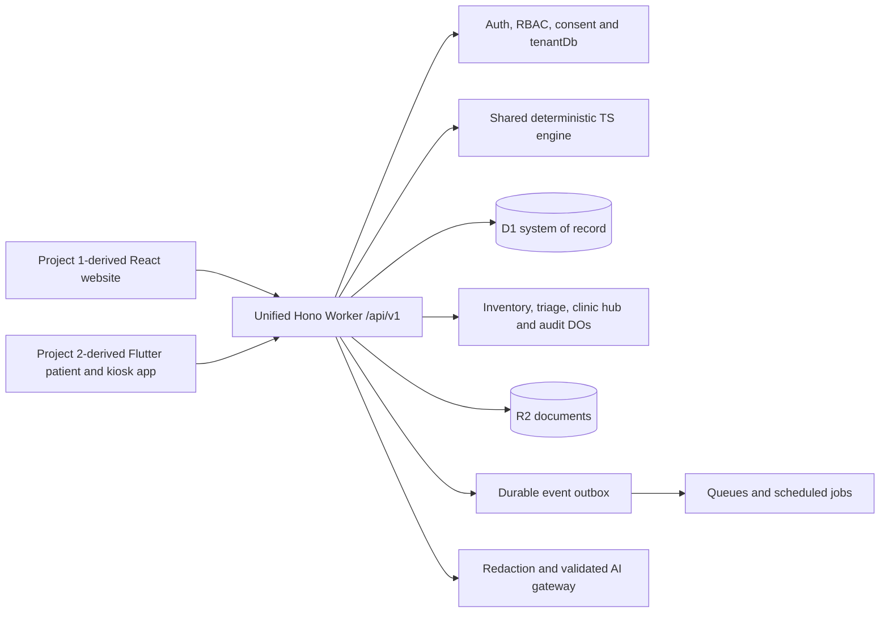

# Project 1 + Project 2 integration implementation plan

Date: 17 October 2026. Status: initial persistent React intake/clinician milestone
implemented; broader feature parity, Flutter and production foundations remain
pending. Current usage and limitations: `docs/INTEGRATION_RUNBOOK.md`.
The starting-point table below records the pre-implementation inspection.

This plan answers the request to integrate `hackshift/projects/project-1` and
`hackshift/projects/project-2` into the main DHAAGA project. `docs/PRD.md` and the
current root `AGENTS.md` govern the implementation. Older AWS-first and DOM-only
decisions describe the existing demo; they are not the target architecture here.

## 1. Frontend decision

**Choose Project 1's React/Vite/Tailwind interface as the primary website.** Port
its layout, navigation, reusable controls and operational screens into
`frontend/website/`. Preserve attribution and applicable source licenses. Rewrite
its service and context boundaries against typed DHAAGA contracts rather than
copying the generic Supabase CRUD service or its `any` types.

**Integrate Project 2's workflows into that same React application.** Port its
kiosk, doctor, triage, patient and AYUSH experiences into routed React modules
using the selected shell and design tokens. Preserve relevant user journeys and
source-linked clinical information. Do not embed the existing HTML portals in
iframes or rely on navigation between independently authenticated websites.

**Use Project 2's Flutter kiosk as the second client**, adapted in `frontend/app/`
for kiosk/patient use. It will share the website's API, identity mappings,
encounter IDs, consent and records. The frontends communicate through the backend;
neither holds the other's session credentials or writes directly to its database.

Project 1 is the better shell because its existing React component structure
already covers the larger operations surface: inventory, POS, procurement,
accounts, wards, staff and administration. Project 2's HTML portals mix UI,
Supabase access and provider calls, so importing them intact would retain the
integration problems. Its Flutter app is useful for the separate kiosk surface.

Keep `hackshift/projects/` unchanged. Keep the existing `apps/web` and
`apps/mobile` demos available during migration, then remove them from default
commands once replacements pass acceptance. Do not maintain Expo and Flutter as
two default patient clients. Preserve useful home-monitoring concepts and shared
engine behavior from the existing platform.

## 2. Verified starting point

| Area | Current evidence | Required change |
|---|---|---|
| Main website | `apps/web/src/main.ts`: DOM-based synthetic PWA | Replace default with the Project 1-derived React website |
| Main API | Root Wrangler targets `apps/api/worker.ts`; `apps/api/app.ts` uses expiring in-memory demo sessions | Migrate useful validation/security behavior into one persistent Worker |
| Proposed unified backend | `backend/src/index.ts` mounts intake/ops/bridge/home/platform routers | Make this the canonical Worker after parity and storage tests |
| Backend behavior | Router responses include fixed stock totals, SOAP, login tokens and sale results; inventory DO acknowledges without persisting stock | Replace placeholders with validated services; never expose these as successful live operations |
| Persistence | No `backend/migrations/` directory; Wrangler contains placeholder resource identifiers | Add local migrations/seeds and environment-specific bindings |
| Shared contracts | `packages/shared/index.ts` and `contracts.ts` disagree on patient fields/languages; package metadata declares Zod 3 while root uses Zod 4 | Consolidate schemas, exports and one compatible dependency version |
| Project 1 | `src/App.tsx`, `context/HospitalContext.tsx`, `lib/dataService.ts` depend on Supabase; many `any` types | Port interface incrementally; replace auth, context, CRUD/RPC and realtime access |
| Project 2 web | `public/kiosk/index.html` and `public/doctor/index.html` access Supabase and `/api/v1` routes | Port workflows, replace direct DB/provider access and validate contracts |
| Project 2 Flutter | `kiosk_app/lib/features/intake/data/sources/api_client.dart` hardcodes localhost, patient/encounter IDs and successful fallback data | Configure API origin, bind server-issued IDs, expose errors and explicit demo mode |
| Main mobile | `apps/mobile` is a separate Expo demo | Preserve until Flutter replacement is verified; retire from default run path afterward |
| Verification | Root TypeScript/lint/build targets omit `backend/` and future `frontend/` | Cover every canonical application and contract in CI |

Existing reports in `DISCOVERY.md`, `SOURCE_INVENTORY.md` and `PROGRESS.md` are
historical evidence, not evidence that these integrations already work. This
planning pass inspected source; it did not rerun upstream builds or access hosted
databases.

## 3. Target architecture and ownership

Canonical locations:

- `backend/`: Worker, tenant repositories, application services, migrations,
  queue consumers and Durable Objects.
- `frontend/website/`: React shell, operations, intake, clinician, home and patient modules.
- `frontend/app/`: Flutter client with configured API transport and scoped sessions.
- `packages/shared/`: canonical Zod models, event schemas, OpenAPI and FHIR mappers.
- `packages/api-client/`: website API client; derive Flutter models/client from
  the same published contract and test representative payloads in both runtimes.
- `packages/engine/`: existing deterministic mechanisms, with limitations retained.
- `packages/ai/`: the only permitted external AI boundary.

D1 owns the new platform's operational and clinical state. Do not simultaneously
write the same encounter/sale to D1 and Supabase. Import from explicitly authorized
sources through validated adapters and a reconciliation report. Existing upstream
instances remain separate until a deliberate migration; their browser config is
not authorization to read hosted patient data.

## 4. Shared record and service contracts

Use server-authorized `org_id`, clinic scope, role, patient ID and purpose. Never
accept tenant membership from `X-Tenant-Id` or a body field alone. All D1 access,
including workers, scheduled jobs and event consumers, passes through
`tenantDb(ctx)` or an equivalent verified service context. Include tenant scope in
foreign keys and uniqueness constraints to prevent cross-tenant relationships.

Data groups and migrations:

1. Organization, clinics, users, memberships, device credentials, refresh sessions.
2. Patients, explicit `(org_id, source, source_id)` identity mappings, consents.
3. Encounters, answers, documents, versioned SOAP, signatures, prescription lines.
4. SKU/composition catalog, batches, reservations, transfers, stock movements.
5. Sales, sale items, payment splits, journal entries/lines, accounting locks.
6. Suppliers, purchase orders/items, goods receipts, supplier payments/credits.
7. Wards, beds, admissions, staff/attendance/shifts, expenses and equipment.
8. Vitals, alerts, nurse actions, follow-ups, audit, outbox, delivery/dedupe records.

Preserve original IDs as provenance; do not merge by name or infer a birth date
from age. Represent unknown demographics explicitly. Resolve the contract's
Hindi/English/Punjabi/Tamil versus existing Telugu mismatch without losing existing
records. Store integer paise, with explicit parsing/rounding of legacy decimal
prices at import; server-side totals are authoritative.

Publish request/response/error schemas, pagination, status transitions and
authorization requirements. Align routes with PRD D5; temporary legacy aliases
must call the same service and carry a documented retirement date. Core groups:

| Route group under `/api/v1` | Responsibilities |
|---|---|
| `/auth`, `/platform` | Staff sessions, device enrollment, tenant/clinic capabilities, settings/audit |
| `/patients`, `/encounters`, `/fhir` | Scoped record, timeline, clinical handoffs and FHIR export |
| `/kiosk`, `/sentinel`, `/intake`, `/documents` | Consent, identity, intake state, answers, controlled upload/extraction |
| `/doctor` | Clinic queue, source-linked SOAP, signed encounter and prescription |
| `/ops` | Catalog, inventory, POS, transfers, procurement, accounts, wards and staff |
| `/bridge` | Rx-to-Shelf plan/reservation, refill forecast and actionable stock gaps |
| `/home` | Patient check-in, vitals, follow-up and nurse queue |

Clinical states: consented intake → triage → waiting/review → signed consult →
dispensing → follow-up. Emergency triage interrupts the routine flow. A clinician
override needs permission, reason and audit. OCR output is draft data until
reviewed; an LLM cannot sign a prescription or decide triage/dispensing.

Use versioned events for `intake.completed`, `prescription.signed`,
`dispense.completed`, `observation.recorded`, `consent.revoked`. Commit the domain
change and outbox record together. Consumers dedupe tenant/event IDs, retry bounded
failures and surface dead-letter/reconciliation state. Queue messages contain
minimal references, not patient names or raw transcripts.

## 5. Implementation order and acceptance gates

Each phase ends with working behavior, relevant tests, source-preservation checks
and a progress update. Do not mark a later phase done because its UI exists.

### Phase 1 — One build and contract foundation

- Add workspace/package scripts for the canonical website, backend and shared
  packages using the existing npm lockfile unless migration is justified.
- Create the React website skeleton using Project 1's visual shell and controls;
  add routed module boundaries rather than its persisted global `view` switch.
- Consolidate Zod and patient/money/language models; define API errors and event
  contracts. Keep the current demo executable while the replacement develops.
- Resolve competing Worker configuration; include backend/frontend in strict
  checks, lint, build and tests. Record the command and deploy target explicitly.

Gate: website and Worker build locally; no untyped application boundaries; the
website can load backend capabilities; old demo remains available explicitly.

### Phase 2 — Persistence, authorization and consent

- Add local D1 migrations, two-tenant synthetic seeds, scoped repositories,
  identity mappings and encrypted identifier fields using Worker secrets.
- Implement staff login/refresh/logout, server-owned role/clinic membership,
  scoped patient access and enrolled kiosk credentials. Public devices must not
  carry an extractable shared secret in downloaded web/Flutter assets.
- Implement purpose-specific consent, revocation enforcement, audit chaining and
  fail-closed missing configuration. Replace mock login/audit responses.
- Set restricted browser origins, secure cookie/CSRF behavior where applicable,
  upload/body limits, redacted errors/logs and no-store patient responses.

Gate: records survive Worker restart; role/clinic/tenant tests deny unauthorized
reads and writes; logout/expiry/revocation take effect; synthetic mode is explicit.

### Phase 3 — Intake and clinician integration

- Port Project 2 kiosk, triage, doctor and patient web workflows into React.
- Persist answers and resumable sessions; invoke the existing Sentinel engine on
  the server; keep red flags ahead of routine questioning.
- Add upload validation, R2 ownership/retention, redaction and optional OCR/speech
  adapters. Missing providers produce unavailable states or labelled fixtures.
- Build clinic queue, source-linked SOAP review, versioned approval and signed
  prescription. Add Patient Thread and encounter-linked FHIR resources.

Gate: a new kiosk encounter appears in the authorized clinician queue without
manual reentry; review/signing retains the same patient/encounter and provenance;
cross-clinic access, unreviewed OCR prescriptions and silent fallback patients fail.

### Phase 4 — Prescription to POS and accounting

- Port Project 1 inventory/POS interfaces against typed domain endpoints.
- Resolve signed prescriptions to exact composition/strength/form; use Rx-to-Shelf
  with course-valid expiry, allergy checks and required clinician approvals.
- Implement durable reservations, expiry/release, atomic stock deduction,
  idempotent checkout, payment splits, invoice and journal posting.
- Keep D1 inventory authoritative. DO coordination cannot substitute for guarded
  DB updates: quantity predicates and rollback-on-conflict must prevent oversell.
  Persist sale, movements, balanced journal and outbox in one validated atomic
  operation; verify the supported D1 mechanism before claiming transaction safety.
- Calculate ledger/P&L from posted entries; enforce accounting date locks and
  explicit reversal workflows. Remove hardcoded revenue/balance indicators.

Gate: signed intake prescription opens as the same patient's POS order; concurrent
sales cannot consume the same remaining stock; retries cannot duplicate charge,
stock movement or journal; balanced totals match actual invoices and inventory.

### Phase 5 — Procurement, transfers and remaining operations

- Port purchase orders → partial/full GRN → stock, supplier pricing/payments,
  expiry radar, bulk imports with preview/errors and inter-clinic transfers.
- Implement transfer reservation, dispatch/receipt and reconciliation without
  assuming atomic commits across different Durable Objects.
- Connect wards/admission/discharge charges, expenses, equipment, staff roster,
  shifts/attendance, operational reports, notifications and administration.
- Replace Supabase RPC/trigger behavior with explicit domain services and tested
  database invariants; do not run copied Postgres SQL against D1.

Gate: each operational action changes the expected inventory/accounting/ward
state and respects permissions. No ported menu points at an unwired placeholder.

### Phase 6 — Close the monitoring and refill loop

- Persist patient vitals, provenance and corrections; run Drift Radar against that
  patient's authorized history, showing the existing model's limits.
- Feed actionable alerts to the nurse queue, acknowledgement and follow-up.
- Feed actual signed/dispensed courses and current stock into ThreadPulse;
  suggested procurement/refills require the appropriate human action.
- Add outbox delivery, retry/dedupe, reconnecting clinic updates and consent
  revocation propagation. WhatsApp remains an optional verified adapter/simulator.

Gate: a patient reading updates the matching clinician/nurse view; dispense data
affects refill demand; replaying an event produces one effect; revoked purposes
stop subsequent processing/delivery even when events are already queued.

### Phase 7 — Flutter as the connected second frontend

- Adapt Project 2's kiosk into `frontend/app/`; configure environment/API origin
  and generate or validate Dart contract models from canonical OpenAPI.
- Replace hardcoded identities, localhost and silent fallbacks; add scoped device
  sessions, patient handoff credentials and actual error/offline states.
- Connect consent, intake, reviewed OCR, encounter status, patient thread, vitals,
  prescriptions, dispense status and follow-up using the same services as web.
- Persist only the minimum consented offline data in appropriate encrypted device
  storage; use idempotent sync and explicit conflict/revocation handling. A web/PWA
  cache must not silently retain health records after logout.

Gate: Flutter intake → React clinician → React POS → Flutter patient record is
verified on the same backend; Android emulator/device networking works without
localhost assumptions. Web/iOS targets receive separate build/runtime evidence.
Retire Expo from default patient commands only after replacement behavior passes.

### Phase 8 — Feature parity, verification and cutover

- Audit every original menu, RPC, provider dependency and PRD requirement; record
  implemented, explicitly simulated, externally gated or outstanding status.
- Cover AYUSH reviewed documentation/coding, insurance/ABHA simulation, settings,
  password recovery, organization onboarding and subscription/notification surfaces.
  Commercial payments, marketing analytics and account-specific services are
  isolated adapters; never silently copy live provider configuration.
- Exercise loading/empty/error/offline states, language/large-text/accessibility,
  deep links and refresh, patient handoff, reconnect and recovery from partial jobs.
- Run TypeScript/lint/unit/contract tests, real local D1/DO integration tests,
  browser end-to-end tests and Flutter analysis/tests/builds. Extend CI to those
  canonical targets and preserve the existing algorithm safety tests.
- Make default run/build/deploy commands target the integrated applications;
  update README, env examples, OpenAPI, runbooks, traceability and demo instructions.
- Verify local staging first. Configure actual Cloudflare bindings/secrets only
  through the intended account, then smoke-test release and rollback before cutover.

Gate: all integration acceptance scenarios below pass; no default route reaches a
legacy mock API; unresolved features remain explicitly outstanding. Deployment
requires configured resources, not placeholder IDs or a successful static build.

## 6. End-to-end definition of done

1. A synthetic patient consents and completes intake in either client. The
   authorized doctor sees that exact encounter with sources and a durable ID.
2. The doctor reviews/signs a prescription. POS receives it without manually
   recreating the patient, medication or encounter.
3. Expired/course-invalid stock is rejected; valid stock is reserved/dispensed
   once; invoice, stock movement and balanced ledger reference the same sale.
4. Retrying checkout or delivery and restarting the Worker preserve correct state.
   A concurrent checkout cannot oversell.
5. Dispensing becomes visible in the patient's thread on both clients and informs
   refill demand. A follow-up reading can create an actionable nurse queue entry.
6. Another organization, wrong clinic, wrong patient or unauthorized role cannot
   read/change any of these records, documents, exports or realtime messages.
7. Consent revocation immediately blocks the affected API and queued actions;
   retained audit/legal records follow an explicit restricted retention policy.
8. Provider outage is visible; no fabricated diagnosis, patient, insurance approval,
   stock reservation, payment receipt or success response replaces a failed call.
9. Every source capability is accounted for. A smaller integrated journey can be
   a completed milestone, but cannot be called complete integration while parity
   requirements remain open. Live government/payment/provider integrations are
   separate from an explicitly labelled synthetic integration release.
10. All canonical clients/backend pass their checks, original sources remain
    unchanged, and setup/deployment/rollback instructions match verified behavior.

## 7. Dependencies, risks and execution notes

- Work in dependency order: contracts/build → persistence/auth → intake/signing →
  stock/ledger → broader operations → monitoring/events → Flutter → parity/cutover.
  This plan does not authorize delegation or introduce additional chats.
- Local synthetic implementation can proceed without hosted upstream credentials.
  Authorized source exports, reviewed identity mappings and reconciliation are
  prerequisites for a real upstream data migration.
- Speech/OCR/WhatsApp/ABDM/payment need separate credentials and verification.
  Missing providers do not block building local workflows, but do block claiming
  their live integration. Never put keys into chat, source or frontend bundles.
- Flutter/native toolchain availability must be established before promising
  mobile artifacts. A web build is not device verification.
- Source inventories contain legacy claims and imperfect extraction; verify each
  RPC/table/trigger before porting. Preserve semantics, not Postgres assumptions.
- Deterministic algorithms currently have documented model/calibration limits.
  Wiring them into a real workflow does not establish clinical validation.
- Reuse requires preserving relevant license notices and recording provenance;
  organizer reuse eligibility remains separate from technical integration.
- No fixed completion estimate is asserted before the first persistent vertical
  slice. Track phases and remaining acceptance failures in `docs/PROGRESS.md`.

First implementation milestone: a locally runnable Project 1-derived React shell
with canonical contracts, persistent tenant/auth foundations and one actual
kiosk-to-clinician encounter flow. This is the first checkpoint, not the full
integration release.
